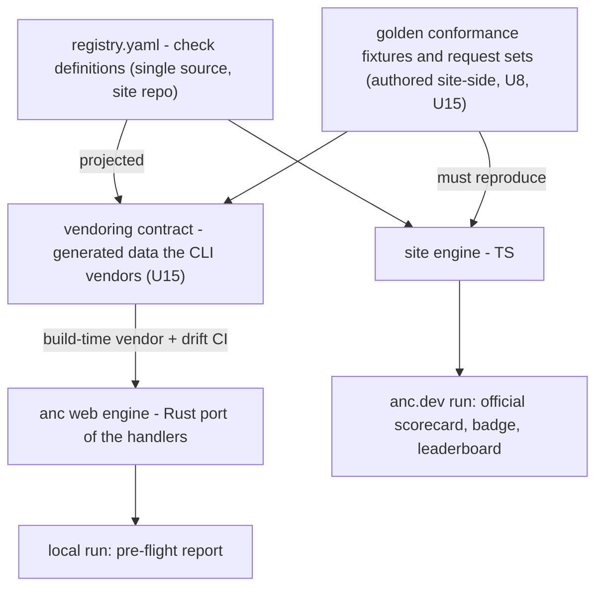
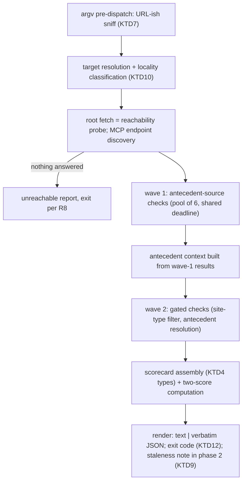
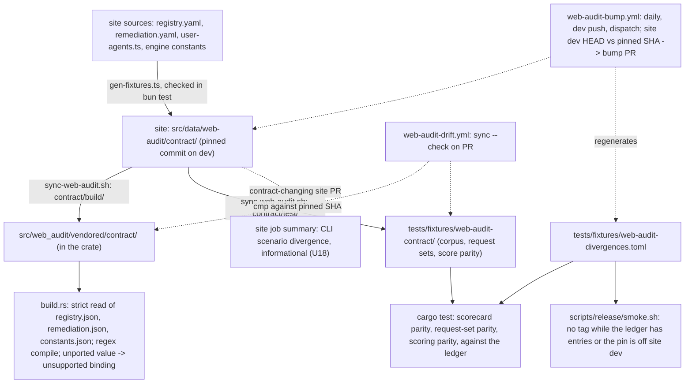
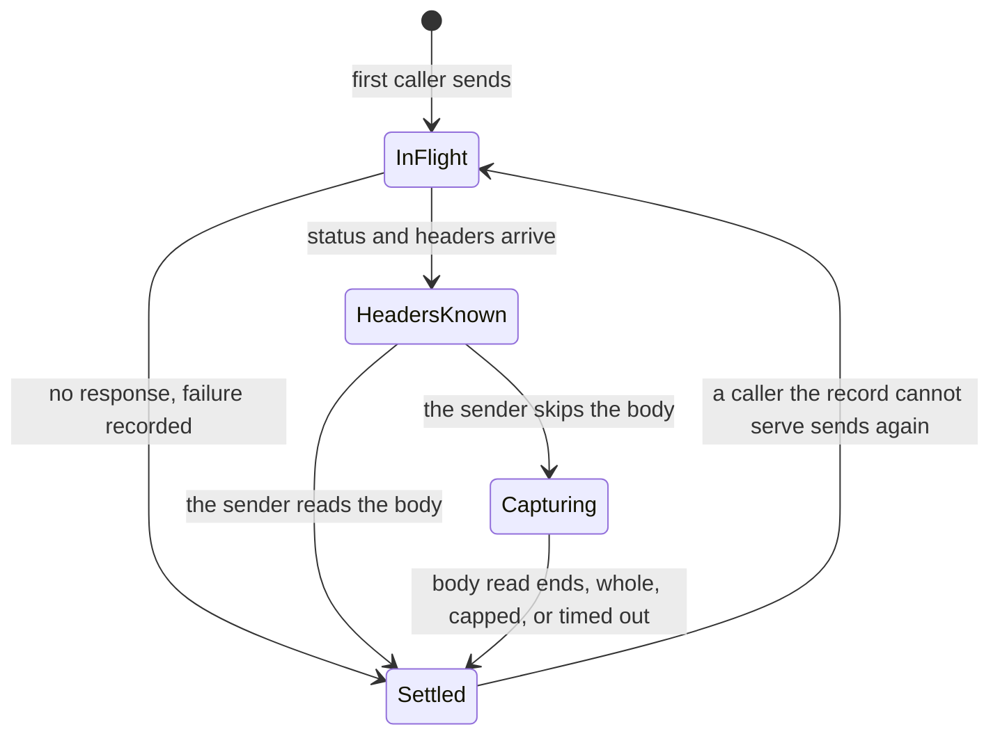

# Local Web Audit - Plan

## Goal Capsule

- **Objective:** A dev whose server anc.dev cannot reach — localhost, an internal host, a pre-deploy stack — gets the
  complete web audit locally, with results they can trust to match the public run, without exposing anything outside
  their network.
- **Means:** `anc web <target>` runs a Rust-native port of the site's registry-driven check engine on a ureq/rustls
  blocking stack (KTD1), with the site's data-only vendoring contract vendored from `agentnative-site` at build time
  (KTD3, KTD4, KTD14). The `web` feature is on by default (KD16), so every build and release carries the verb.
- **Product authority:** This plan owns the CLI feature and the site-side companion units (U8, U9, the site half of U13,
  U15, U18, the site half of U20) — no separate plan exists in the site repo. `agentnative-site` remains canonical for
  check definitions, engine semantics, and the "Web audit" / "check" / "probe" vocabulary
  (`agentnative-site:CONCEPTS.md`).
- **Phases:** The phase line follows dependency, not convenience. Phase 1 ships everything that needs no anc.dev
  endpoint: U1–U8, U10, U11, U13–U21, U12's bump workflow and release gate, every handler kind and eval rule the
  vendored registry carries, the vendoring contract, the conformance corpus and suite, the fix catalog and its readers,
  the docs, and the skill coverage diff. Phase 2 ships what depends on U9's served signal: U9 and U12's staleness note
  (R6, KTD9). Both phases sit in the go-live stack (Delivery).
- **Stop conditions:** Stop and surface to the user if the release binary passes the 20 MiB ceiling on any release
  target (the size bet behind KD2 fails), or if corpus generation in U8 reveals the TS engine is nondeterministic for
  fixed inputs (the parity mechanism fails), or if U15's generator finds a scenario whose requests differ between
  concurrency 1 and the default (request parity fails).

---

## Product Contract

### Summary

Bring the anc.dev web audit, every registry-defined check, into the `anc` binary as `anc web <target>`, batteries
included, in the default build, emitting the same JSON the site produces. Check definitions stay single-source in the
site repo and reach the CLI through one data-only vendoring contract the site generates. The generic probe handlers are
ported to Rust once and held to parity by golden fixtures authored site-side, including the requests each scenario
sends. A site change reaches the CLI through an automatic re-pin PR, and a release cannot tag while the engine diverges
from the corpus. The site-side vendoring hooks (contract generator, fixture generator, version signal, CLI-parity
report) are units of this plan.

### Problem Frame

The deployed anc.dev auditor rejects loopback, RFC1918, and internal hostnames by design
(`agentnative-site:src/worker/audit-web/ssrf.ts`; the operations runbook states localhost targets cannot be audited
through the public API). A dev auditing an internal site therefore had to publish it to an obfuscated public URL — a
security-unacceptable workaround, and one most devs in organizations lack the authority to perform at all.

The site's Bun runner (`agentnative-site:scripts/web-audit/audit.ts`) can audit arbitrary live targets, but it presumes
a bun runtime and a site checkout — neither can be assumed on a dev machine, and neither is an `anc` command. The
audience that most needs local auditing is exactly the audience that can't assemble that toolchain.

### Key Decisions

- KD1. **Local runs are dev-loop pre-flight only.** (session-settled: user-directed — chosen over first-class local
  scorecards and self-attested badge claims: local results are unverifiable.) Official scorecards, badges, and the
  leaderboard remain anc.dev-exclusive.
- KD2. **Rust-native engine port with vendored data.** (session-settled: user-approved, tested against embedded engines
  — chosen over an embedded JS engine and a site-adopts-WASM inversion: site engine untouched, checks stay single-source
  data, and no embedded runtime clears the bars.) Handlers and scoring are ported once and fixture-enforced; hard parity
  is the aim, best-effort divergence the accepted floor when environments genuinely differ. An embedded site-built
  engine replaces the port only by clearing all five bars: zero hand-ports, byte parity on the full corpus, real-target
  wall time no slower than the port, a release binary under 20 MiB on every release target, and nothing for the user to
  install. QuickJS fails the wall-time bar at 1.35x the port, and embedding Bun or V8 fails the size bar. The site
  engine on Bun does beat the port on a clean runner, by 1.20x, so U19 and U20 are required to close that gap in the
  port (Speed and size findings). Governs R5, R9, R23.
- KD3. **`anc web` is canonical; bare URL-ish targets are sugar.** (session-settled: user-approved — chosen over a
  sugar-free subcommand and over overloading `anc audit`: explicit form for agents and CI, one-token invocation for
  humans.) Governs R1, R2.
- KD4. **All checks run, with honest labels.** (session-settled: user-approved — chosen over a curated local profile and
  over simulating the public view: the dev always sees the full parity picture.) Governs R4.
- KD5. **Staleness surfaces in web-audit reports only.** (session-settled: user-directed — chosen over
  `--help`/`--version` surfaces: those commands stay offline-pure, per anc's own audit principles.) Governs R6.
- KD6. **Output is the site's JSON shape verbatim.** (session-settled: user-approved — chosen over an anc metadata
  envelope or a new schema: a local run diffs directly against a public run.) Governs R7.
- KD7. **The agent-web-audit skill is a designed-for consumer.** (session-settled: user-directed — chosen over a
  note-only follow-up: convergence on one probe engine is verified at ship, not hoped for.) Governs R11.
- KD8. **External-DNS checks auto-gate on target locality, with an override.** (session-settled: user-directed — chosen
  over always-run-with-disclosure: the default must not leak internal hostnames off-network.) Governs R12.
- KD9. **A local run may present a sign-in credential for the audited MCP endpoint, and scores the full access
  picture.** (session-settled: user-directed — chosen over deferring authenticated targets: the anc.dev scorecard points
  rows it could not evaluate behind a sign-in to a local `anc web` run, and the site's access-scoring definition,
  `agentnative-site` plan KTD25, scores a credentialed local run as the full picture.) Governs R18, R19.
- KD10. **The site publishes one vendoring contract, and the CLI reads site data, never site source.** (session-settled:
  user-approved — chosen over packaging the site engine as a TypeScript package: the CLI is Rust and cannot consume
  TypeScript, and the site engine already imports nothing Worker-specific.) Governs R9, R10, R20.
- KD11. **Every run sends HTTPS only.** (session-settled: user-directed — chosen over allowing http to a local target's
  own origin: the local engine keeps the site engine's no-plaintext rule at every vantage.) Governs R1, R21.
- KD12. **Local and private targets also trust the OS trust store, and `--ca-cert` adds roots for any target.**
  (session-settled: user-directed — chosen over a `--ca-cert` flag alone and over requiring publicly trusted
  certificates: localhost and internal CAs must work with no flags, while public targets keep anc.dev parity.) Governs
  R3, R22.
- KD13. **One crate.** (session-settled: user-approved — chosen over splitting the contract or the engine into a crate
  of their own: the contract is data, and a second crate adds a publish order and removes nothing.) The contract lives
  in one directory of the single `agentnative` crate. Governs R9.
- KD14. **The site engine stays where it is.** (session-settled: user-approved — chosen over moving the site engine into
  a package: the CLI consumes no TypeScript.) One generated, data-only directory, `src/data/web-audit/contract/`, is the
  CLI's only input, and the conformance corpus is the behavior boundary between the two engines. Governs R9, R10.
- KD15. **Vendoring is painless, and that has a definition.** (session-settled: user-approved.) Five properties,
  together:
  - One data-only contract directory, vendored by SHA with one command, with `build_support/ts_consts.rs` and the YAML
    normalizer mirror deleted (U16).
  - A bump workflow, on a daily schedule and on `dev` pushes, that opens re-pin PRs through `CI_RELEASE_TOKEN` (U12).
  - A divergence regenerates the ledger and stays green, so a site change never turns a CLI PR red for parity (U12,
    KTD17).
  - A release gate refuses to tag while the ledger has entries or a vendored check binds an unported kind, so no release
    diverges from the corpus (U12).
  - An informational site report names the CLI scenario divergence on a contract-changing site PR, and no site PR waits
    on it (U18).

  Governs R9, R24.
- KD16. **`web` is on by default.** (session-settled: user-approved — chosen over withholding the verb from releases.)
  `default = ["web"]`, the feature stays so `--no-default-features` builds without the networking stack, and no release
  branch strips web code. Governs R1.
- KD17. **aws-lc-rs stays the TLS provider, with no fork.** (session-settled: user-directed — chosen over ring.) ring is
  smaller and faster at the handshake, and it fails the owner's recent-releases rule: its last release is 0.17.14 from
  March 2025, it has a sole owner, and no maintained fork exists. Governs R3.
- KD18. **The speed bar is the user-visible wall clock.** (session-settled: user-directed.) A run is measured start to
  finish, startup included, on a clean GitHub Actions runner, because a loaded host inflates startup and reversed an
  earlier comparison. A comparison is like for like: a transport fix applies to every engine compared, at the same pin.
  The target is at least the site engine's wall clock, and the release gate is one run's noise of it: within one
  interleaved run, the port's sum of per-target medians is at or below the site engine's plus the larger of 5% and that
  run's own round-to-round spread. That gate needs U19 and U21 landed. U20 ships in the same release if it is ready and
  follows if it is not. The evidence: on the second clean run the pool alone left a 2.8% gap (23.36 s against 22.72 s),
  brotli off at least halves handshakes on top of that, U20 speeds both engines and so barely moves the ratio, and Bun's
  own total swung from 20.10 s to 22.72 s between runs, so an exact "at or below" gate would flake. Progress feedback is
  part of the bar, so a user can tell a run is still working and when it is done. Peak memory is reported and is not a
  bar. Governs R23.
- KD19. **Bump PRs track site `dev`.** (session-settled: orchestrator decision under the owner's delegation — chosen
  over site `main`: the sync script's rule is that a pin names a commit on site `dev`.) anc.dev deploys from site
  `main`, so `dev` can sit ahead of it, and staleness wording compares fingerprints ("differs from anc.dev") and never
  says "behind". Governs R6, R24.



### Requirements

**Command surface**

- R1. `anc web <target>` runs the full web audit against an HTTPS target — hostname, host:port, or URL; local, internal,
  or public.
- R2. A bare URL-ish first argument routes to the web audit; an existing path or discoverable binary of the same name
  wins the tie, and a token that fails the hostname grammar keeps today's fast offline audit-path error.
- R3. The audit needs nothing from the host system — no dig, curl, node, or bun; TLS trust roots ship in the binary. A
  target the locality classifier labels local or private also trusts the operating system's trust store; a public target
  trusts only the bundled roots.

**Audit behavior**

- R4. Every registry check appears in every report; a check that cannot run against the target reports n_a or skip with
  a stated reason, never a silent drop.
- R5. For the same target and registry version, local verdicts and scores match the site engine's, enforced in CI by the
  vendored conformance fixtures.
- R6 (phase 2). When the vendored contract fingerprint differs from the one anc.dev serves, the report carries a note
  saying so and naming the upgrade — inline in text mode, on stderr in JSON mode so the verbatim shape holds; when that
  version signal is skipped, unreachable or answers anything but 200, the note is omitted and the run is otherwise
  unaffected. Every report names the vendored registry fingerprint and the pinned site SHA, and a run against a local or
  private target makes no anc.dev connection.
- R12. Checks that query external DNS resolvers do not fire for local or private targets (IPv4 and IPv6 alike); gated
  checks report n_a with a stated reason, and `--external-dns` forces them on.
- R13. A run against an unresponsive or tarpitting target completes within the engine's per-audit deadline, reporting
  partial results per R4 rather than hanging the shell or CI step.
- R20. For each conformance scenario the local engine sends the requests the site engine recorded, each distinct request
  once, as the site's per-audit request memo does.
- R21. A run sends no plaintext request: an `http` target ends the run unreachable before any request goes out, and a
  root or redirect hop that leads to `http` is refused as the site engine refuses it.
- R22. `--ca-cert <file>` adds the PEM roots in that file to the trust set for any target, and may be repeated;
  certificate chain and hostname verification always run, and no option skips them.
- R23. A run's user-visible wall clock, process start to exit, is the speed measure, and on the same clean runner and
  pin it stays within one run's noise of the site engine's (KD18). While a run works it says so on stderr on a terminal,
  and it says when it is done.

**Output**

- R7. `--output json` emits the site's web-audit scorecard shape verbatim — field-for-field the JSON anc.dev produces,
  scores included.
- R8. Text output follows anc's existing text conventions; exit codes follow the binary's one table (0 clean, 1 warnings
  only, 2 failures or a usage error, 3 could not check; KTD12), the same on `anc audit` and `anc web`.
- R15. Every failing row carries actionable guidance at the point of failure: text mode prints the goal, the fix and its
  doc links under each failing check, and an offline reader serves the same catalog to agents. A run's time to first fix
  needs no second tool, no browser and no network.
- R16. A run that cannot produce a scorecard says what happened, why, and what to try next: JSON mode emits the repo's
  structured error envelope and text mode names the problem, the cause and the next action.
- R17. The binary has one exit-code contract across every verb, and a run's output names the code it is returning and
  what earned it.
- R18. A run can present a bearer token for the audited MCP endpoint, read from the `ANC_WEB_TOKEN` environment variable
  when `web` is typed explicitly or from stdin with `--token-stdin`, never from an argv value. The token goes only to
  the endpoint of record's handshake and session probes, on a declared host too when the endpoint lives there and that
  host confirms it: never to the follow slice's own requests, metadata documents, sign-in servers, any other check, or
  the enforcement probe that tests token-less refusal. It never appears in the scorecard, text output, logs, or errors.
- R19. Every local scorecard records its vantage as the site defines it (`vantage: { network: "local", credentialed }`,
  `credentialed` true only when a token was presented), and the sign-in server check counts a private-address
  authorization server as usable when the endpoint itself is private.
- R14. Agents can discover the check vocabulary and the web-scorecard JSON shape offline, via `anc emit` variants for
  both.

**Vendoring**

- R9. Every vendored input reaches the CLI from the site's vendoring contract at CLI build time, through the established
  sync-script, drift-CI and build-codegen pattern. The contract holds data only, including the conformance fixtures
  authored site-side (U8); the CLI parses no site source code, and nothing is fetched at runtime.
- R10. The probe engine is never published as a depend-able package (npm, crates.io, JSR); site-repo changes stay
  limited to the vendoring hooks this plan defines (fixture generator, corpus-completeness gate, version signal, the
  vendoring contract with its generator and the engine-constant exports it reads, the CLI-parity report), the
  local-target pointer and its `ANC_WEB_RELEASED` flip (U13), the one registry content change U8 carries, the
  Vary-header pattern expressed without lookaround, and U20's scheduling changes — no engine package move and no
  restructuring beyond them.
- R24. A site change reaches the CLI through an automatic re-pin PR to a commit on site `dev`. A corpus divergence that
  re-pin brings regenerates the ledger and leaves the PR green, and no release tags while the ledger has entries, a
  vendored check binds an unported kind, or the pin names a commit off site `dev`.

**Ecosystem consumer**

- R11. The agent-web-audit skill's report is constructible from `anc web --output json` and exit codes; the coverage gap
  between the skill's 32-check registry and the site's registry is diffed and either closed or documented as accepted
  gaps before ship.

### Key Flows

- F1. **Local pre-flight loop.**
  - **Trigger:** Dev runs `anc web staging.internal:8443` (or a bare URL-ish target) against an HTTPS server.
  - **Steps:** Target resolves; vendored registry loads; probe waves run with antecedent gating; report renders
    verdicts, n_a reasons, scores, and any staleness note; exit code gates the shell or CI step.
  - **Outcome:** An actionable fix list with zero public exposure.
  - **Covers R1–R8, R12, R13, R21.**
- F2. **Pre-flight to official.**
  - **Trigger:** Local report is clean and the site deploys publicly.
  - **Steps:** Dev (or anyone) runs the audit on anc.dev; the official scorecard and badge mint from the public run.
  - **Outcome:** The local promise holds — what passed locally passes publicly — and official artifacts stay
    anc.dev-only.
  - **Covers R5.**
- F3. **Skill as consumer.**
  - **Trigger:** An agent invokes the agent-web-audit skill against a target.
  - **Steps:** The skill shells out to `anc web <target> --output json` and builds its report from the result.
  - **Outcome:** One probe engine serves the site, the CLI, and the skill.
  - **Covers R11.**

### Acceptance Examples

- AE1. **Covers R2.** Given a file or directory named `anc.dev` in the working directory, when the dev runs
  `anc anc.dev`, then the CLI audit of that path runs; given no such path and no binary of that name, then the web audit
  of the `anc.dev` host runs.
- AE2. **Covers R21.** Given target `http://localhost:8787`, or an HTTPS target whose root redirects to `http`, when
  audited, then no plaintext request goes out, the run ends unreachable naming the no-plaintext reason, and the exit
  code is 3 (could not check).
- AE3. **Covers R6.** Given a machine with no route to anc.dev, when a local target is audited, then the report
  completes normally with no staleness note and no error.
- AE4. **Covers R5.** Given a public target and a current vendored registry, when audited locally and via anc.dev, then
  verdicts and scores are identical.
- AE5. **Covers R3, R22.** Given an internal HTTPS target signed by a private CA that is in the machine's OS trust store
  or passed with `--ca-cert`, when audited, then TLS succeeds and every check runs; given the same target with its CA in
  neither, then the run ends unreachable, naming the chain rejection and the trust set that rejected it, and exits 3.
- AE6. **Covers R12.** Given target `https://intranet.corp.internal`, when audited without flags, then no query reaches
  a third-party DoH resolver — the hostname touches only the machine's own configured resolver — and DNS checks report
  n_a ("needs public DNS — verified on anc.dev"); when audited with `--external-dns`, the DoH queries fire.
- AE7. **Covers R13.** Given a target that accepts connections but never responds, when audited, then the run completes
  within the per-audit deadline with unprobed checks reported per R4 and a failing exit code per R8.
- AE8. **Covers R2, R18.** Given `anc report.json`, `anc main.go`, `anc a.out` or `anc main.rs:42`, where no such path
  exists and no binary of that name is on PATH, when invoked, then the run fails fast and offline through today's audit
  error path — no DNS lookup, no connection attempt — because a bare dotted token routes only when its last label is an
  IANA TLD outside the file-extension denylist, and the port form applies the same check. Given a bare target that does
  route, then `ANC_WEB_TOKEN` is not read.

- AE9 (phase 2). **Covers R6.** Given a vendored contract whose fingerprint differs from anc.dev's and `--output json`,
  when a public target is audited, then stdout carries only the verbatim scorecard JSON and the upgrade note appears on
  stderr.
- AE10. **Covers R20.** Given the vendored `run-healthy` scenario and an empty unported list, when the local engine
  audits it through the mock transport, then the requests it sends equal the scenario's recorded request set, and none
  goes out twice.
- AE11. **Covers R24.** Given a site `dev` commit whose corpus the engine does not reproduce, when the bump workflow
  runs, then it opens one re-pin PR carrying the regenerated ledger, with each entry owned by the site PR that set the
  golden, and CI on that PR is green; and while those entries remain, the release gate refuses to tag, naming them.
- AE12. **Covers R23.** Given a run on a terminal against a target that takes twenty seconds, when the dev watches it,
  then progress appears on stderr until the run says it is done; given the same run piped, then stderr stays silent and
  stdout holds only the report.
- AE13. **Covers R2, R16.** Given `anc missing.dev` where no such path exists, when the host does not resolve, then the
  error says the token was read as a website because `.dev` is a top-level domain, and its next step is
  `anc audit ./missing.dev`; when the host does answer, then a `routed-to-web` warning on stderr names the same path
  form.
- AE14. **Covers R4, R16.** Given a handler that panics in the release build, when a run reaches it, then that check
  reports an error row with the panic's message, every other check still reports, and the process exits through KTD12's
  table.

### Success Criteria

- The vendored conformance suite passing against both engines is the evidence behind the parity claim; a divergence is a
  red build, not a support ticket.
- The release binary stays under the 20 MiB ceiling in `scripts/check-binary-size.sh` on every release target. The gate
  measures `x86_64-unknown-linux-gnu`, a sound proxy: v0.7.0's seven archives sit within 18% of each other, and the
  measured binary has twice the headroom. It measures about 9.4 MB with `web` on `x86_64-unknown-linux-gnu`, so a
  measured wall-clock gain outranks a small size saving (KD18).
- The incident test: a dev audits an internal-only site end to end — install anc, run one command, read the report —
  with nothing exposed publicly at any step; the target hostname reaches no third-party resolver or proxy.

### Scope Boundaries

**Deferred for later**

- Authenticated targets beyond a bearer token for the MCP endpoint (R18): custom headers, cookies, and mTLS, and
  credentials for any other check.
- Rewiring the agent-web-audit skill to shell out to `anc web` (its own change, in its own repo; R11 only guarantees it
  can).
- Runtime registry refresh between anc releases.

**Outside this product's identity**

- Badges, official scorecards, or leaderboard entries minted from local runs.
- Uploading or submitting local results anywhere.
- Publishing the probe engine as a reusable package.
- Restructuring the site's engine beyond the vendoring hooks and U20's scheduling changes that R10 names.

<!-- ce-section: work-relationships -->
### How This Work Fits Together

This plan owns the CLI feature and the site-side hooks (U8, U9, the site half of U13, U15, U18, the site half of U20 —
committed in `agentnative-site`, planned here, with no separate site plan).

- agent-web-audit skill rewiring — this work **enables** it; a later change in the skill's own repo swaps its 32-check
  Python probe script for `anc web`. U11's coverage diff is the input that change will consume.
- `agentnative-spec` — this work **can proceed independently of** it; web checks are defined by the site registry, not
  the spec's principle registry.

### Delivery

**On `dev`.** The engine and its verb, gated behind the cargo feature `web`: U1–U7, U10, U11, U14, U17 and the CLI half
of U13 (#97–#106, #202, #204, #207–#230), with U8 on site `dev`. `src/web_audit/vendored/SITE_SHA` pins raw vendored
files at site `dev` `d5772289`, and the divergence ledger holds no entry, so the engine reproduces every scenario of the
vendored corpus. No release carries `anc web`: v0.7.0's release branch strips the web code (#241), and the go-live stack
ends that.

**The go-live stack.** Every PR below stays open and unmerged until the owner merges it. The site's PRs form one linear
stack; the CLI's stack where they touch the same files, and #291 sits on `dev` and merges last.

| Order | Repo | Unit | PR             | What it lands                                                                                                    |
| ----- | ---- | ---- | -------------- | ---------------------------------------------------------------------------------------------------------------- |
| S1    | site | U9   | #503           | `GET /api/web-audit/version`, the served signal                                                                  |
| S2    | site | U15  | #504           | `src/data/web-audit/contract/`, `contract/FINGERPRINT`, and `contract_fingerprint` on the signal                 |
| S3    | site | U20  | on top of #504 | Ranks 1–4 of the fan-out design, regenerating `requests.json` wherever a set moves                               |
| S4    | site | U18  | on top of S3   | The informational CLI-parity report on contract-changing PRs                                                     |
| —     | site | U13  | independent    | The local-target pointer and `ANC_WEB_RELEASED = true`; merges only after the anc release that carries `anc web` |
| C1    | cli  | U12  | #289           | Re-pin to site `dev` `031ec6e`: an empty ledger holds at any pin, and site-owned counts read the vendored data   |
| C2    | cli  | U12  | on top of #289 | `scripts/web-audit-bump.sh` and `.github/workflows/web-audit-bump.yml`                                           |
| C3    | cli  | U16  | on top of C2   | Re-pin to the contract at #504's head SHA; `ts_consts.rs` and the normalizer mirror deleted                      |
| C4    | cli  | U19  | on top of C3   | ureq's `brotli` off first, then the DNS cache, idle pool, one worker pool per audit, the aws-lc opt-level call   |
| C5    | cli  | U21  | with C4        | Web-only crates at `opt-level = "s"`, with the `brotli` saving from C4                                           |
| C6    | cli  | U20  | after S3       | The port's mirror of ranks 1–4                                                                                   |
| C7    | cli  | U12  | on top of C6   | The staleness note consuming U9, and the release gate in `scripts/release/smoke.sh`                              |
| C8    | cli  | KD16 | #291           | `feat(web): ship anc web in the default build`                                                                   |

The landing order, once the owner merges:

1. C1, C2 and C3 merge to CLI `dev`, so its sync script reads the contract layout before site `dev` carries it. An
   old-layout script fails hard on every `dev` push once the corpus moves. C3 still pins #504's head SHA, which stays
   fetchable through the PR's ref. A bump run between this step and the next fails the same way in reverse, and that red
   run blocks nothing: it opens no PR and is not a required check.
2. S1 and S2 merge to site `dev`. The squash gives the contract a new SHA with the same bytes.
3. The next CLI `dev` push runs the bump, which opens the re-pin to that site `dev` SHA even though no vendored file
   changed (U12). Until the workflow file reaches `main`, `scripts/web-audit-bump.sh` run by hand covers a quiet `dev`.
4. S3 and C6 follow in that order, site first (KTD19), and the bump between them carries any `requests` entries in the
   ledger until C6 deletes them. C6 does not hold the release: if it is not ready, the release pins the site commit
   before S3, and U20 follows (KD18).
5. The rest of the CLI stack merges with `gh stack merge`, default-on last.
6. The next anc release carries `anc web`. Preflight refuses to tag while the ledger has entries, a vendored check binds
   an unported kind, or the pin is off site `dev`, and the release PR shows the same verdict (U12).
7. The site merges U13 after that release ships.

**Follow-ups this plan owns.**

- Rename the required check `Web feature (clippy, test)` together with `.github/rulesets/protect-dev.json` once the open
  lane PRs drain. Renaming it earlier leaves those PRs waiting on a check that stops reporting. With #291 the job runs
  `--no-default-features`, so its name no longer describes it.
- `DRIFT_MANIFEST_COMPARE="version"` stays in `scripts/release/release.env` until a tag newer than v0.7.0 exists.
  v0.7.0's manifest is the stripped one, so drift gate 0 can only compare it with `dev`'s manifest by version until a
  later tag carries the web lines.
- A known CI cost: `scripts/cargo-inputs.sh` classifies every `docs/` path as a cargo input, because it normalizes the
  URL-path literal `"/docs"` in Rust test fixtures (for example `src/web_audit/engine/retained.rs:62`) to the directory
  `docs`. Every docs-only push here runs the full cargo pre-push, over 8 minutes under load. The script is canon-owned
  and stays as it is; the orchestrator carries it to the owner.

### Dependencies / Assumptions

- The site's probe engine remains fetch-only — standard `fetch`/`URL`/`AbortController`, no Workers-specific APIs in the
  probe path (verified; the Bun runner exists because of it).
- The sync pins a committed site SHA (KTD3); GitHub permits fetch-by-SHA, which the mechanism relies on, and that covers
  an open PR's head commit. A stack may pin a PR head while the PR is open, and a release pins a commit on site `dev`
  (R24). The contract lives under `src/data/web-audit/contract/`.
- anc.dev deploys from site `main` and the pin tracks site `dev`, so a CLI release can carry a contract anc.dev has not
  deployed yet. R5's parity promise holds for one contract; the staleness note names the case (KD19).
- `CI_RELEASE_TOKEN` is a repository secret, and `dev` requires signed commits. GraphQL `createCommitOnBranch` through
  that token yields a verified commit where the REST `git/commits` endpoint yields an unsigned one, so the bump workflow
  commits through GraphQL.
- GitHub runs a `schedule` trigger only from the default branch (`main`), and a workflow reaches `main` only with a
  release, which is why U12 also triggers on `dev` pushes.
- The next anc release also carries the spec-alignment audit changes on `dev`, so it re-vendors the spec tag they grade
  against. That gate belongs to the spec repo's alignment plan.
- Internal targets are reachable from the machine running `anc`; a bearer token covers the MCP endpoint (R18), and other
  credentials stay deferred.

### Sources

- `docs/plans/spikes/2026-11-03-anc-web-engine-speed-and-size-spike.md` — the long form of the speed and size findings:
  the clean-runner benchmark, the embedded-engine prototypes, the fan-out analysis, the request traces and the size
  matrix.
- `agentnative-site:src/data/web-audit/registry.yaml` — 68 checks, 13 handler kinds and 4 eval rules at site `dev`
  `031ec6e`; entry schema fields:
  `id, category, tier, principle, site_types, antecedent, eval, weight, handler, with, hint, title`. `keyword` is
  build-derived from `tier` (required→must, recommended→should, optional→may) and rejected if hand-authored; the
  registry also carries required top-level blocks `version`, `mcp_discovery`, `categories`, `category_order`.
- `agentnative-site:src/build/13-web-audit-registry.mjs` — the normalizer whose output the contract commits (KTD3,
  KTD14): keyword derivation, `{ua:...}` token expansion (throws on literal UA strings), and structural validation.
- `agentnative-site:src/shared/user-agents.ts` (+ `src/shared/site-url.ts`) — probe UA token map and `AUDIT_USER_AGENT`;
  behavioral test inputs that reach the CLI through the contract (KTD14), never restated in Rust (KTD8).
- `agentnative-site:src/worker/audit-web/` — `engine.ts` (wave orchestration, antecedent gating, 25s deadline, degraded
  2s timeout, concurrency 6, eval-rule dispatch, optional-absent re-tag), `scorecard.ts` (`WebScorecard` shape,
  `WEB_SCHEMA_VERSION = '0.5'`, 7-state `ScorecardStatus`), `score.ts` (two-score formula mirroring
  `scripts/scoring/score_model.py`; parity test `tests/web-audit-two-score.test.ts`), `handlers/` (shared
  `runX(check, ctx) -> ProbeOutcome` contract; `mcp.ts` is 815 lines and stateful; `http.ts` also hosts the
  legacy-alias-redirects eval function), `ssrf.ts` (`guardedFetch`: manual redirect loop, 4-hop cap, per-hop
  revalidation, three body-cap regimes — 0 skip, 64 KiB truncate-and-continue, unset full-read for the root fetch),
  `antecedents/site-type.ts` (`site_type` is caller-supplied; null applies every check; `mcp`-typed checks gate on
  endpoint discovery).
- `agentnative-site:src/worker/audit-web/request-hop.ts` and `tests/web-audit-request-memo.test.ts` — the per-audit
  request memo KTD15 ports, and the cases U17 ports with it.
- `agentnative-site:src/build/13-web-audit-registry.mjs` (`emitWebAuditRegistry`, `emitWebRemediation`) — the registry
  and remediation projections the contract commits (KTD14); `scripts/web-audit/conformance-corpus.ts` (`stubFetchFor`) —
  the one seam every engine request passes, where U15 records request sets.
- `docs/solutions/architecture-patterns/evict-test-only-files-from-a-drift-guarded-vendored-surface.md`,
  `docs/solutions/best-practices/repoint-every-generator-that-writes-to-a-relocated-files-old-path.md`,
  `docs/solutions/tooling-decisions/mirror-a-subtree-exclusion-to-every-formatter-in-the-chain.md`,
  `docs/solutions/integration-issues/nondeterministic-upstream-scope-serialization-defeats-byte-drift-gate.md` — the
  contract's shape (one directory per consumer destination), the move, the formatter exclusions, and the sorted request
  sets.
- `agentnative-site:scripts/web-audit/audit.ts` — local-runner precedent: arg surface (`--target`, `--check`, `--json`,
  `--site-type`) and the per-status `STATUS_EXIT` table it keeps (KTD12).
- `scripts/sync-skill-fixture.sh`, `.github/workflows/skill-fixture-drift.yml`, `build.rs` (`emit_skill_hosts`) — the
  vendoring pattern U2 extends; the codegen validation mirrors the site build script, the precedent KTD3 follows.
- `src/skill_install.rs` — the git hardening surface (`GIT_HARDEN_FLAGS`, `GIT_HARDEN_ENV_*`) U2's sync script mirrors
  in shell form.
- `src/argv.rs` — `inject_default_subcommand`;
  `docs/solutions/best-practices/clap-default-subcommand-via-argv-pre-parse-20260415.md` — the seven argv pre-parse
  gotchas U7 must honor.
- `docs/solutions/architecture-patterns/xurl-subprocess-transport-layer.md` — reqwest ripped out of a sibling repo (303
  transitive crates); the Transport-trait pattern KTD1 follows.
- `docs/solutions/design-patterns/pin-a-cross-language-hand-mirror-to-the-wire-json-not-a-shared-type.md` — wire-JSON
  parity pinning with strict rejection (KTD4). Marked stale on its worked example; the pattern statement is what this
  plan uses.
- `docs/solutions/integration-issues/cdn-tarpit-ua-less-probes-web-audit-deadline-exhaustion.md` — identifying
  User-Agent requirement (KTD8) and the egress-class parity hazard.
- `docs/solutions/best-practices/rust-bounded-http-reads-with-take-2026-04-20.md` — bounded body reads (U1 pattern;
  bounds apply to decompressed bytes).
- `docs/solutions/best-practices/agentnative-version-model-2026-05-01.md` — the ecosystem version-literal table KTD9
  slots into.
- External: ureq 3.x (no HTTP/2 — acceptable; body exposes `std::io::Read` for SSE; proxy support requires explicit
  `Proxy::try_from_env()` wiring; redirects disabled at the agent per KTD1; `rustls-native-certs` supplies the OS trust
  store for KD12, beside the bundled anchors and `--ca-cert` roots), rustls `aws-lc-rs` backend (rustls's default; its
  `aws_lc_rs` feature enables `aws-lc-rs/prebuilt-nasm`, and aws-lc-sys 0.46 builds with `cc` where prebuilt bindings
  ship, so a C compiler is the whole toolchain), webpki-roots (bundled Mozilla CA set, CDLA-Permissive-2.0), regex
  (linear-time engine; the registry carries no lookaround once U8 rewrites the Vary-header pattern).

---

## Planning Contract

### Key Technical Decisions

- KTD1. **Networking stack: ureq 3.x (blocking) + rustls with the `aws-lc-rs` backend + webpki-roots, behind a
  single-hop `Transport` trait.** (session-settled: user-directed — chosen over reqwest/tokio: a sibling repo already
  removed reqwest over a 303-crate transitive tree, and probes are one-shot calls that don't need an event loop;
  attohttpc rejected for having no rustls option; the `ring` backend rejected under KD17.) A C compiler is the whole
  toolchain, and the tree-sitter grammars already need one: rustls's `aws_lc_rs` feature enables
  `aws-lc-rs/prebuilt-nasm`, and aws-lc-sys 0.46 compiles with `cc`, not cmake, on every release target because prebuilt
  bindings ship for them. Musl and windows-gnu both build with `nasm` and `cmake` stubbed to exit 127, so no workflow
  passes `windows_nasm`, no `Cross.toml` exists, and task T1 is dropped. The `[profile.release.package.aws-lc-sys]`
  `opt-level = "s"` override stays unless the clean-runner real-target benchmark shows a difference beyond noise (U19):
  removing it costs 1,461,704 bytes for a fixture handshake of 298 ms against 337 ms on a loaded host. U21 builds the
  web-only crates at `opt-level = "s"` and drops ureq's `brotli` feature. Trust follows KD12, separable from the
  provider choice: a public target trusts only webpki-roots, the parity requirement (R3); a local or private target also
  trusts the OS trust store, loaded through `rustls-native-certs`; and `--ca-cert` roots join the trust set for any
  target (R22). The fetch layer holds one agent per trust class and picks it from the locality class of each hop.
  Contract details:
  - The Transport is **single-hop**: the ureq agent has redirects disabled, and a call returns the response head with
    the body still unread, so the body caps apply above the seam, where the site's request memo reads too (KTD15). A
    `src/web_audit/fetch.rs` layer above it ports `guardedFetch` — the manual redirect loop, the 4-hop cap, per-call
    follow/no-follow, the per-call cross-origin policy (`crossOriginRedirects` return or refuse, `refuseRedirects`),
    header lowercasing, and the never-throws error-result shape — so the mock seam matches the site's `fetchImpl`
    boundary by construction.
  - An `Authorization` header never crosses origins: the fetch layer drops it from any hop whose origin differs from the
    first hop's, whatever the call's redirect policy (R18). The site engine sends no credential, so this costs no
    parity.
  - Every hop, initial target and each redirect destination alike, is locality-classified (KTD10) before connecting:
    cloud-metadata ranges (`169.254.0.0/16`, IMDS IPv6) are refused outright, and a hop whose locality class crosses
    from the resolved target's class is refused with a `blocked:` evidence string in place of the response.
  - Proxy selection is **per-request**: targets classified local/private bypass any configured proxy; public paths
    (public targets, DoH resolvers, the U9 version signal) honor `HTTP_PROXY`/`HTTPS_PROXY` via `Proxy::try_from_env()`
    and `NO_PROXY`.
  - Body caps mirror the site's: `Some(0)` skips the body, a capped read (the probe, document, metadata and OpenAPI
    caps, read from the contract's `constants.json` per KTD14) **truncates and continues** with a truncation flag —
    never an error — and `None` reads fully (the canonical root fetch's regime) up to `AUDIT_ROOT_MAX_BODY_BYTES` = 16
    MiB of decompressed bytes, past which the read truncates and continues with the flag set and an evidence note on the
    root-derived checks. The site reads these whole; the ceiling is a recorded OOM-safety divergence (Known
    divergences). Bounds apply to decompressed bytes, so a compression bomb stops at the ceiling.
  - Registry `*_regex` patterns compile with the `regex` crate, linear-time by construction, under flags chosen to match
    JavaScript's `i` and `im` semantics where the crate can (ASCII classes for `\d` and `\w`, explicit line-terminator
    classes where `.` is used). Lookaround and backreferences fail the build naming the check id; the one such pattern
    in the registry today, the Vary-header check, is rewritten without lookaround in U8. Residual JS-vs-Rust semantic
    differences are measured by the U8 regex-parity fixture through the U5 test, and any the flags cannot close are
    named here.
  - gzip decoding on by default, and ureq's `brotli` feature off, because a brotli body never returns its connection to
    the pool (U19, Known divergences). TLS failures carry evidence distinguishing "chain rejected by the trust roots in
    use", naming that trust set, from other TLS errors, so a stale-root false negative is self-diagnosable: the fetch
    layer matches `ureq::Error::Rustls(rustls::Error::InvalidCertificate(CertificateError::UnknownIssuer))`, which needs
    `rustls` as a direct dependency at the exact version ureq resolves (ureq does not treat the wrapped error as API),
    and the U1 self-signed-server test pins that coupling. Governs R3.
- KTD2. **Concurrency and deadlines port as a thread pool, not async, and the deadline is enforced at request issue
  time.** A pool of 6 worker threads mirrors the engine's `DEFAULT_CONCURRENCY`; one shared deadline instant mirrors the
  25s per-audit budget; a dead root fetch drops per-check timeouts to the degraded 2s mode. All three numbers come from
  the contract's `constants.json` (KTD14). Blocking I/O cannot be cancelled from outside, so `AbortController` semantics
  map to:
  - Every request's header phase is bounded when it is issued, through ureq's connect, send and response-header
    timeouts, at min(per-check timeout, remaining budget).
  - Every body read runs under its reader's deadline: the caller's own or, for a body the request memo reads on its own,
    a deadline a later caller can push back (KTD15). A read past its deadline stops and reports the timeout.
  - The collector waits on a channel with `recv_timeout` until the audit deadline and then assembles the scorecard,
    resolving unreturned checks as skip; stalled workers and readers are abandoned, never joined, and exit with the
    process.

  A trickling-body tarpit and a never-responds tarpit are both tested against the wall clock. Governs R13.
- KTD3. **Vendor the site's contract (KTD14) pinned to a committed site SHA; `build.rs` compiles the registry
  projection, with two failure classes.** The engine consumes the *normalized* registry, so the CLI vendors the
  projection the site's normalizer emits (keywords derived, `{ua:...}` tokens expanded, server-card requirements
  spliced) instead of re-running that normalizer in Rust. The codegen reads `registry.json`, `remediation.json` and
  `constants.json` through strict serde types, compiles every registry regex pattern at build time with the `regex`
  crate (lookaround, backreferences, or any pattern the crate rejects fails the build naming the check id), and emits
  the top-level blocks as compiled tables.
  - Every enumerated value outside the handler kinds and eval rules (antecedent, retained-document key, n_a reason,
    status, CORS surface, protected-resource operation) parses strictly: an unknown value, a malformed entry, or an
    unknown contract file fails the build loudly, naming it.
  - A handler kind or eval rule the Rust engine's dispatch does not implement compiles to an unsupported binding that
    reports skip at runtime ("handler `<kind>` not yet ported to the local engine", per R4), and any run containing such
    a skip flags its headline score as non-comparable (see U7), so degradation never masquerades as parity.
  - "Ported" means the dispatch implements the value: the ported list is the dispatch table, so a listed kind with no
    implementation does not compile. A kind the site adds after the pin stays unported until a PR ports it, and the
    release gate holds the tag until then (KTD17).

  The sync pins `SITE_SHA` rather than floating HEAD, to a commit on site `dev` (KD19). The bump workflow (U12) moves
  the pin by opening a PR, and `scripts/sync-web-audit.sh --pin <sha>` moves it by hand. A stack may pin an open site
  PR's head SHA, and the release gate refuses to tag until the pin names a commit on site `dev` (KTD17). Governs R9,
  R24.
- KTD4. **Parity pins to the wire JSON.** Rust serde mirrors of `WebScorecard` and its rows reject out-of-contract
  values (unknown statuses, unknown fields fail deserialization loudly), so a canonical-side addition breaks the build
  instead of being silently misread. Every numeric field is an integer type: the site emits only half-up rounded
  integers (`score_pct`, `score.relative`, `score.global`, summary counts, coverage levels), and `JSON.stringify` prints
  an integral number as `85` where serde_json prints an `f64` as `85.0`, so an `f64` mirror can never byte-match; a
  future decimal field fails golden deserialization loudly. The golden corpus (U8) asserts byte-comparable scorecard
  JSON for fixed inputs; corpus exchanges are recorded at the single-hop `fetchImpl` boundary KTD1's Transport
  reproduces. Governs R5, R7.
- KTD12. **One exit-code table for the binary.** (DX review D8: adoption is low enough that one reconciliation now is
  cheaper than two contracts forever.) The table is `0` clean, `1` warnings only, `2` failures present or a usage error,
  `3` could not check — an unreachable target, a probe that errored, or every selected check inapplicable. Web statuses
  become warnings or failures through the tier mapping the README already publishes (MUST miss → fail, SHOULD and MAY
  miss → warn), which the web registry supports because every check carries a tier. `agentnative-site`
  `scripts/web-audit/audit.ts` keeps its own per-status `STATUS_EXIT`: the site owns its runner, and a CI gate reads the
  table in `anc web --help`. Every run names the code it returns and what earned it, `--help` carries the table, and a
  test pins it so a later edit cannot quietly merge the cases. Governs R8, R17.
- KTD13. **Fix guidance is vendored data, delivered on its own surface.** (DX review D4.) `remediation.yaml` joins the
  sync set: 48K, exactly one entry per registry check, each with a goal, a markdown fix and doc links, already the
  site's single source for four consumers. Text mode prints the goal, the fix and its links under each failing row.
  Agents read the whole catalog offline through `anc emit web-remediation`, mirroring the site's `get_web_remediation`
  reader. The fix text never enters the scorecard object, so KD6's verbatim shape and U10's byte-parity test are
  untouched. Governs R15.
- KTD6. **New parallel module tree `src/web_audit/`.** The existing `src/scorecard/mod.rs` (2,621 lines, typed against
  `AuditResult`/`AuditStatus`) shares no structure with `WebScorecard`; the web path reuses only `src/output.rs` and
  `src/color.rs` at the leaves.
- KTD7. **Bare-target URL sniffing is a new pre-dispatch step with a strict hostname grammar.** Today's injector only
  decides whether to inject `audit`; the URL-vs-path decision runs alongside it. Routing to web requires an explicit
  scheme, an explicit `:port`, or a dot-bearing token with no path separator whose last label is an IANA TLD and not in
  a file-extension denylist (`.rs`, `.md`, `.sh`, `.py`, `.pl`, `.pm`, `.so`, `.cc`, `.ps`, `.mk`, ...). The port form
  applies the same extension check, so `anc main.rs:42` stays a path. The TLD list is vendored with a refresh script and
  fails safe: a label it does not hold stays a path. Path/binary existence wins ties; anything failing the grammar falls
  through to today's fast offline audit error, so a filename typo never triggers a network attempt (AE8).
  `ANC_WEB_TOKEN` is read only when `web` is typed explicitly, so a sniffed bare target never presents a credential
  (R18). A missing TLD-shaped dotted path routes to the web audit where it used to exit 2, which is a
  `### Breaking changes` bullet in 0.8.0. Chosen over a denylist alone, whose growth never closes the class, and over
  dropping the sugar, which reverses KD3. Every rule is checked against the seven documented argv pre-parse gotchas.
  Governs R2, R18.
- KTD8. **Identifying User-Agent, identical to the site engine's.** The site sends an identifying UA after the
  CDN-tarpit incident; the CLI sends the same UA family so servers classify both probes alike. `AUDIT_USER_AGENT` comes
  from the contract's `constants.json`, and the probe UA tokens arrive expanded in the registry projection (KTD14),
  never restated as Rust constants. Residual risk: egress class differs (workstation vs Cloudflare), an accepted
  best-effort parity gap under KD2.
- KTD9 (phase 2). **Staleness compares the vendored contract fingerprint with the one anc.dev serves, for public targets
  only.** The CLI reads `GET https://anc.dev/api/web-audit/version` (U9) and compares `contract_fingerprint` with its
  vendored `contract/FINGERPRINT`. The hash covers every file the CLI mirrors, goldens included, so it moves on a
  handler or scoring change that `registry_fingerprint` misses, and the CLI compares site-generated bytes. The note says
  "differs" and never "behind" (KD19). The CLI fetches the signal only during `anc web` runs against targets the
  locality classifier labels public — a local or private target's run makes no anc.dev connection at all. The fetch runs
  beside the audit on its own thread with a bounded timeout, so it adds nothing to the wall clock (KD18). Any failure,
  any non-200, an unparseable body, or a body with no `contract_fingerprint` skips the note silently (per KD5 and R6).
  The remaining public-target fetch is disclosed in `anc web --help`. The version literals have rows in the ecosystem
  version-model table (`docs/solutions/best-practices/agentnative-version-model-2026-05-01.md`).
- KTD10. **Locality classification mirrors the site's `ssrf.ts` and gates the whole request chain.** `locality.rs` ports
  the site's classifier verbatim: IPv4 literals in every inet_aton form (dotted, short-dotted, decimal, octal, hex),
  IPv6 literals bracketed or bare with zone ids stripped, IPv4-mapped (`::ffff:a.b.c.d`) and IPv4-compatible forms
  classified by their embedded IPv4 address, `[::]` and `0.0.0.0`, `localhost` and `.localhost`, and
  `metadata.google.internal` and `.internal` — all decided **before any resolution occurs**; remaining hostnames
  classify by system-resolved address class via the machine's own configured resolver, never a third-party one. Local
  classes: IPv4 loopback/RFC1918/link-local, IPv6 loopback (`::1`), ULA (`fc00::/7`), and link-local (`fe80::/10`) — an
  IPv6-only internal host must gate exactly like an IPv4 one or KD8's privacy property fails. The U4 scenario table is
  the site's `web-audit-ssrf.test.ts` table, one case per form. The gate wraps the dns-doh handler and the KTD9 version
  fetch; `--external-dns` bypasses the DNS gate. Redirect hops are classified per KTD1: metadata ranges and
  class-crossing hops are refused and recorded as `blocked:` evidence — never a silent public egress from a run the user
  believes is local. Cites R12 (KD8's governed requirement).
- KTD11. **`anc web` mirrors the site runner's `--site-type` and `--check` surface.** `site_type` is caller-supplied on
  the site (never auto-detected; null applies every check per `antecedents/site-type.ts`), so `--site-type content|api`
  is an optional flag with the same semantics, and `--check <id>` gates a single check with the per-status exit codes
  that make `n_a = 3` meaningful for CI and the skill consumer. Governs R1, R8.
- KTD14. **The vendoring contract is one site directory, generated and drift-checked on the site, and mirrored on the
  CLI by consumer.** (session-settled: user-approved — chosen over packaging the site engine as a TypeScript package:
  the CLI reads data, not TypeScript; instantiates KD10, KD13 and KD14 for R9, R10, R20.) The site keeps its sources
  where they are (`src/data/web-audit/registry.yaml`, `remediation.yaml`, `src/shared/user-agents.ts`, the engine
  modules) and commits their data projections under `src/data/web-audit/contract/`:
  - `build/registry.json` and `build/remediation.json` are the readable JSON the emit stage of
    `src/build/13-web-audit-registry.mjs` writes, not `dist/_internal/`'s minified bytes, so a registry change reads as
    a short diff in both repos. `tests/regression.test.ts` holds `minifyJson` of each file byte-equal to the shipped
    `dist`.
  - `build/server-card.schema.json` is the vendored schema, byte for byte.
  - `build/constants.json` holds `AUDIT_USER_AGENT`, the engine settings the port must match (concurrency; the
    per-check, per-audit, degraded and follow timeouts; the redirect cap; the probe, document, metadata and OpenAPI body
    caps; the request memo's caps; the follow request caps; the discovery budget; the handler budgets) with the probe UA
    tokens and the registry fingerprint prefix the site's stored scorecards carry. Its keys are the source constants'
    own flat names (`DEFAULT_CONCURRENCY`, `MEMO_BODY_MAX_BYTES`, ...), and each value is imported from its owning
    module, never restated. It is JSON because the site's funnel-path guard scans YAML under `src/`, and the user-agent
    string carries a site URL. Scoring weights and `WEB_SCHEMA_VERSION` stay out, because `score-parity.json` and the
    goldens pin them, and so does the CLI's root-regime ceiling, which has no site constant (Known divergences).
  - `test/score-parity.json` (hand-authored, moved from `tests/fixtures/web-audit-score-parity.json`) and
    `test/conformance/` (the U8 corpus, moved from `tests/fixtures/web-audit-conformance/`). Every scenario adds a
    `requests.json`: the requests the site engine sent, sorted by the request memo's identity key, each recorded once.
  - `FINGERPRINT` is a sha256 prefix over the path, length and bytes of every file the CLI mirrors, goldens and
    hand-authored fixtures included, so it moves when the engine's behavior does. The version signal serves it as
    `contract_fingerprint`, the identity R6 compares.
  - One command, `bun scripts/web-audit/gen-fixtures.ts`, regenerates every generated file, and its `--check` runs in
    the site's `bun test` gate through `tests/web-audit-contract.test.ts`, so a stale file fails the site PR that caused
    it. `src/build/web-audit-contract-paths.mjs` owns every contract path and the `CONTRACT_LISTING` pin.

  The CLI's sync maps by consumer: `build/` and `FINGERPRINT` to `src/web_audit/vendored/contract/`, inside the crate,
  and `test/` to `tests/fixtures/web-audit-contract/`, outside it. Neither repo keeps a per-file list beyond the site's
  listing pin. Chosen over vendoring `registry.yaml` with its normalizer inputs: the projection is the engine's actual
  input, and vendoring it deletes the Rust copy of the site normalizer instead of extending it to the server-card schema
  and the retained-document keys. Both shapes are data, so the choice turns on which normalizer copies survive and needs
  no bake-off.
- KTD15. **The request memo ports with the site's semantics, and a memo-owned body read runs on its own thread.** The
  memo (`agentnative-site:src/worker/audit-web/request-hop.ts`) lives for one audit, is consulted once per redirect hop
  inside the fetch layer, and is keyed on what the target sees: method, URL, lowercased sorted headers, and body.
  - It keeps two stages per request, the status and headers, then the body.
  - It answers a caller from the record only when the record serves the caller's body cap and would have reached it by
    its deadline, and it reuses a recorded timeout only for a caller whose budget is no longer.
  - It keeps the better of two answers and retains at most the per-body and per-audit byte caps from `constants.json`
    (KTD14).
  - A caller that skips the body (a status-only probe, a redirect it follows) returns at the headers, and a detached
    reader thread reads the body. The header phase is bounded by that caller's deadline, the body read checks a deadline
    a later waiter can push back between chunks, a capture whose deadline passes is recorded as timed out, and a blocked
    thread is abandoned, never joined, like a stalled worker (KTD2).
  - The pool shares the memo behind a lock, and an identical request already in flight is joined, not re-sent.
  - A credentialed request's `Authorization` value enters the key as a digest, never verbatim, and the memo and request
    types redact header values wherever they print. A key still tells the credentialed handshake from the token-less
    enforcement probe, without holding the token (R18).

  Governs R20.
- KTD16. **Conformance compares the full scorecard and request set, at the public vantage.** The suite (U10) compares
  every scenario's scorecard byte for byte and its distinct requests with `requests.json` as parsed entries, against the
  ledger in both directions (KTD17). A request sent twice fails unless the memo's own rules require the second send
  under that interleaving: a body cut at a smaller cap than a later reader's, or a recorded timeout reaching a caller
  with a longer budget (KTD15). Conformance runs at the public vantage, with an injected resolver and the site's guard
  rules, so the requests that reach the mock transport are the ones the site's guard let through when the corpus was
  recorded. `anc web` is visible, in `--help` and through bare URL-ish routing (KTD7), in every build that compiles
  `web`, so the default-on PR (#291) lands with the ledger empty and every handler kind ported. From then on a later
  unported kind runs as flagged skips (KTD3), and the release gate holds the tag until a port closes it. Governs R5,
  R20.
- KTD17. **A bump stays green on parity, and a release holds on it.** The ledger is the bump's valve and the release
  gate is its stop. A re-pin that brings a corpus divergence regenerates `tests/fixtures/web-audit-divergences.toml`,
  each entry owned by the site PR that set its golden; the suites compare the replay with the ledger in both directions,
  so CI passes and each port PR deletes the entries it closes. An unported handler kind or eval rule stays green too: it
  binds to the placeholder (KTD3), and full-run verdict tests stand down loudly and per row, still asserting every
  supported row. An element is a top-level scorecard field, `row:<check id>`, `unreachable`, `document`, or, from U16
  on, `requests`, so a request-set change is ledgered like a verdict change. An empty ledger names no pin and holds at
  any pin, a ledger with entries fails at any pin but its own, and counts the site decides (checks, scenarios,
  categories, parity cases) read the vendored data, while `HANDLER_KINDS` and `EVAL_RULES` keep literal counts because
  the engine owns those lists (#289). Structural failures stay red, because the CLI cannot read the data: a malformed
  contract file, an unknown enumerated value, a field the strict scorecard mirror rejects, a compile failure. The bump
  PR still opens, with a title saying so and the failure listed. Governs R5, R24.
- KTD18. **One per-audit resolver feeds locality classification and the connect.** `locality::Resolver` and ureq's
  `unversioned::resolver::Resolver` read one cache that lives for one audit, keyed on the lowercased host and holding
  the resolved addresses or the failure. Concurrent lookups of one host coalesce into one query, which runs off the
  callers' threads, so a stalled resolver holds no caller past its own deadline, as ureq's `DefaultResolver` does when
  it is given a timeout. The connect goes to the address the classifier saw, which closes the resolve-classify-connect
  gap the site engine documents in `ssrf.ts` and cannot close on Workers. ureq's exact pin covers the `unversioned` API,
  as it does for `src/web_audit/tls.rs`. A proxied hop still connects to the proxy, and the proxy resolves the target.
  Governs R12, R23.
- KTD19. **A change to which requests go out starts on the site.** R20 holds the port to each scenario's
  `requests.json`, so a change that moves a request set lands on the site engine first, regenerates the contract in that
  PR, reaches the CLI through a bump with `requests` entries in the ledger, and the port PR deletes those entries. A
  port-only speed change (U19, the port-only items in U20) sits below the Transport seam or changes only when a request
  goes out, so it leaves the set alone and U15's concurrency check keeps holding. Governs R20, R23.
- KTD20. **Release builds unwind, so a panicking handler is one error row.** `probe_one` wraps each handler in
  `catch_unwind` (`src/web_audit/engine/waves.rs:358`) and turns a panic into an error row, which is what R4 and R16 ask
  for. `[profile.release]` sets `panic = "abort"`, under which `catch_unwind` catches nothing: the release binary dies
  on SIGABRT with exit 134, no scorecard and no envelope, while every test passes, because the test profile always
  unwinds. The release profile takes `panic = "unwind"`, and a test reads the profile so the two cannot drift apart
  again. The size cost is unmeasured and U21 records it; the binary has twice its size in headroom. Governs R4, R8, R16.

### Speed and size findings

The long form, with raw data and method, is `docs/plans/spikes/2026-11-03-anc-web-engine-speed-and-size-spike.md`. This
is the summary the decisions above rest on.

| Question                                   | Measured                                                                                                                                                                                                                                                                                                                                                                                                                                                                                                                                        | Decision                                                                     |
| ------------------------------------------ | ----------------------------------------------------------------------------------------------------------------------------------------------------------------------------------------------------------------------------------------------------------------------------------------------------------------------------------------------------------------------------------------------------------------------------------------------------------------------------------------------------------------------------------------------- | ---------------------------------------------------------------------------- |
| Port against the site engine               | Clean ubuntu-24.04 runner, 5 interleaved rounds, sum of per-target medians: Bun 20.10 s, port 24.06 s (1.20x); a second run, Bun 22.72 s, port 25.45 s, port with a 16/64 idle pool 23.36 s (pool alone -8%). Port faster only on developers.cloudflare.com (1.89 s against 2.56 s). Scores identical but for one target Bun scored 93 or 94 across rounds. Bun startup is about 20 ms.                                                                                                                                                         | U19 and U20 are required; the target is the site's wall clock (KD18)         |
| Brotli and connection reuse                | Load-independent handshake counts with `brotli` on and off: anc.dev 44 and 12 for 63 requests, vercel.com 30 and 15, supabase.com 47 and 21. Raising idle per host barely moves the count while brotli is on. My read of the mechanism, inferred and not traced at runtime: the brotli decoder stops at stream end, so ureq never sees the end-of-body read, where gzip's `MultiGzDecoder` reads on. Upstream [algesten/ureq#549](https://github.com/algesten/ureq/issues/549) describes the same class, compressed responses inhibiting reuse. | Drop `brotli`: a speed fix and -188,096 bytes (U19, U21)                     |
| Loaded host against clean runner           | On a host at load 40–58, the same comparison read port 29.35 s, Bun 32.61 s, because load inflated Bun's startup.                                                                                                                                                                                                                                                                                                                                                                                                                               | Benchmarks run on a clean runner (KD18)                                      |
| Embedded QuickJS against the port          | 4 targets, sum of medians: host 20.69 s, port 15.27 s (1.35x), even with a native URL binding. Cloudflare 2.28x, 290 MB RSS against 70 MB. CPU per audit 0.23–0.63 s against 0.12–0.20 s. One audit ran to 51 s past the 25 s deadline on late timers.                                                                                                                                                                                                                                                                                          | Keep the port (KD2)                                                          |
| Embedded Bun or V8                         | Breaks the 20 MiB ceiling.                                                                                                                                                                                                                                                                                                                                                                                                                                                                                                                      | Keep the port (KD2)                                                          |
| Peak memory                                | Port 20–69 MB, Bun 88–300 MB.                                                                                                                                                                                                                                                                                                                                                                                                                                                                                                                   | Reported, not a bar (KD18)                                                   |
| DNS on one audit                           | vercel.com: 108 DNS queries against Bun's 4, because `SystemResolver` resolves per hop and ureq resolves again at connect. The lookups sum to about 0.18 s of a 4.7 s audit, so DNS is a minority of the gap. TCP connects are close, 30 against 27.                                                                                                                                                                                                                                                                                            | One per-audit resolver (KTD18, U19)                                          |
| What sharing would save                    | 1,543 logical and 1,355 network requests over 20 audits. The memo already shares: 1 re-send in 20 audits, from the 1 MiB per-body cap. Same-URL repeats left are negotiation or time-sensitive.                                                                                                                                                                                                                                                                                                                                                 | No new sharing layer; build the scheduling ranks (U20)                       |
| Where a run's time goes                    | 30% in root, discovery and endpoint in series; sequential chains inside checks; the wave barrier; status-only expectations reading whole bodies.                                                                                                                                                                                                                                                                                                                                                                                                | U20 ranks 1–4                                                                |
| TLS provider                               | ring alone saves 630,040 bytes and handshakes in 236–249 ms against 405–420 ms for aws-lc at `opt-level = "s"`. In a later fixture run, aws-lc without the override handshakes in 298 ms against 337 ms and costs 1,461,704 bytes, and ring with U21's levers reaches 8,344,856 bytes and 195 ms.                                                                                                                                                                                                                                               | Keep aws-lc-rs (KD17); keep `"s"` unless the clean runner shows a difference |
| Size, on the base build of 9,381,616 bytes | Web-only crates at `opt-level = "s"`: -217,536. No `brotli`: -188,096. C unwind tables through `CFLAGS`: -91,456, and exported `CFLAGS` have broken aws-lc-sys builds. Whole binary at `"s"`: -1,323,496, but `anc audit --source` runs 67% slower. No help or worse: `-C force-unwind-tables=no`, `agentnative` at `"s"` (+256,864) or `"z"` (+51,544), network crates at `"z"`, `idna_adapter` 1.1 (+132,672). `idna_adapter` 1.0 breaks IDN parity.                                                                                          | U21 takes the first two; the rest are not built                              |
| Release toolchain                          | Musl and windows-gnu build with `nasm` and `cmake` stubbed to exit 127.                                                                                                                                                                                                                                                                                                                                                                                                                                                                         | T1 dropped (KTD1)                                                            |

### Known divergences

Where the local engine knowingly differs from the site engine. Each is outside the ledger, because no corpus scenario
reaches it or the difference is the point of a local run.

| Divergence             | Local engine                                                                             | Site engine                                                                                                                                                                                                         | Why                                                                                                                                                                                                                                      |
| ---------------------- | ---------------------------------------------------------------------------------------- | ------------------------------------------------------------------------------------------------------------------------------------------------------------------------------------------------------------------- | ---------------------------------------------------------------------------------------------------------------------------------------------------------------------------------------------------------------------------------------- |
| Root-regime reads      | Truncate at `AUDIT_ROOT_MAX_BODY_BYTES`, 16 MiB of decompressed bytes, with the flag set | Reads whole: `request-hop.ts` `readBytes` with `maxBodyBytes` undefined reads `arrayBuffer`, from the root fetch (`engine.ts`), `auth-md.ts`, `scoped-llms.ts`, `markdown-frontmatter.ts` and `http.ts` with no cap | Local memory safety. developers.cloudflare.com serves a 69.7 MB `llms-full.txt`. A check that reads past 16 MiB can reach another verdict, and the evidence note says so. Not in `constants.json`, because the site has no such constant |
| Content coding         | Advertises gzip only                                                                     | The platform's `fetch` also advertises brotli                                                                                                                                                                       | A brotli body breaks connection reuse in ureq (U19). No check reads the encoding, and the corpus records decoded bodies above the seam                                                                                                   |
| Connect address        | Connects to the address the classifier saw (KTD18)                                       | Cannot pin the connection on Workers, per `ssrf.ts`                                                                                                                                                                 | A hardening with no effect on what a target sees                                                                                                                                                                                         |
| Egress class           | The developer's workstation or CI host                                                   | Cloudflare                                                                                                                                                                                                          | Inherent to a local run (KTD8)                                                                                                                                                                                                           |
| Private sign-in server | Usable when the endpoint itself is private (R19)                                         | Refused                                                                                                                                                                                                             | A private endpoint is the local run's reason to exist                                                                                                                                                                                    |
| Domain budget          | Always admits (U4)                                                                       | Hourly per-host budget                                                                                                                                                                                              | A local run is one user's single audit                                                                                                                                                                                                   |

### High-Level Technical Design

Run pipeline (one `anc web` invocation):



Deadline and pool (KTD2), one run:

```text
main thread                                   worker pool (6 threads)
-----------                                   -----------------------
deadline = now + 25s
root fetch ------------------------------->   timeout_global = min(per-check, deadline - now)
  | dead root: per-check = 2s
  |- wave 1: send checks ----------------->   each request issued with timeout_global = min(per-check, deadline - now)
  |    recv_timeout(deadline - now)  <-----   (status, evidence) per check
  |    past deadline: unreturned = skip("deadline")
  |- antecedent context
  |- wave 2: same loop
  \- assemble scorecard, render, exit code
       stalled workers are never joined; they exit with the process
```

Vendoring and parity pipeline (build and CI time):



Contract layout (KTD14):

```text
src/data/web-audit/contract/        agentnative-site
  README.md                         site-only: consumers, the regenerate command
  FINGERPRINT                       -> anc: src/web_audit/vendored/contract/; hash of every mirrored file
  build/                            -> anc: src/web_audit/vendored/contract/
    registry.json                   generated: normalized registry projection, readable
    remediation.json                generated: normalized fix catalog, readable
    server-card.schema.json         generated: the vendored schema, byte for byte
    constants.json                  generated: user agent, engine settings, registry fingerprint
  test/                             -> anc: tests/fixtures/web-audit-contract/
    score-parity.json               hand-authored scoring cases
    conformance/                    generated corpus
      scenarios/<name>/             scenario.json, scorecard.json, requests.json
      regex-parity.json, scores.json, README.md
```

One request's life in the memo (KTD15):



### System-Wide Impact

- **Bare-invocation behavior delta.** Scripts relying on bare `anc "$X"` today get a fast offline exit 2 for any bad
  token; after KTD7, a grammar-passing token drives a network-touching run in KTD12's result space (0 to 3) instead. U7
  documents the split in `--help`, names the path form in a `routed-to-web` warning, the release notes carry it as a
  `### Breaking changes` bullet and recommend explicit `anc audit` in scripts; U10 regression-tests a corpus of
  previously-valid bare invocations to prove they still route to audit.
- **Emit symmetry.** `anc emit schema` self-describes the CLI scorecard; the web family gets the same treatment in U7 —
  `anc emit web-checks` (vocabulary) and `anc emit web-schema` (scorecard shape) — so agents can validate either output
  family offline (R14).
- **Two scorecard schemas, one binary.** CLI scorecard 0.8 and web scorecard 0.5 version independently and are not
  comparable; U7's docs state which command emits which, mirroring the existing "Scorecard JSON fields" documentation
  convention.
- **DoH failure semantics.** A blocked or unreachable resolver (corporate egress filtering) must not read as "record
  absent": the dns-doh handler reports transport failure as error/skip with a stated reason, and only a
  resolver-confirmed absence as a failing verdict (U5) — otherwise filtered networks produce false negatives that break
  R5's promise for public targets.
- **The contract couples site PRs to CLI re-pins, and blocks neither.** A site change to the registry, the engine's
  requests or an engine setting regenerates the contract in the same site PR, whose check fails otherwise. Its effect on
  the CLI shows in U18's report on that PR and reaches the CLI through the next bump PR. A divergence sits in the ledger
  until a port PR deletes it, so a release holds on it without a red `dev`.
- **Every build compiles the networking stack.** With `web` in `default`, the default binary grows from about 3.5 MB to
  about 9.4 MB, `anc web` and the `anc emit web-*` readers appear in `--help` and the completions, and bare URL-ish
  tokens route to the web audit. `--no-default-features` builds without any of it, and `anc audit` stays offline either
  way.
- **Redirect crossings are refused and visible.** A hop that leaves the target's locality class — or lands in a
  cloud-metadata range — is refused per KTD1/KTD10 and recorded as `blocked:` evidence, preserving the Success
  Criteria's "nothing exposed publicly" property without silently following hostile redirects.

### Risks & Mitigations

- **Registry volatility vs drift CI.** The site registry changes at feature cadence, and PR-only drift checking (the
  `skill-fixture-drift.yml` model) goes silently stale when the CLI repo is quiet. Mitigation (KTD3, U12): the bump
  workflow runs daily and on `dev` pushes, diffs site `dev` HEAD against the pin and opens a bump PR, so staleness shows
  as an open PR, not as a date someone has to check.
- **A green bump hides drift.** A ledgered bump passes CI, so entries can pile up with nobody porting them. Mitigation:
  the bump PR's body lists every entry by its site owner, U18 shows the same list on the site PR that caused it, and the
  release gate stops the tag (KTD17).
- **A target without prebuilt aws-lc bindings.** aws-lc-sys falls back to cmake and bindgen on a target with no prebuilt
  bindings, so a new release row or an aws-lc-sys bump could need a toolchain no row provisions. Mitigation:
  `release-matrix-check.yml` builds every release row on any PR that touches `Cargo.toml`, `Cargo.lock` or the toolchain
  pin, so the gap surfaces as a red check before a tag.
- **A red bump run during landing.** Site `dev` and the CLI's sync script change layout in two steps, so one side is
  briefly ahead. Mitigation: the Delivery order keeps the window short, and a failed bump run opens no PR and is not a
  required check, so the next run recovers.
- **The clean-runner target drifts.** U20 speeds the site engine too, so the wall-clock target moves. Mitigation (KD18):
  each comparison runs both engines at one pin on one runner, through the committed benchmark (U19).
- **New handler kinds outpacing the port.** A well-formed registry entry with an unported handler or eval rule must not
  hold vendoring hostage to an MCP-sized porting effort. Mitigation (KTD3): the unsupported binding compiles and reports
  skip with a named reason, the run's score is flagged non-comparable, the bump stays green (KTD17), and the bump PR's
  description lists any unported kinds, so the gap is visible and the release gate holds the tag until a port closes it.
- **webpki-roots staleness.** A public target on a newly issued root can pass on anc.dev and fail locally — a parity
  break masquerading as a target defect. Mitigation: bump webpki-roots on every release (release-checklist item, same
  discipline as the toolchain pin), and KTD1's evidence names the trust set that rejected the chain, so an affected user
  self-diagnoses ("try a newer anc release", or `--ca-cert` for a root they trust).
- **Corpus lagging the registry.** A site PR adding a check without regenerating the U8 corpus leaves the newest check
  conformance-untested — no build failure, just an invisible gap. Mitigation: U8 includes a site-side CI gate asserting
  every registry check id has at least one corpus scenario before a registry-touching PR merges to `dev`.
- **Request-set churn.** Every engine request change (a header, a new probe, a JSON-RPC body) regenerates the affected
  `requests.json` files, and the port must match each header value and body byte. Mitigation (KTD16, KTD17): request
  sets compare as parsed entries, JSON-RPC bodies serialize in the site's key order (U6), and a set the port does not
  yet match sits in the ledger as a `requests` entry until a port PR deletes it.
- **Tooling rewrites generated contract files.** Biome reformats `JSON.stringify` output, and the CLI's markdownlint
  auto-fixes markdown. Mitigation: the site's Biome exclusion and `.gitattributes` `-text` line move with the contract
  (U15), and the CLI ignores `tests/fixtures/web-audit-contract/` in markdownlint and its prose check (U16).

### Assumptions

- The TS engine is deterministic for fixed fetch inputs (same responses in, same scorecard out). U8's generator proves
  this; nondeterminism is a stop condition.
- The site engine's distinct request set for each corpus scenario does not depend on request completion order. U15's
  concurrency-1 cross-check tests it on two JS schedules, and a difference is a stop condition; KTD16 names the re-sends
  the memo's rules allow under other interleavings.

---

## Implementation Units

| U-ID | Phase | Title                                       | Repo | Key files                                                                                                                | Depends on        |
| ---- | ----- | ------------------------------------------- | ---- | ------------------------------------------------------------------------------------------------------------------------ | ----------------- |
| U1   | 1     | Networking foundation + size gate           | cli  | `Cargo.toml`, `deny.toml`, `src/web_audit/transport.rs`, `src/web_audit/fetch/`, `tests/fixtures/tls/`                   | —                 |
| U2   | 1     | Vendoring pipeline                          | cli  | `scripts/sync-web-audit.sh`, `.github/workflows/web-audit-drift.yml`, `build.rs`, `tests/fixtures/web-audit-contract/`   | —                 |
| U3   | 1     | Scorecard types + scoring                   | cli  | `src/web_audit/scorecard.rs`, `src/web_audit/score.rs`, `schema/web-scorecard.schema.json`                               | U2                |
| U4   | 1     | Engine orchestration                        | cli  | `src/web_audit/engine/`, `src/web_audit/locality.rs`                                                                     | U1, U3, U16–17    |
| U5   | 1     | Stateless handlers and eval rules           | cli  | `src/web_audit/handlers/*.rs`                                                                                            | U4                |
| U6   | 1     | MCP handler                                 | cli  | `src/web_audit/handlers/mcp/`                                                                                            | U4                |
| U7   | 1     | CLI surface                                 | cli  | `src/cli.rs`, `src/argv.rs`, `src/main.rs`, `src/web_audit/render/`                                                      | U4                |
| U8   | 1     | Conformance corpus generator                | site | `scripts/web-audit/gen-fixtures.ts`, `src/data/web-audit/registry.yaml` (Vary pattern)                                   | —                 |
| U10  | 1     | Conformance suite + dogfood                 | cli  | `tests/web_audit_conformance.rs`, `tests/integration.rs`                                                                 | U5–8, U14, U17    |
| U11  | 1     | Skill coverage diff                         | cli  | `docs/web-audit-skill-coverage.md`                                                                                       | U7                |
| U12  | 1, 2  | Bump workflow, release gate, staleness note | cli  | `scripts/web-audit-bump.sh`, `.github/workflows/web-audit-bump.yml`, `scripts/release/smoke.sh`, `src/web_audit/render/` | U7, U16; note: U9 |
| U13  | 1     | Docs and discovery                          | both | `README.md`, `Cargo.toml`, `src/main.rs`, site `src/worker/audit-web/core.ts`, `provenance-copy.ts`                      | U7                |
| U14  | 1     | Credentialed MCP probes + vantage           | cli  | `src/web_audit/handlers/mcp/session.rs`, `src/web_audit/handlers/protected_resource.rs`, `src/runner/mod.rs`             | U6, U7, U16       |
| U15  | 1     | Vendoring contract                          | site | `src/data/web-audit/contract/`, `scripts/web-audit/gen-fixtures.ts`, `tests/web-audit-contract.test.ts`                  | U8                |
| U16  | 1     | Re-pin to the contract                      | cli  | `scripts/sync-web-audit.sh`, `build.rs`, `build_support/web_registry/`, `src/web_audit/scorecard.rs`                     | U2, U3, U15       |
| U17  | 1     | Request memo                                | cli  | `src/web_audit/fetch/memo/`, `src/web_audit/fetch/redirect.rs`, `tests/web_audit_memo.rs`                                | U1, U16           |
| U18  | 1     | Site CLI-parity report                      | site | `.github/workflows/web-audit-cli-parity.yml`, `scripts/web-audit/cli-parity-summary.ts`                                  | U15, U16          |
| U19  | 1     | Transport speed                             | cli  | `src/web_audit/transport.rs`, `src/web_audit/locality.rs`, `src/web_audit/engine/pool.rs`, `Cargo.toml`                  | U1, U4            |
| U20  | 1     | Request sharing and fan-out                 | both | site `src/worker/audit-web/engine.ts`, cli `src/web_audit/engine/`                                                       | U15, U16, U19     |
| U21  | 1     | Release size                                | cli  | `Cargo.toml`, `scripts/check-binary-size.sh`                                                                             | U1                |
| U9   | 2     | Version signal                              | site | `src/worker/audit-web/version-signal.ts`, `src/worker/index.ts`, `src/shared/audit-routes.ts`                            | —                 |

### U1. Networking foundation and size gate

- **Goal:** Land the ureq/rustls/webpki-roots stack behind the single-hop `Transport` trait plus the guarded-fetch
  layer, and prove the size and license bets before anything builds on them.
- **Requirements:** R3, R21, R22. Implements KTD1 (session-settled; cites R3) and KD12.
- **Dependencies:** None.
- **Files:** `Cargo.toml`, `deny.toml`, `src/web_audit/mod.rs`, `src/web_audit/transport.rs`,
  `src/web_audit/fetch/{mod,redirect,body,proxy,trust}.rs`, `tests/web_audit_transport.rs`, `tests/fixtures/tls/`
  (self-signed cert and key).
- **Approach:**
  1. Add ureq (rustls/aws-lc-rs/webpki-roots feature selection per KTD1, plus OS trust-store support per KD12, redirects
     disabled at the agent, exact-pin any pre-1.0 crate per repo convention), the gzip feature, `rustls` as a direct
     dependency at ureq's resolved version (for the TLS evidence match), and `regex` (first used in U5; added here so
     the size and license gates measure the full v1 dependency set).
  2. Define the single-hop `Transport` trait (request in, response head plus an unread body stream out; `fetch/body.rs`
     applies the caps above it) with a ureq-backed impl and a test mock; UA constant sourced from the vendored
     user-agents module per KTD8.
  3. Build the `fetch/` modules per KTD1, one responsibility each: `redirect.rs` (4-hop loop, per-call follow flag,
     per-hop locality/metadata gating via KTD10, and the site guard's refusal of any `http` hop per R21), `proxy.rs`
     (per-request selection with local-target bypass and `NO_PROXY`), `body.rs` (the skip, capped truncate-and-continue
     and 16 MiB root-ceiling regimes, on decompressed bytes, with the truncation flag), `trust.rs` (the KD12 trust set
     per locality class, and `--ca-cert` loading that fails before any request on a missing or non-PEM file), and
     never-throws error results with TLS evidence naming the trust set that rejected a chain.
  4. Measure `target/release/anc` before/after with the full dependency set; run `cargo deny check`; add
     `CDLA-Permissive-2.0` (webpki-roots) to the `deny.toml` allow list as a recorded licensing decision and validate
     the aws-lc-rs tree's licensing the same way.
  5. Prove the build matrix with no provisioning (KTD1): `release-matrix-check.yml` builds every release row, and musl
     and windows-gnu build with `nasm` and `cmake` stubbed to exit 127. The native Windows job and the release matrix's
     `x86_64-pc-windows-msvc` row take aws-lc-sys's prebuilt NASM objects, and the three `cross` rows need nothing from
     `Cross.toml`.
- **Execution note:** Measurement first — record the release-binary size in the PR body before porting anything onto the
  stack; the 20 MiB ceiling is the Goal Capsule stop condition.
- **Patterns to follow:** `docs/solutions/architecture-patterns/xurl-subprocess-transport-layer.md` (Transport seam);
  `docs/solutions/best-practices/rust-bounded-http-reads-with-take-2026-04-20.md`.
- **Test scenarios:**
  - Happy path: GET against the mock transport returns status, headers, and body through the trait; the fetch layer
    follows a 2-hop public redirect chain and returns the final response.
  - Edge: a body over the 64 KiB cap is truncated and returned with the truncation flag set — evaluated, never errored;
    cap `Some(0)` skips the body; `None` reads fully under the absolute ceiling.
  - Edge: with `HTTPS_PROXY` set, a public target routes through the proxy while a loopback target connects directly;
    `NO_PROXY` entries are honored.
  - Edge: a public target that 302s to `169.254.169.254` (and to an IPv6 metadata address) gets the hop refused with
    `blocked:` evidence, not followed. Same for a local target redirecting to a public host.
  - Edge: an `http` URL, or an HTTPS response that redirects to `http`, sends no plaintext request; the hop is refused
    with the site guard's insecure-scheme result. Covers AE2.
  - Error: connect timeout and total deadline each surface as distinct, matchable errors.
  - Error: an in-test rustls server presenting the checked-in self-signed certificate (`tests/fixtures/tls/`, expiry far
    out, regeneration command documented) yields the trust-root rejection evidence class, not a generic TLS error; the
    test pins the ureq-to-rustls error coupling. Covers AE5.
  - Edge: the same in-test server, signed by a test CA passed with `--ca-cert`, completes TLS and answers. Covers AE5.
  - Edge: a public target never consults the OS trust store, asserted through an injected trust provider that fails the
    test if called; a local target consults it.
  - Error: `--ca-cert` naming a missing or non-PEM file fails before any request with the structured error envelope.
  - Edge: a body over the 16 MiB root ceiling, and a gzip body that inflates past it, truncate with the flag set and no
    allocation beyond the cap.
  - Integration: HTTPS GET against a real public endpoint verifies bundled roots work with no system cert store
    (ignored-by-default network test, run in CI).
- **Verification:** `cargo deny check` green with the recorded allow-list addition; the CI Windows check and every
  release-matrix row green with no toolchain provisioned; pre-push hook step 7 green locally; measured size recorded and
  under the 20 MiB ceiling.

### U2. Vendoring pipeline

- **Goal:** The full normalization input set flows from a pinned site SHA into committed CLI copies with drift CI and a
  scheduled bump lane, and `build.rs` turns it into compiled check tables.
- **Requirements:** R9. Implements KTD3 (cites R9).
- **Dependencies:** None (fixture sync activates once U8 publishes the corpus).
- **Files:** `scripts/sync-web-audit.sh`, `.github/workflows/web-audit-drift.yml`, `build.rs`,
  `src/web_audit/vendored/contract/` (vendored build inputs), `tests/fixtures/web-audit-contract/` (vendored corpus,
  request sets, score-parity and regex-parity fixtures), `tests/build_registry.rs`. The bump workflow,
  `web-audit-bump.yml`, is U12.
- **Approach:**
  1. Fetch by pinned SHA, not branch: `git init` into a temp dir, `git remote add origin <url>`,
     `git fetch --depth 1 origin "$WEB_AUDIT_SITE_SHA"`, extract byte-exact via `git show FETCH_HEAD:<path>`; an
     unresolvable pin fails hard naming the SHA, never falling through to the branch ref. Keep `cmp`+`diff -u` `--check`
     mode from the skill-fixture script.
  2. Harden every git call with the shell equivalent of `src/skill_install.rs`'s constants —
     `GIT_CONFIG_GLOBAL=/dev/null GIT_CONFIG_SYSTEM=/dev/null GIT_TERMINAL_PROMPT=0` plus `-c credential.helper= -c
     core.askPass= -c protocol.allow=never -c protocol.https.allow=always -c http.followRedirects=false` — with a test
     pinning the hardening surface.
  3. Sync set, split by consumer: the contract's `build/` directory and `FINGERPRINT` vendor under
     `src/web_audit/vendored/contract/` because `build.rs` needs them in the crates.io package, and its `test/`
     directory vendors under `tests/fixtures/web-audit-contract/`, which `Cargo.toml` excludes from the package (KTD14).
     Both map whole, and the drift check compares both listings and bytes.
  4. `build.rs` gains `emit_web_registry` per KTD3: strict reads of the three contract files against a pinned list of
     the files it reads, strict enum parsing, registry regex compilation with the `regex` crate under JS-matching flags
     (fail on lookaround, backreferences, or any rejected pattern, naming the check id), top-level block emission,
     KTD3's two failure classes, sorted stable output, codegen to `$OUT_DIR/generated_web_registry.rs`, and
     `cargo:rerun-if-changed` on every vendored input.
  5. Drift workflow mirrors `skill-fixture-drift.yml` (PR trigger, cmp against the pinned SHA across both vendored
     roots).
- **Patterns to follow:** `scripts/sync-skill-fixture.sh`; `build.rs::emit_skill_hosts`; `src/skill_install.rs` (git
  hardening); `docs/solutions/architecture-patterns/cross-repo-artifact-sync-commit-over-fetch-20260420.md`;
  `docs/solutions/architecture-patterns/evict-test-only-files-from-a-drift-guarded-vendored-surface.md`.
- **Test scenarios:**
  - Happy path: codegen over the vendored contract yields the pin's check, category, handler-kind and eval-rule counts
    (counter tests, deliberate-bump semantics like the principle registry's), and the emitted tables equal
    `registry.json` row for row.
  - Edge: a handler kind or eval rule the dispatch does not implement builds and binds to the unsupported placeholder,
    and an unknown value of any other enumerated field fails the build naming it.
  - Error: a projection entry with a missing field, an unknown field, a malformed `with` block, lookaround, or a
    backreference fails the build with a message naming the entry id; an extra or missing contract file fails the build
    naming the file.
  - Integration: `scripts/sync-web-audit.sh --check` exits 0 against the pinned SHA; the hardening test asserts the
    exact env/flag surface on the git invocation.
- **Verification:** Build fails on each structural-mutation class; unported values build and skip at runtime; drift
  workflow red when the vendored copy diverges from the pin, green when current.

### U3. Scorecard types and scoring

- **Goal:** Rust mirrors of the site's result model and two-score formula, proven against the vendored scoring-parity
  fixture, plus the committed web-scorecard JSON Schema.
- **Requirements:** R5, R7, R14. Implements KTD4 (cites R5, R7).
- **Dependencies:** U2.
- **Files:** `src/web_audit/scorecard.rs`, `src/web_audit/score.rs`, `schema/web-scorecard.schema.json`,
  `tests/web_audit_score_parity.rs`.
- **Approach:**
  1. Serde types for `WebScorecard`, result rows, category rollups, coverage summary, and the 7-state status — strict:
     unknown fields and unknown status strings fail deserialization, and every numeric field is an integer type (KTD4).
  2. Scoring mirrors `score.ts` / `score_model.py`: tier weights 5/3/1, `broken_factor` 0.75, `noncompliant_credit`
     0.25, SHOULD-absent half-weight in the relative denominator, half-up rounding (never banker's).
  3. Serialization field order and null-vs-absent semantics match the site's JSON byte-comparably for fixture inputs.
  4. Author `schema/web-scorecard.schema.json` describing the shape (the artifact `anc emit web-schema` prints), with a
     round-trip test binding it to the serde types.
- **Execution note:** Port the parity test first; the fixture drives the implementation.
- **Patterns to follow:**
  `docs/solutions/design-patterns/pin-a-cross-language-hand-mirror-to-the-wire-json-not-a-shared-type.md`;
  `docs/solutions/design-patterns/web-audit-fairness-scoring-model.md`; `schema/scorecard.schema.json` (the existing
  emit-schema artifact convention).
- **Test scenarios:**
  - Happy path: every case of the vendored `score-parity.json` reproduces its expected relative and global scores.
  - Edge: all-n_a input scores without dividing by zero; a lone `broken` MUST check produces the negative-credit result
    the formula defines.
  - Edge: a value exactly at .5 rounds up (half-up, catching any banker's-rounding regression).
  - Error: a scorecard JSON with an unknown status string fails to deserialize with an error naming the value.
  - Integration: a serialized scorecard validates against `schema/web-scorecard.schema.json` (round-trip drift test).
  - Integration: a serialized scorecard contains no `.0` and byte-matches a JS-emitted golden from the corpus (the
    integral-number rule in KTD4).
- **Verification:** Parity test green; a deliberately perturbed weight fails the fixture test (proves the fixture
  actually binds).

### U4. Engine orchestration

- **Goal:** The wave scheduler: discovery, antecedent gating, concurrency, deadlines, and scorecard assembly —
  everything except the handlers themselves.
- **Requirements:** R1, R4, R13, R12, R20, R21. Implements KTD2 (cites R13), KTD10 (cites R12) and KTD15 (cites R20).
- **Dependencies:** U1, U3, U16, U17.
- **Files:** `src/web_audit/engine/{mod,waves,antecedents,pool}.rs`, `src/web_audit/locality.rs`,
  `tests/web_audit_engine.rs`.
- **Approach:**
  1. Port `engine.ts`'s sequence: canonical root fetch (doubles as reachability probe), MCP endpoint discovery,
     unreachable short-circuit, wave 1 over the antecedent-source check set, antecedent context, wave 2 with site-type
     filter and antecedent resolution, the optional-absent re-tag (an absent MAY check finalizes as n_a with the
     `optional-absent` reason, matching the site), and scorecard assembly.
  2. Thread pool of 6 with a shared deadline instant (25s default) in `pool.rs`: each request's header phase is bounded
     at issue by min(per-check timeout, remaining budget) and each body read by its reader's deadline, the collector
     uses `recv_timeout` to the deadline and abandons stalled workers, past-deadline checks resolve as skip; dead root
     fetch flips per-check timeouts to the degraded 2s mode (KTD2).
  3. `locality.rs` classifies targets per KTD10 as a verbatim port of the site's `ssrf.ts`: inet_aton IPv4 forms,
     IPv4-mapped and compatible IPv6, zone ids, `[::]`, `localhost`/`.localhost`, `.internal`, all before any
     resolution, then system-resolver-only lookups; the engine withholds external-DNS checks (and, in phase 2, the KTD9
     version fetch) for local/private targets (`--external-dns` overrides the DNS gate) and supplies the per-hop
     classification the `fetch/` modules enforce.
  4. One request memo per audit (KTD15) rides on every fetch. Following declared hosts with reciprocity and the follow
     opt-out, API anchor hosts, the SEP-2127 discovery order and the MCP lanes port with the engine sequence at the U16
     pin; the domain budget is an always-admit budget, since a local run is one user's single audit.
  5. An `http` target ends unreachable before any request (R21), and the locality resolver and the audit clock are
     injectable, so conformance runs at the public vantage with no DNS resolution and the corpus's fixed clock (KTD16).
- **Test scenarios:**
  - Happy path: mock transport with a healthy target runs both waves and produces a scorecard with every registry row.
  - Edge: an unmet antecedent yields n_a with `antecedent-unmet` reason on every downstream check; an absent MAY check
    re-tags to n_a with `optional-absent`.
  - Error: an `http` target ends unreachable with the no-plaintext reason and the transport sees no request. Covers AE2.
  - Integration: identical requests from two checks in one audit reach the mock transport once.
  - Edge: the site's `web-audit-ssrf.test.ts` table, one case per form: loopback (v4 and `::1`), RFC1918, IPv6 ULA
    `fc00::/7`, link-local (v4 and `fe80::/10`), `[::]`, decimal/octal/hex/short-dotted IPv4 literals (`0x7f.0.0.1`,
    `0x0a.1.2.3`, `2130706433`, `127.1`), IPv4-mapped IPv6 (`[::ffff:127.0.0.1]`), zone ids (`fe80::1%eth0`),
    single-label hostname, `localhost`/`.localhost`, `metadata.google.internal`, and `.internal` each classify local —
    the literal and shape-classifiable ones without any resolution call; a public FQDN and a public IPv6 address
    classify public. Covers AE6.
  - Error: a transport that stalls forever on wave 1 still completes within the deadline with skip-labeled remaining
    checks. Covers AE7.
  - Error: a transport that trickles one byte per second on wave 1 (slow-loris body) still completes within the deadline
    with skip-labeled remaining checks; requests issued near the deadline carry the shortened header timeout, and their
    body reads stop at the reader's deadline. Covers AE7.
  - Integration: unreachable target (connection refused on root fetch) produces the unreachable report, not a panic.
- **Verification:** Engine tests green; a wall-clock assertion proves the tarpit case exits inside the deadline plus
  grace.

### U5. Stateless handlers and eval rules

- **Goal:** Port http, cors-preflight, dns-doh, auth-md, webmcp, scoped-llms, markdown-frontmatter, content-without-js,
  llms-txt-quality, api-hygiene, server-card, and the legacy-alias-redirects, retained-document and api-description eval
  rules.
- **Requirements:** R4, R5, R12.
- **Dependencies:** U4.
- **Files:** `src/web_audit/handlers/` (one module per handler), `tests/web_audit_handlers.rs`.
- **Approach:**
  1. Shared handler signature mirroring the TS contract: check definition + context in, probe outcome (status, evidence,
     n_a reason) out; `{host}`/`{mcp_endpoint}` token substitution as in `handlers/shared.ts`; assertion regexes via the
     compiled `regex` patterns from U2's codegen.
  2. dns-doh queries the Cloudflare/Google JSON APIs over the fetch layer; the engine's locality gate (U4) decides
     whether it runs at all. Resolver transport failure reports error/skip with a stated reason; only a
     resolver-confirmed absence is a failing verdict (System-Wide Impact's false-negative guard).
  3. The legacy-alias-redirects, retained-document and api-description eval rules port as stateless entry points that
     dispatch on the `eval` key; `scoped-discovery` is validated but inert at runtime.
  4. Redirect-following (through the fetch layer's per-call flag — the canonical-redirect check needs the 301 visible,
     not erased), header normalization, and decompression behavior pinned by tests, not assumed.
- **Execution note:** Fixture-first — port each handler against its U8 corpus slice; the site's per-handler tests
  (`agentnative-site:tests/web-audit-handlers.test.ts`) enumerate the cases to mirror.
- **Test scenarios:**
  - Happy path per handler: the canonical passing response from the corpus yields pass with matching evidence.
  - Edge: expected-status mismatch, body-regex miss, and empty-body cases each yield the same status the TS engine
    yields for that fixture.
  - Integration: every pattern in the vendored `regex-parity.json` produces the same boolean the site's `RegExp`
    produced for every probe string (ASCII and Unicode digits and letters, case-fold pairs, `\r\n` and Unicode
    line-separator bodies, empty string, trailing newline); a residual divergence is named in KTD1, never silently
    skipped.
  - Edge: redirect chains and gzip-encoded bodies produce identical verdicts to the site engine; a truncated over-cap
    body evaluates as the site evaluates it.
  - Edge: dns-doh with an unreachable resolver reports error with a transport reason, not a failing verdict; with a
    reachable resolver and no record, it fails as the site engine does.
  - Edge: a private-CA HTTPS target whose CA is in neither trust set ends unreachable with the trust-root rejection
    evidence, honestly labeled. Covers AE5.
  - Error: transport failure mid-check yields error status with evidence, not a panic.
- **Verification:** Per-handler corpus slices green; KTD3's unported list no longer names any kind or rule this unit
  ports.

### U6. MCP handler

- **Goal:** Port the one stateful handler — JSON-RPC initialize / tools-list / error-code checks, session-ID tracking,
  legacy/modern lane detection, and the post-wave initialized notification.
- **Requirements:** R4, R5.
- **Dependencies:** U4.
- **Files:** `src/web_audit/handlers/mcp/{mod,jsonrpc,sse,session,checks}.rs`, `tests/web_audit_mcp.rs`.
- **Approach:**
  1. Isolated from U5 deliberately: at 815 source lines and multi-request state, this handler is the concentrated parity
     risk under KD2's best-effort floor. One responsibility per file: `jsonrpc.rs` (frames and ids), `sse.rs` (event
     splitting over buffered text), `session.rs` (session-ID and lane state), `checks.rs` (per-check evaluation).
  2. Responses are read as the site reads them (`mcp.ts:639`, `ssrf.ts:342-371`): through the capped body reader to the
     64 KiB cap, the server closing, or the per-check timeout, and only then parsed — `sse.rs` splits the buffered text
     into events and `jsonrpc.rs` matches ids, both pure functions tested without a transport. There is no early return
     on id match: a server that keeps its stream open times out here exactly as it does on anc.dev.
  3. Session-ID and lane state live in the engine context the way `mcpSessionId`/`mcpLanes` do in `HandlerContext`.
  4. JSON-RPC request bodies serialize in the site's key order
     (`agentnative-site:src/worker/audit-web/handlers/mcp.ts`), since request sets compare bodies byte for byte (KTD16).
- **Test scenarios:**
  - Happy path: a mock MCP server speaking modern streamable-HTTP passes initialize and tools-list checks.
  - Edge: legacy-lane server detected and labeled as the TS engine labels it; SSE-framed and plain-JSON responses both
    parse.
  - Edge: JSON-RPC error codes map to the same check statuses as the site engine for the corpus cases.
  - Edge: a server that answers initialize and keeps the SSE stream open resolves to the site's timeout status, not an
    early pass (corpus scenario from U8).
  - Error: a server that answers initialize but hangs on tools-list degrades within the check timeout to the
    site-matching status.
- **Verification:** MCP corpus slice green; the U10 conformance suite passes with U6 included.

### U7. CLI surface

- **Goal:** `anc web <target>` with bare-target sugar, text and JSON rendering, exit codes, `--external-dns`,
  `--site-type`, and `--check`, plus the three offline readers and the fix rendering. The staleness note is U12 (phase
  2).
- **Requirements:** R1, R2, R7, R8, R14, R15, R16, R17. Implements KTD7 (cites R2), KTD11 (cites R1, R8), KTD12 (cites
  R8, R17), KTD13 (cites R15).
- **Dependencies:** U4 (rendering/exit paths exercise engine output; handler completeness not required to land the
  surface).
- **Files:** `src/cli.rs`, `src/argv.rs`, `src/main.rs`, `src/web_audit/render.rs`, `tests/integration.rs`.
- **Approach:**
  1. `Commands::Web` as a flat top-level variant (the `Audit` shape, not the nested `Skill` shape), routed to a
     `run_web` helper; flags per KTD11 (`--site-type content|api`, `--check <id>`) plus `--external-dns` (KD8), the
     repeatable `--ca-cert <file>` (R22), and the standard `--output` pair.
  2. URL-ish pre-dispatch sniff per KTD7's grammar; path/binary existence wins; scheme-less targets default https for
     every target (R21); grammar misses fall through to today's behavior unchanged. 3a. Render contract (DX review D6).
     Progress goes to stderr, emitted only when stdout is a terminal and silenced by `--quiet`, its env binding,
     `NO_COLOR` or a pipe, so a twenty-five second run never reads as a hang. The report opens with a verdict line, then
     failing rows each carrying KTD13's goal, fix and doc links, then passing checks as a count that `--verbose`
     expands. `--quiet`, `AGENTNATIVE_QUIET` and `NO_COLOR` behave exactly as they do on the audit path, which is also
     what `p7-quiet` and `p6-no-color-behavioral` audit in other tools. JSON mode puts nothing but the scorecard on
     stdout. 3b. Failure contract (DX review D10). Every path that ends without a scorecard — connection refused, name
     not resolved, handshake failed, proxy failure, invalid target, every selected check inapplicable — emits the repo's
     existing envelope (`src/json_error.rs`) in JSON mode with its coarse `kind`, precise `reason`, `message` and
     `next_step`, and in text mode names the problem, the cause and the next thing to try, such as whether the server is
     running or whether the scheme defaulted to https on a dot-bearing name. Exit code is KTD12's could-not-check code.
     One test per path. 3c. Exit codes per KTD12: the closing line names the code and what earned it; `--help` carries
     the single table.
  3. Text renderer follows `anc` text conventions through `output::emit`/`color::should_color`; JSON mode prints the U3
     scorecard verbatim on stdout; exit codes per KTD12; the report header names the vendored registry fingerprint and
     the pinned site SHA so a reader can compare against anc.dev by hand until U12 automates it.
  4. When any unported-handler or unported-eval skip is present, flag the headline score as non-comparable — inline in
     text mode, on stderr in JSON mode — naming the unported kinds and skipped check ids (KTD3's degradation-honesty
     rule). 4a. Offline readers (DX review D9, phase 1): `anc emit web-remediation` serves KTD13's whole fix catalog,
     mirroring the site's `get_web_remediation`; `anc emit web-checks` serializes the compiled registry tables so
     `--check <id>` has a discoverable argument; `anc emit web-schema` prints `schema/web-scorecard.schema.json`. All
     three are serializers over data compiled in phase 1 and need no network.
  5. `--help` documents the single exit-code table, the two scorecard schema families, and the `--external-dns` egress
     (in AE6's words); release notes carry the bare-invocation migration note (System-Wide Impact).
  6. The verb, its `--help` entry, the bare URL-ish routing and the "did you mean anc web" hint are present in every
     build that compiles `web`, which is the default build (KD16, KTD16).
  7. Stderr warnings in JSON mode carry a stable code, `warning: <code>: <message>`, from a closed set:
     `non-comparable`, `contract-differs`, `routed-to-web`. A sniffed target emits `routed-to-web`, naming
     `anc audit ./<token>`, and on a failure with no scorecard its envelope's `next_step` is
     `{action: "fix-target", command: "anc audit ./<token>"}`, because the reader may have meant a path. An
     `insecure-scheme` failure's `next_step.command` is the `https` form of the target, not `anc web --help`.
- **Patterns to follow:** `src/cli.rs` `Audit` variant; the seven gotchas in
  `docs/solutions/best-practices/clap-default-subcommand-via-argv-pre-parse-20260415.md`;
  `docs/solutions/architecture-patterns/anc-cli-output-envelope-pattern-2026-04-29.md`.
- **Test scenarios:**
  - Happy path: `anc web <mock-target> --output json` emits deserializable, site-shaped JSON on stdout; text mode
    renders every row.
  - Edge: `anc anc.dev` with and without a same-named local path. Covers AE1.
  - Edge: `anc report.json`, `anc main.go`, `anc a.out` and `anc main.rs:42` (no such file, no such binary) fail fast
    through the audit error path with zero network activity. Covers AE8.
  - Security: with `ANC_WEB_TOKEN` set, a sniffed bare target presents no credential, and `anc web <target>` does.
    Covers AE8.
  - Edge: `anc localhost:8787` routes to web with https; `anc ./localhost:8787` (explicit path form) routes to audit;
    `--` separator and value-flag tokens still behave per the existing argv tests.
  - Edge: `--check <id>` runs the single check with KTD12's exit codes (clean 0, warnings 1, failures 2, could not check
    3); `--site-type api` filters as the site's `siteTypeApplies` does; omitted site-type runs everything.
  - Integration: a run against a local target makes no connection to anc.dev (transport panics on any non-target host).
    Covers AE3.
  - Edge: a run with an unported-handler skip carries the non-comparable-score flag naming the kind.
  - Edge: `anc web http://localhost:8787` exits 3 naming the no-plaintext reason, with no connection attempted. Covers
    AE2.
  - Error: a sniffed target that does not resolve names the top-level-domain reading and `anc audit ./<token>`, in text
    and in the envelope. Covers AE13.
  - Edge: a sniffed target that answers prints `warning: routed-to-web: ...` on stderr, and an explicit
    `anc web <target>` does not. Covers AE13.
  - Error: `anc web http://localhost:8787` has `next_step.command` `anc web https://localhost:8787/`.
  - Error: unresolvable bare token gets the existing audit error path plus a "did you mean anc web" hint; exit codes
    match KTD12's table for clean, warning, failure and could-not-check scorecards.
  - Integration: `--help` and `--version` make zero network calls (assert via a transport that panics on use).
- **Verification:** Integration tests green; text and JSON renderers exercised against a full mock-target scorecard.

### U8. Conformance corpus generator (site repo)

- **Goal:** The golden corpus that makes cross-engine parity testable: recorded fetch exchanges plus the TS engine's
  scorecard for each, committed where the CLI sync can pull them, with a completeness gate.
- **Requirements:** R5, R9, R10.
- **Dependencies:** None (informs U5/U6; corpus format agreed with U3's types).
- **Files (agentnative-site):** `scripts/web-audit/gen-fixtures.ts`, `src/data/web-audit/contract/test/conformance/`
  (committed corpus and `regex-parity.json`, `dev` branch, at the location U15 gives it),
  `src/data/web-audit/registry.yaml` (the Vary-header pattern), CI gate workflow.
- **Approach:**
  1. A Bun script that feeds the engine a stubbed `fetchImpl` (the same seam the site's handler tests already use — the
     single-hop boundary KTD1's Transport reproduces) from declarative exchange files, then writes the resulting
     scorecard JSON per scenario.
  2. Scenario set: per-handler pass/fail/absent cases mirroring `tests/web-audit-handlers.test.ts`, plus whole-run
     scenarios (healthy target, unreachable, antecedent-unmet chains, MCP legacy and modern lanes, an MCP server that
     answers initialize and keeps its SSE stream open).
  3. Deterministic output (sorted keys, fixed timestamps) so `cmp`-based drift checks work; regeneration is a committed,
     reviewed change.
  4. Site-side CI gate: a PR touching `registry.yaml` fails unless every check id has at least one corpus scenario
     (Risks & Mitigations' corpus-lag guard).
  5. Emit `regex-parity.json`: every registry pattern crossed with a fixed probe-string table, with the boolean the
     site's own `RegExp` evaluation returns for each pair (the ground truth for U5's regex-parity test).
  6. Rewrite the Vary-header `header_regex` (`(?=.*accept(?!-))(?=.*user-agent)`) without lookaround, semantics
     preserved, with a site test asserting the old and new patterns agree on a header-value table; after this the
     registry carries no lookaround, so the CLI compiles every pattern with the `regex` crate.
- **Test scenarios:**
  - Happy path: running the generator twice yields byte-identical output (determinism — the Goal Capsule stop condition
    check).
  - Edge: a registry-touching change without a matching corpus scenario fails the completeness gate.
  - Edge: the rewritten Vary pattern matches exactly the header values the lookaround form matched.
  - Integration: the site's existing test suite passes with the generator's stub inputs (the corpus reflects real engine
    behavior, not a parallel mock).
- **Verification:** Corpus committed on `dev`; `bun test` green; completeness gate red on a coverage gap; regeneration
  diff is empty when the engine is unchanged.

### U9. Version signal (site repo, phase 2)

- **Goal:** A cheap, publicly served signal carrying the deployed web audit's identity, for the CLI staleness note.
- **Requirements:** R6.
- **Dependencies:** None. `contract_fingerprint` arrives with U15, stacked on this PR.
- **Files (agentnative-site):** `src/worker/audit-web/version-signal.ts`, `src/worker/index.ts`,
  `src/shared/audit-routes.ts` (`API_WEB_AUDIT_VERSION_PATH`), `src/worker/headers.ts`,
  `tests/web-audit-version-signal.test.ts`, `tests/e2e/discoverability.e2e.ts`, `AGENTS.md`, `DESIGN.md`,
  `scripts/SYNCS.md`, and a live smoke in the deploy jobs. PR #503.
- **Approach:**
  1. The shape is fixed. `GET` and `HEAD /api/web-audit/version` answer 200 with `application/json; charset=utf-8` and
     one object: `{"spec_version":"0.7.0","registry_fingerprint":"c06f1efd281b","web_schema_version":"0.5"}`.
     `registry_fingerprint` is the 12-hex prefix every stored web scorecard records, computed at request time from the
     deployed registry. There is no new state, build step, or KV or R2 read.
  2. U15 adds `contract_fingerprint` additively, the contract's `FINGERPRINT` file (KTD9). A client reads the field it
     needs and ignores the others.
  3. It serves as HIT-1d: it has no `s-maxage` and a new Worker version starts cold, so a deploy that moves a value
     shows at the edge right away.
  4. Any non-200 means skip for the CLI. Other methods answer 405 with `Allow: GET, HEAD`, and an unreadable registry
     answers an unstored 503 with `Retry-After: 30` and a `web-audit.error` record.
  5. The path stays out of `llms.txt`, because an `/api/` path there declares anc.dev an API surface and drops its own
     score from 96 to 88. `AGENTS.md`, `DESIGN.md` and the "Runtime reads by other repos" table in `scripts/SYNCS.md`
     list it. The deploy jobs run a live smoke, because the CLI skips silently on any failure, so no consumer would ever
     report a broken deploy.
  6. The new literals join the ecosystem version-model table
     (`docs/solutions/best-practices/agentnative-version-model-2026-05-01.md`).
- **Test scenarios:**
  - Happy path: the endpoint returns exactly the fixed fields, matching the deployed build's constants, and the
    fingerprint is the prefix a stored scorecard records.
  - Edge: the body is byte-stable across requests for a deploy and never negotiates.
  - Edge: `HEAD` answers 200 with the `GET` headers and no body; other methods answer 405 unstored and read nothing.
  - Error: an unreadable registry is an unstored 503 with a record, and the next request recovers.
- **Verification:** Site tests green; a real HTTP request against the local Worker shows the body and headers; U12's
  staleness tests consume the documented shape.

### U10. Conformance suite and dogfood

- **Goal:** The CI evidence for the parity claim, plus proof the new verb doesn't regress anc's own agent-readiness or
  existing bare-invocation behavior.
- **Requirements:** R5, R13, R20. Also guards R2 and R3 (size). Implements KTD16 (cites R5, R20).
- **Dependencies:** U5, U6, U7, U8, U14, U17.
- **Files:** `tests/web_audit_conformance.rs`, `tests/integration.rs`, CI workflow addition for the size gate.
- **Approach:**
  1. Drive the Rust engine from each vendored corpus scenario's exchanges through the mock Transport, and compare its
     scorecard and its sent requests with the scenario's goldens under KTD16's rule. Covers AE4.
  2. Redirect, decompression, truncation, and timeout semantics get dedicated scenarios (the fetch-parity gaps KTD1
     names).
  3. Dogfood: `anc audit .` still passes with the new verb present (envelope pattern, safe probing,
     `arg_required_else_help` untouched); a corpus of previously-valid bare invocations (`anc .`, `anc <path>`,
     `anc <flags>`) still routes to audit (System-Wide Impact's behavior-delta guard).
  4. Size gate: CI asserts the release binary stays under the absolute ceiling `CEILING_BYTES` (20 MiB) in
     `scripts/check-binary-size.sh`.
- **Test scenarios:**
  - Happy path: full corpus green. Covers AE4.
  - Edge: a deliberately mutated golden file fails (the suite binds).
  - Happy path: every scenario's distinct sent requests equal its `requests.json`, and a repeat appears only where KTD16
    allows one. Covers AE10.
  - Edge: every bare-invocation form in the existing argv test suite still routes as it did before the sniffing change.
  - Integration: dogfood run green; size assertion green.
- **Verification:** All CI jobs green including drift, conformance, dogfood, and size.

### U11. Skill coverage diff

- **Goal:** The R11 evidence: a check-by-check diff of the agent-web-audit skill's 32-check registry against the site's
  registry at the pin, with each gap closed or accepted.
- **Requirements:** R11. Implements KD7's verification (cites R11).
- **Dependencies:** U7.
- **Files:** `docs/web-audit-skill-coverage.md`.
- **Approach:**
  1. Table mapping every skill check id to its covering registry check(s), or to "accepted gap" with a reason; note
     vocabulary translation (skill's pass/fail/na and letter grades vs the 7-state model).
  2. Demonstrate constructibility: a walkthrough showing the skill's report fields derivable from
     `anc web --output json` + exit code — and stating that retained evidence bodies (`raw_evidence[].body`) are
     untrusted target-supplied text the skill must quote or summarize, never treat as instructions.
  3. Gaps that should become registry checks get filed as site-repo issues, referenced from the doc — not silently
     absorbed into this plan.
- **Test scenarios:** Test expectation: none — analysis artifact; its verification is the completeness check below.
- **Verification:** Every one of the skill's 32 check ids appears exactly once in the table; the constructibility
  walkthrough cites only fields present in the U3 types.

### U13. Docs and discovery (phase 1, both repos)

- **Goal:** A developer who needs this finds it, and the published docs are correct the day the verb ships.
- **Requirements:** R1, R17. Implements DX review D11 and D12.
- **Dependencies:** U7.
- **Files:** `README.md`, `Cargo.toml`, `src/main.rs`, and in `agentnative-site`, the guard's refusal message.
- **Approach:**
  1. README gains a web section: what `anc web` audits, the single command, the two scorecard schema families and which
     verb emits which, and the fix-guidance surfaces. The exit-code table is rewritten for KTD12's single table,
     including the new could-not-check code. The section states the routing rule (the IANA list minus the extension
     denylist, a path always wins, `anc audit` forces a path) and carries no literal check count, because the count
     moves with every bump: `README.md:8` and `:357` say 65 where the registry holds 68. The install section says that a
     target with no prebuilt aws-lc bindings (anything outside x86-64 and aarch64 Linux gnu and musl, x86-64 and aarch64
     macOS, and x86-64 Windows) needs cmake and bindgen for `cargo install`, or `--no-default-features` to build without
     the verb.
  2. The anc.dev refusal for a local, private or internal target points at the local command. This is the highest-intent
     moment in the funnel: the visitor has just proved they want exactly this. `ANC_WEB_RELEASED` in
     `src/worker/audit-web/provenance-copy.ts` gates the two not-run strings (`notRunRemedy`, `notRunScoreNote`), and
     the direct refusal, `prepareWebTarget` in `src/worker/audit-web/core.ts`, returns the bare gate reason
     (`blocked: localhost is not a public host`) and names no command. The site half adds the pointer to that refusal
     behind the same flag and sets the flag true. Its PR's first line says it must not merge before an anc release
     carrying `anc web` ships, because naming the command earlier sends a reader to one that fails.
  3. Bring this crate onto the `xurl-rs` docs standard: `#![deny(missing_docs)]`, the README wired in as the rustdoc
     landing page through `#![doc = include_str!("../README.md")]`, `#![warn(missing_debug_implementations)]`, a
     `[package.metadata.docs.rs]` block, and the pre-push gate running `cargo doc --no-deps` under
     `RUSTDOCFLAGS="-D warnings"`. The `documentation` field currently advertises a docs.rs page the crate cannot
     populate, because it has no library target; resolve that as part of adopting the standard.
- **Patterns to follow:** `xurl-rs` `crates/xdk/src/lib.rs` (the `include_str!` landing page and the lint set),
  `crates/xdk/Cargo.toml` (`[package.metadata.docs.rs]`), and `xurl-rs` `scripts/hooks/pre-push` (the rustdoc gate).
- **Test scenarios:**
  - Integration: `cargo doc --no-deps` is clean under `RUSTDOCFLAGS="-D warnings"`, so a broken intra-doc link fails the
    push.
  - Integration: the README's exit-code table matches the codes the binary actually returns, asserted against KTD12's
    pinning test rather than by eye.
  - Edge: with the flag true, a local target submitted to the site's guard produces a refusal naming the local command;
    with it false, the refusal names no command.
- **Verification:** Docs land in the same release as the verb, and the site half merges after that release; the
  Definition of Done blocks shipping without them. The site half's copy is browser-verified in light and dark.

### U12. Bump workflow, release gate and staleness note

- **Goal:** A site change reaches the CLI as a re-pin PR with no hand edit, a divergence stays visible without turning
  CI red, no release tags over a divergence, and a report says when its contract differs from anc.dev's.
- **Requirements:** R24, and R6 for the note. Implements KD15, KD19, KTD9 and KTD17.
- **Dependencies:** The workflow needs #289 and nothing else, because it keys on `scripts/sync-web-audit.sh`, not on the
  vendored layout. The ledger's `requests` element needs U16. The note needs U7 and U9.
- **Files:** `scripts/web-audit-bump.sh`, `.github/workflows/web-audit-bump.yml`,
  `scripts/web-audit-divergence-ledger.py`, `tests/common/ledger.rs`, `tests/fixtures/web-audit-divergences.toml`,
  `scripts/web-audit-release-gate.sh`, `scripts/release/smoke.sh`, `.github/workflows/ci.yml`, `RELEASES.md`,
  `RELEASES-PREFLIGHT.md`, `scripts/SYNCS.md`, `src/web_audit/registry.rs`, `src/web_audit/emit.rs`,
  `src/web_audit/render/`, `src/cli.rs`, `src/main.rs`, `tests/web_audit_render.rs`, `tests/integration.rs`.
- **Approach:**
  1. **Triggers: `push` to `dev`, `schedule` (daily), `workflow_dispatch`.** GitHub runs `schedule` and
     `workflow_dispatch` only from a workflow file on the default branch, and this file reaches `main` only with a
     release, so the `dev` push trigger is the one that works before then and the other two take over after. A run with
     nothing to bump exits at once, so a `dev` push costs one `git ls-remote`, and merging a bump PR ends in a no-op
     run. Every trigger checks out `dev` explicitly (`ref: dev`), since a `schedule` run starts from `main`, whose pin
     is the last release's.
  2. **Script.** `scripts/web-audit-bump.sh` (with `--dry-run`) resolves site `dev` HEAD, runs
     `sync-web-audit.sh --pin`, and exits 0 with "nothing to bump" when no vendored file changed. A site commit that
     leaves the contract alone therefore moves nothing. The one exception: a pin that is not a commit on site `dev`
     always bumps, even with identical bytes, because squash-merging a site PR the stack pinned by head SHA gives the
     same contract a new commit, and otherwise the pin stays off `dev` with no PR to move it.
  3. **Ledger regeneration.** A bump that changed a vendored file runs
     `scripts/web-audit-divergence-ledger.py --since <old pin>` against a site clone with history, so each entry is
     owned by the site PR that set its golden (KTD17). The generator reads goldens at each revision from the path that
     revision kept them at, because a range can straddle the contract's move. The ledger gains the `requests` element
     once U16 vendors `requests.json`.
  4. **What stays red.** Only the structural failures KTD17 names. The PR still opens, with a title that says so, and
     the body lists the failure.
  5. **PR mechanics.** One fixed branch, `bot/web-audit-bump`, force-updated, and one PR to `dev`, created or edited,
     through `CI_RELEASE_TOKEN`, since a `GITHUB_TOKEN`-authored PR triggers no workflows. The commit goes through
     GraphQL `createCommitOnBranch`, which yields the verified commit `dev` requires where REST `git/commits` does not.
     The body fills the repo's PR template and lists the old and new pin, the changed vendored files, any unported
     kinds, and the ledger entries by owner. A bump that adds, retires or re-tiers a check carries a `### Changed`
     bullet naming them, since the PR body is the changelog's source, and one that moves only goldens leaves
     `## Changelog` empty. Actions are SHA-pinned, `permissions:` is least-privilege, `rust-cache` covers the build, and
     the token reaches only the commit and PR step, never the step that compiles and runs tests. A bot PR never merges
     itself.
  6. **Release gate.** `scripts/web-audit-release-gate.sh` fails when `tests/fixtures/web-audit-divergences.toml` has
     entries, naming them; when `anc emit web-checks` reports a check with `ported: false`, naming it; and when
     `src/web_audit/vendored/SITE_SHA` is not a commit on site `dev`, read through the sync script's hardened fetch. It
     fails closed: an unreachable site is a failure, not a skip, since a tag needs the network anyway. Each refusal
     states its cause and its fix under a stable code: `web-audit-ledger` (the entries, then "port each owner's change
     and delete its entries"), `web-audit-unported` (the check and kind, then "port the kind in
     `src/web_audit/handlers/`"), and `web-audit-pin` (the SHA, then `scripts/web-audit-bump.sh`). Two callers run it.
     `scripts/release/smoke.sh`, the project-specific body `preflight.sh smoke` delegates to, is the refusal. A step in
     `ci.yml`'s release binary job with `if: github.base_ref == 'main'` shows the same verdict on the release PR,
     because preflight runs by hand and `release.yml` does not run it; that step stays out of `protect-main.json`'s
     required list, so no ruleset changes. `anc emit web-checks` gains an additive per-row `ported` boolean, and the
     assertion in `the_unported_bindings_are_exactly_the_known_ones` (`src/web_audit/registry.rs`) moves into this gate,
     because it would turn a bump with an unported kind red. `RELEASES-PREFLIGHT.md` documents the gate.
  7. **Staleness note.** Per KTD9: fetched on its own thread for targets the locality classifier labels public, with a
     bounded timeout, and silently skipped on any failure, any non-200, or a body with no `contract_fingerprint`; inline
     in text mode, on stderr in JSON mode as `warning: contract-differs: ...` (AE9); `--help` discloses the
     public-target fetch. It says "differs from anc.dev", never "behind", because a CLI pinned to site `dev` can be
     ahead of what anc.dev deploys (KD19). `--verbose` states the check's result every time (`anc.dev contract: same`,
     `differs`, or `not checked (<reason>)`), so no note is not ambiguous.
  8. The new version literals join the ecosystem version-model table
     (`docs/solutions/best-practices/agentnative-version-model-2026-05-01.md`).
  9. A short "Handling a bump PR" section in `RELEASES.md` says what each state means and what to do: green with no
     entries, merge; green with entries, merge and port each owner's change; red, read the body's failure, which needs a
     code change first. The bump PR's body links it.
- **Test scenarios:**
  - Happy path: against a deliberately stale pin, `--dry-run` reports the old and new pin and the changed files; against
    the current pin, it reports nothing to bump. Covers AE11.
  - Edge: a pin off site `dev` whose contract bytes match site `dev` HEAD still bumps, to the site `dev` SHA, with no
    vendored file changed.
  - Happy path: a bump that adds a check names it under `### Changed`, and a golden-only bump leaves `## Changelog`
    empty.
  - Integration: a throwaway site check plus its regenerated corpus passes every web suite with no hand edit, through
    the ledger.
  - Edge: a corpus divergence regenerates the ledger, each entry names a site PR, and the conformance suite is green;
    deleting an entry turns it red, and a ledgered element that starts matching turns it red. Covers AE11.
  - Edge: a registry entry with an unported handler kind binds to the placeholder, CI stays green, and full-run verdict
    tests name the rows they stand down for while still asserting every supported row.
  - Error: a contract file with an unknown enumerated value fails the build, and the PR title and body say so.
  - Error: the release gate fails on a non-empty ledger, naming each entry; fails on a vendored check bound to an
    unported kind, naming it; fails on a pin that names no commit on site `dev`; fails when the site is unreachable;
    passes on an empty ledger at a site `dev` pin. Covers AE11.
  - Edge: the staleness note renders when the vendored fingerprint differs from the signal's — stderr in JSON mode
    (Covers AE9), inline in text; absent when equal, when the target is local (no fetch attempted), when the signal
    fetch fails, on a non-200, and on a body with no `contract_fingerprint`.
  - Edge: a signal that stalls adds nothing to the run's wall clock.
  - Integration: the signal fetch honors the configured proxy, sends the identifying user agent, and carries no token.
  - Edge: `--verbose` prints `same`, `differs` or `not checked` with its reason on every public-target run.
  - Error: each gate refusal prints its code, cause and fix.
  - Integration: `--help` and `--version` still make zero network calls.
- **Verification:** A bump PR opened by the workflow from a stale pin carries a verified commit and runs CI, on a
  corpus-wide bump as well as a small one, since `createCommitOnBranch` takes every changed file in one request;
  integration tests green; `preflight.sh smoke` refuses a seeded ledger, and a PR to `main` with one shows the red step.

### U14. Credentialed MCP probes and the local vantage

- **Goal:** A dev whose MCP endpoint requires sign-in gets the rows anc.dev reports as not evaluated, by presenting a
  token, and every local scorecard says where it was run from.
- **Requirements:** R18, R19, R4, R5, R7. Implements KD9.
- **Dependencies:** U6, U7, and U16 (the re-pin that carries the site's sign-in checks, `vantage` field, and
  access-scoring rules, `agentnative-site` plan U3, KTD24, KTD25).
- **Files:** `src/web_audit/handlers/mcp/session.rs`, `src/web_audit/handlers/protected_resource.rs`,
  `src/web_audit/scorecard.rs`, `src/cli.rs`, `src/runner/mod.rs`, `tests/web_audit_mcp.rs`, `tests/integration.rs`.
- **Approach:**
  1. Read the token from `ANC_WEB_TOKEN` or `--token-stdin` (R18); reject an empty value with the structured error
     contract; never echo it, and redact it from every error and debug path.
  2. Attach `Authorization: Bearer` only to the endpoint of record's handshake and session requests
     (`engine::mcp_wire::post_as_client`), which can sit on a declared host. The follow slice's own requests, metadata
     reads, sign-in servers, the enforcement probe, and every non-MCP check stay token-less, so a credentialed run still
     scores token-less refusal.
  3. Write `vantage` from the run: `network` from the locality classifier (KTD10), `credentialed` from R18. A
     credentialed run's session and handshake rows are evaluated rather than read auth-required, so a correctly
     protected server can reach 100 global locally while its anc.dev score keeps those rows in the global maximum.
  4. Port the site's vantage-relative sign-in server rule (R19) and its outcome pricing exactly as the vendored corpus
     pins it.
  5. Remove `ANC_WEB_TOKEN` from the environment of every process anc spawns (each audited binary in
     `src/runner/mod.rs`, the skill-install git calls), so an exported token never reaches a third-party binary;
     `--help` recommends scoping the variable to one invocation or using `--token-stdin`.
- **Test scenarios:**
  - Happy path: a mock protected MCP server with a valid token yields evaluated session rows, passing sign-in checks,
    and `vantage.credentialed` true.
  - Security: the token never reaches the follow slice's own requests, a metadata URL, a sign-in server, or the
    enforcement probe (asserted on the mock's request log), and never appears in JSON, text, or error output.
  - Security: a credentialed handshake answered by a 307 or a 308 to another public origin sends no request carrying the
    token to that origin (KTD1).
  - Security: an audited fixture binary that prints its environment shows no `ANC_WEB_TOKEN`.
  - Edge: without a token the same server reads auth-required rows matching the site corpus; an intranet endpoint naming
    an intranet sign-in server passes the sign-in server check.
- **Verification:** the U10 conformance suite stays green; the credentialed and private-endpoint tests pass.

### U15. Vendoring contract (site repo)

- **Goal:** One site directory holds every input the CLI vendors, as data the site generates and checks, with each
  conformance scenario's request set recorded.
- **Requirements:** R9, R10, R20. Implements KTD14 (session-settled via KD10, KD13, KD14; cites R9, R10, R20).
- **Dependencies:** U8 (the corpus generator it extends), and U9 for the signal field. PR #504, stacked on #503.
- **Files (agentnative-site):** `src/data/web-audit/contract/` (`README.md`, `.editorconfig`, `FINGERPRINT`, `build/`,
  `test/`), `src/build/web-audit-contract-paths.mjs`, `scripts/web-audit/contract.ts`,
  `scripts/web-audit/gen-fixtures.ts`, `scripts/web-audit/conformance-corpus.ts`,
  `scripts/web-audit/conformance-requests.ts`, `scripts/web-audit/conformance-scenarios.ts`,
  `src/build/12-minify-dist.mjs`, `src/build/13-web-audit-registry.mjs`, `src/worker/audit-web/request-hop.ts` and the
  engine modules whose settings and vocabularies the contract reads (exports only),
  `src/worker/audit-web/version-signal.ts`, `scripts/scoring/score_model.py` (fixture path), `biome.json`,
  `.gitattributes`, `.markdownlint-cli2.yaml`, `.vale.ini`, `scripts/prose-check.sh`, `scripts/SYNCS.md`, the tests that
  read the moved paths, `tests/regression.test.ts`, `tests/web-audit-contract.test.ts`.
- **Approach:**
  1. Export the request memo's identity key from `request-hop.ts` and use it in the memo, the generator and
     `tests/web-audit-request-memo.test.ts`, so one function decides what counts as the same request.
  2. Export each engine setting `constants.json` carries from its owning module, under its own flat name (KTD14).
     `src/build/web-audit-contract-paths.mjs` owns every contract path, the regenerate command and `CONTRACT_LISTING`,
     so no test re-derives a path by hand.
  3. Move the corpus and the score-parity fixture under `contract/test/` as renames, and repoint every reader and
     writer: `CORPUS_DIR`, the corpus README template's path prose, the scoring script's fixture argument, and the docs
     that name the old paths.
  4. Extend `gen-fixtures.ts` to write `contract/build/`, `FINGERPRINT` and each scenario's `requests.json`. It records
     requests at `stubFetchFor` before matching, sorts them by the identity key, and throws when a scenario sends one
     twice. It also runs each scenario at concurrency 1 and fails when the scorecard or the request set differs from the
     default run.
  5. Serve `FINGERPRINT` as `contract_fingerprint` on the version signal (U9, KTD9).
  6. Keep every tool off the generated bytes: Biome, `.gitattributes -text`, markdownlint, Vale, both `prose-check.sh`
     modes and a nested `.editorconfig`. The contract's own `README.md` stays linted.
  7. Add the contract test. The committed files equal a fresh generation, `tests/regression.test.ts` holds `minifyJson`
     of `build/registry.json` and `build/remediation.json` equal to the shipped `dist/_internal/` bytes, and the
     listings of the contract root, `build/` and `test/` match `CONTRACT_LISTING`; the corpus subtree stays under the
     corpus test's set equality.
  8. Write the contract README (its consumers, the one regenerate command, and the rule that a registry, request or
     setting change regenerates the contract in the same PR), and add the contract row to `scripts/SYNCS.md`.
- **Execution note:** Land the move first as pure renames and prove it: `git diff -M` shows only renames for the
  existing corpus files, every site test passes, and the registry fingerprint is unchanged, so the web board does not
  reflow. Add the generated files after.
- **Patterns to follow:** `src/build/00-spec-version-gen.mjs` with `tests/spec-version-gen.test.ts` (a committed derived
  file checked against a fresh render); `VENDORED_CARD_SCHEMA_PATH` in `src/build/web-audit-card-schema.mjs` (one owner
  for a path); `docs/solutions/architecture-patterns/evict-test-only-files-from-a-drift-guarded-vendored-surface.md`;
  `docs/solutions/best-practices/repoint-every-generator-that-writes-to-a-relocated-files-old-path.md`;
  `docs/solutions/tooling-decisions/mirror-a-subtree-exclusion-to-every-formatter-in-the-chain.md`.
- **Test scenarios:**
  - Happy path: a fresh generation equals the committed contract byte for byte, and two generations produce identical
    bytes.
  - Happy path: `run-healthy`'s `requests.json` lists every request its audit sent, sorted, each once.
  - Happy path: the signal's `contract_fingerprint` equals the committed `FINGERPRINT`, and editing any mirrored file
    without regenerating fails the contract test.
  - Edge: a constant edited at its owning module without regenerating fails the contract test, naming the stale file.
  - Edge: a file added to `build/` or `test/` without updating the pinned listing fails the listing test.
  - Error: a scenario whose audit sends a request twice fails generation, naming the scenario and the request.
  - Error: a scenario whose scorecard or request set differs between concurrency 1 and the default fails generation (the
    Goal Capsule stop condition).
  - Integration: after the move, the generator in write mode recreates nothing under `tests/fixtures/`.
- **Verification:** The contract PR merges to site `dev` with `bun test`, `bun run lint` and the generator's check
  green, the registry fingerprint unchanged, and the corpus files moved as renames; `bun run lint` leaves every
  generated contract file unchanged.

### U16. Re-pin to the contract and catch up

- **Goal:** The CLI vendors the contract at a site commit that carries it, reads only data, and its vendoring, scorecard
  and scoring code (U2, U3) passes against that pin.
- **Requirements:** R5, R7, R9, R14. Implements KTD3, KTD4 and KTD14 on the CLI side (cites R5, R7, R9).
- **Dependencies:** U2, U3, and U15 committed on the site. U16 pins #504's head SHA while that PR is open, re-pinning
  when that head moves, and the bump after the site's squash merge moves the pin to the site `dev` SHA.
- **Files:** `src/web_audit/vendored/SITE_SHA`, `src/web_audit/vendored/contract/`, `scripts/sync-web-audit.sh`,
  `.github/workflows/web-audit-drift.yml`, `build.rs`, `build_support/web_registry/`, `build_support/ts_consts.rs`
  (deleted), `src/web_audit/registry.rs`, `src/web_audit/scorecard.rs`, `src/web_audit/score.rs`,
  `schema/web-scorecard.schema.json`, `tests/build_registry.rs`, `tests/sync_web_audit.rs`,
  `tests/web_audit_score_parity.rs`, `tests/fixtures/web-audit-contract/`, `tests/common/ledger.rs`,
  `scripts/web-audit-divergence-ledger.py`, `.markdownlint-cli2.yaml`, `scripts/prose-check.sh`, `scripts/SYNCS.md`.
- **Approach:**
  1. Pin `SITE_SHA` to a site commit carrying the contract (KTD3), and map it by consumer in `sync-web-audit.sh`:
     `build/` and `FINGERPRINT` inside the crate, `test/` outside it. `--check` compares every listing as well as the
     bytes.
  2. Delete the legacy vendored copies (`registry.yaml`, `remediation.yaml`, the three TypeScript modules, the old
     corpus and parity-fixture paths) and `build_support/ts_consts.rs`, and drop the normalizer mirror from
     `build_support/web_registry/`, keeping the regex translation and the table emission (KTD3).
  3. Catch the mirrors up to the pin wherever the contract's shape moved them. Site-owned counts read the vendored data,
     and `HANDLER_KINDS` and `EVAL_RULES` keep their literal counts (KTD17, #289).
  4. Compare each scenario's distinct requests with its `requests.json` under KTD16's rule, and add the ledger's
     `requests` element, so a set the port does not match is an entry and not a red build (KTD17).
  5. Bind every `constants.json` key. Codegen emits each one as a generated constant, the engine reads those, and the
     literals it keeps today go: `DEFAULT_CONCURRENCY` and the timeouts in `engine/waves.rs`, `DISCOVERY_BUDGET` in
     `engine/discovery.rs`, the follow budget and caps in `engine/follow_requests.rs`, the body caps in `fetch/body.rs`,
     `DEFAULT_TIMEOUT` and `DEFAULT_MAX_REDIRECTS` in `fetch/`, the memo caps in `fetch/memo/retention.rs`, and the
     handler budgets such as `DEFAULT_MAX_LINKS` and `DEFAULT_MAX_CANDIDATES`. Until then a changed site setting
     regenerates the contract, passes every test, and changes nothing in the CLI, because no corpus scenario runs
     against a wall clock. Keys ending in `_MS` become `Duration`. An unknown key fails the build naming it (KTD17).
     `AUDIT_ROOT_MAX_BODY_BYTES` stays a CLI constant (Known divergences).
  6. Ignore `tests/fixtures/web-audit-contract/` in markdownlint and the prose check, so a vendored README is never
     rewritten.
- **Execution note:** The proof the format switch is neutral is the corpus round-trip and the scoring parity suite green
  at the new pin, the ledger still empty, plus the test that the emitted tables equal `registry.json` row for row.
- **Patterns to follow:** the current `scripts/sync-web-audit.sh` (hardened fetch by SHA, `--check`);
  `build.rs::emit_skill_hosts` (loud, path-naming reads of committed JSON);
  `docs/solutions/architecture-patterns/cross-repo-artifact-sync-commit-over-fetch-20260420.md`.
- **Test scenarios:**
  - Happy path: `sync-web-audit.sh --check` exits 0 at the new pin, and every corpus golden round-trips through the
    strict scorecard mirror byte for byte.
  - Happy path: every case in the vendored `score-parity.json` reproduces its expected scores.
  - Edge: a file present in the site contract but absent locally, or the reverse, fails `--check` naming the path.
  - Error: a `constants.json` missing a key the codegen reads fails the build naming the key and the sync script.
  - Edge: a changed `DEFAULT_CONCURRENCY` in the vendored `constants.json` changes the pool size a run uses, and a key
    nothing reads fails the build naming it.
  - Edge: a `requests.json` the replay does not reproduce fails unless the ledger carries the scenario's `requests`
    element, and an entry that starts matching fails until removed.
  - Integration: `cargo package --list` includes the `build/` copies and excludes the corpus.
- **Verification:** CI green with the drift, build-registry, scoring-parity and corpus round-trip tests at the new pin,
  the ledger empty, and nothing under `src/web_audit/vendored/` besides `SITE_SHA` and `contract/`.

### U17. Request memo

- **Goal:** One local audit sends each distinct request once, reusing an answer it already has whenever that answer
  serves the caller, as the site engine does.
- **Requirements:** R20. Implements KTD15 (cites R20).
- **Dependencies:** U1 (the fetch layer it sits in), U16 (the memo caps in `constants.json`).
- **Files:** `src/web_audit/fetch/memo.rs`, `src/web_audit/fetch/redirect.rs`, `tests/web_audit_memo.rs`.
- **Approach:**
  1. Key, stages, reuse rule, better-of retention and the two byte caps per KTD15, consulted once per redirect hop
     inside the redirect loop, so a memo-held redirect is still checked by the guard before a caller follows it.
  2. The memo-owned body read runs on a detached reader thread per KTD15, with the movable deadline checked between
     chunks; without a memo, a status-only read cancels the body.
  3. The memo lives for one audit and never reaches the scorecard or the report.
- **Execution note:** Port `agentnative-site:tests/web-audit-request-memo.test.ts` case by case first, against the mock
  transport, so the memo is proven before U4 exists; the corpus request sets gate it later through U10.
- **Patterns to follow:** `agentnative-site:src/worker/audit-web/request-hop.ts` (the semantics) and its test file (the
  cases).
- **Test scenarios:**
  - Happy path: an identical request reads the recorded answer as its own copy, and requests that differ in method, a
    header or the body each reach the target.
  - Happy path: concurrent identical requests share one request.
  - Edge: a status-only probe and a body reader share one request in either order, and the probe returns at the headers
    while the body is still arriving.
  - Edge: a body cut at a smaller cap than the next caller reads is asked for again.
  - Edge: a body past the per-body cap reaches its reader and is not kept, and once an audit holds the total cap, later
    bodies are not kept.
  - Edge: a recorded timeout answers only a caller whose budget is no longer, and an answer that took longer than the
    next caller allows is asked for again.
  - Edge: a later waiter pushes the memo's body read back to its own deadline, and a status-only caller never waits on
    another caller's stalled body.
  - Error: a body read that fails after the headers still answers a status-only caller.
  - Integration: a memo-held redirect to a metadata address is refused for the caller that would follow it, and a
    cross-origin redirect one caller kept is refused for a caller that refuses cross-origin hops.
- **Verification:** The ported memo cases pass against the mock transport, and a stalled capture never holds a caller
  past its own deadline.

### U18. Site CLI-parity report (site repo)

- **Goal:** A site PR that changes the contract sees which CLI corpus scenarios it would diverge, without waiting on the
  CLI and without a required check.
- **Requirements:** R24. Implements KD15's report.
- **Dependencies:** U15, and U16 on CLI `dev`, so the checkout it builds reads the contract.
- **Files (agentnative-site):** `.github/workflows/web-audit-cli-parity.yml`, `scripts/web-audit/cli-parity-summary.ts`,
  `scripts/SYNCS.md`.
- **Approach:**
  1. Trigger on `pull_request` with `paths: src/data/web-audit/contract/**`. The job writes a job summary, is never in
     the site's rulesets, and exits 0 whatever it finds, including when it could not produce a report, which it states
     in the summary.
  2. Clone CLI `dev` (a public repo, so no token), point it at the PR's commit with
     `WEB_AUDIT_SITE_REPO=$GITHUB_WORKSPACE scripts/sync-web-audit.sh --pin <sha>`, and run
     `WEB_AUDIT_DIVERGENCE_OUT=<file> cargo test --features web --test web_audit_divergences`. The feature is passed
     explicitly, and a missing output file reads as "report unavailable", because `tests/web_audit_divergences.rs`
     compiles to nothing without `web` and would otherwise look like a clean run. `permissions: contents: read`, and the
     job holds no secret.
  3. Render the summary: a one-line verdict, then a table of scenario and element, marking each as new or already in the
     CLI ledger, then any handler kind or eval rule the CLI has not ported. A divergence is expected whenever the engine
     changes, so the wording reports what the next bump will carry and does not ask the author to act.
  4. Cache the CLI build with `rust-cache` keyed on the CLI commit and toolchain, and measure it cold and warm.
- **Test scenarios:**
  - Happy path: a contract change that reproduces every scenario reports that in one line.
  - Edge: a deliberately changed golden names its scenario and element as new, and an element the CLI ledger already
    holds is marked as such.
  - Error: a CLI build failure or a contract the CLI cannot read reports "report unavailable" with the reason, and the
    job still exits 0.
- **Verification:** A draft site PR with a deliberately changed golden shows the summary on a real run, and the check's
  absence from the rulesets is confirmed by reading them.

### U19. Transport speed

- **Goal:** `anc web` is at least as fast as the site engine on the same clean runner and pin, which it is not today:
  24.06 s against 20.10 s, sum of per-target medians. These transport fixes ship whatever else changes (KD18).
- **Requirements:** R23, R12. Implements KTD18, KD17 and KD18.
- **Dependencies:** U1, U4. Independent of the contract, and below the Transport seam, so the corpus stays green by
  construction.
- **Files:** `src/web_audit/transport.rs`, `src/web_audit/tls.rs`, `src/web_audit/locality.rs`,
  `src/web_audit/fetch/redirect.rs`, `src/web_audit/fetch/hop/`, `src/web_audit/engine/pool.rs`,
  `src/web_audit/engine/waves.rs`, `src/web_audit/engine/discovery.rs`, `src/web_audit/render/progress.rs`,
  `Cargo.toml`, `tests/web_audit_transport.rs`, `.github/workflows/web-audit-bench.yml`, `scripts/web-audit-bench/`.
- **Approach:**
  1. **ureq's `brotli` feature off, as the first PR.** With it on, brotli bodies never return their connection to the
     pool: anc.dev pays 44 handshakes for 63 requests with it and 12 without, and a larger idle pool barely moves that
     count while it stays on. Every step below measures on top of this one.
  2. **Per-audit DNS cache**, per KTD18: one resolver for locality classification and ureq's connect.
  3. **Idle pool sized to the concurrency.** ureq keeps 3 idle connections per host and 10 in total by default, and an
     audit runs 6 workers at one host. Set `max_idle_connections_per_host` to the concurrency and `max_idle_connections`
     to cover the declared hosts. A 16/64 pool alone took 8% off the clean-runner total.
  4. **Connection reuse after capped and status-only reads.** ureq returns a connection to its pool only when the body
     reaches its end, so a read that stops early loses the socket. Drain the remainder on a detached reader, like the
     memo's capture (KTD15), up to a measured byte bound and the caller's deadline, and close past either, so a slow
     body never lengthens the caller's own wall clock.
  5. **One worker pool per audit.** `run_bounded` starts threads for discovery and again for each wave. One pool lives
     for the audit.
  6. **The aws-lc opt-level call.** Keep `opt-level = "s"` unless the clean-runner real-target benchmark shows a
     difference beyond noise. The fixture shows 298 ms against 337 ms on a loaded host for 1,461,704 more bytes, so the
     real-target number decides. Record the call and its numbers in KTD1.
  7. **Progress.** The narration in `render/progress.rs` starts after discovery, and the counter can stop short of the
     total at the deadline. Print a line before the root fetch and a closing line with the elapsed time, so a run says
     it has started and that it is done (R23, AE12).
  8. **A committed benchmark.** Promote the harness from the `bench/kd2-wallclock` branch to
     `.github/workflows/web-audit-bench.yml` and `scripts/web-audit-bench/`, triggered on `bench/**` pushes and
     `workflow_dispatch`: ubuntu-24.04, 5 interleaved rounds, sum of per-target medians, both engines at the vendored
     pin. A comparison reads only within one run, because totals move between runs (Bun 20.10 s and 22.72 s on the same
     runner image). It stays out of every ruleset, since it reads live third-party sites.
- **Test scenarios:**
  - Happy path: an injected resolver sees one lookup per host for one audit, and concurrent lookups of one host
    coalesce.
  - Edge: a resolver that answers a public address and then a private one connects to the first and is never asked
    again.
  - Edge: a cached address in a metadata range refuses the hop exactly as an uncached one does, and a host with a mix of
    classes classifies as `classify_host` does: a metadata address wins, then any local address.
  - Error: a resolver that never answers holds no caller past its own deadline, and waiters on that lookup time out with
    it.
  - Edge: with a proxy configured, a public hop connects to the proxy, and a local hop connects directly to the cached
    address.
  - Error: a failed lookup answers the rest of that audit from the cache, and the next audit asks again.
  - Happy path: a local fixture server counts connections, and 6 workers making repeated requests at one host open no
    more than 6, for plain and gzip bodies alike.
  - Edge: a `Content-Encoding: br` response a server sends anyway reaches the handlers as received and costs no panic,
    since the client advertises gzip only.
  - Edge: a capped read whose remainder fits the drain bound reuses its connection, one past the bound closes it, and a
    stalling remainder returns the caller at its cap.
  - Edge: the first progress line appears before the root fetch, and a run that hits the deadline still prints the
    closing line. Covers AE12.
- **Verification:** The committed benchmark shows the port within one run's noise of the site engine's sum of medians at
  the same pin (KD18), with every score matching; the corpus and the transport suite are green; the aws-lc call and its
  numbers sit in KTD1.

### U20. Request sharing and fan-out

- **Goal:** Close the time a run spends waiting. Brett's direction: "optimize for parallel fan-out as well as
  intelligently sharing results when possible (eg grab the whole response the first time and pass it or parts of it to
  later tests that need it, to prevent them from making their own request; unless time sensitive)".
- **Requirements:** R20, R23, R5. Implements KTD19.
- **Dependencies:** U15 (the site half stacks on #504), U16, and U19 for the port's single worker pool.
- **Files:** in `agentnative-site`, `src/worker/audit-web/engine.ts`, the `llms-txt-links` handler, the expectation
  reader, and the regenerated `contract/`; in this repo, `src/web_audit/engine/{mod,waves,pool,discovery}.rs`,
  `src/web_audit/handlers/`, `tests/web_audit_engine.rs`.
- **What the data says** (site `031ec6e`, on Bun, 10 targets × 2 rounds, 1,543 logical and 1,355 network requests, with
  a schedule simulation reproducing measured totals of 46.4 s against 46.8 s; long form in
  `docs/plans/spikes/2026-11-03-anc-web-engine-speed-and-size-spike.md`):
  - The memo already does what the direction asks. An identical request is answered from the record, with 1 re-send in
    20 audits, and that one comes from the 1 MiB per-body cap, not from a smaller first cap. The same-URL repeats left
    are negotiation or time-sensitive (MCP session and wire probes, the CORS pair, GET fast-fail) and stay separate
    requests. So no new sharing layer is built.
  - The time goes to structure: 30% in root, discovery and endpoint running in series; sequential chains inside checks
    (`llms-txt-links` up to 8–9 probes, `scoped-llms` up to 8 directories, `path_any` up to 3); the wave barrier (on
    Cloudflare a 1.94 s wave-1 tail, a full read of a 69.9 MB `llms-full.txt`); and status-only expectations reading
    whole bodies (3.45 s over 20 audits).
- **Approach:** Ranks 1–4, built site first and then mirrored in the port (KTD19). They are worth about 0.68 s of a 2.3
  s average audit, about 29%, and are request-set neutral on healthy targets.
  1. Dependency-driven scheduling replaces the wave barrier: a check starts when what it reads has settled. Edges follow
     what resolvers and handlers read: `content-without-js` waits on `llms-txt`, auth rows on OpenAPI and the MCP
     settle, API rows on `llms-txt` and the sitemap, markdown-twin rows on `llms-txt`, and `llms-txt-scoped` does not
     wait on `llms-full-txt`.
  2. `llms-txt-links` probes fan out under a deterministic budget rule, so the set a scenario sends does not depend on
     completion order.
  3. Root fetch and discovery run concurrently, keeping the degraded-budget cut on a dead root. This is the one accepted
     request-set change: `run-root-redirects-to-http` gains the same-origin https first-pass document GETs, since no
     overlap can avoid them. Its unreachable output is unchanged, and nothing goes over http.
  4. Status-only expectations read headers only, on rows without `with.timeout`. `mcp-get-fast-fail` keeps its full
     read, because its failure mode is a held-open body.

  Port-only, since the site has no counterpart: the token-less re-ask (`ask_without_token`, U14) folds into the
  dependency graph.
- **Not built, and why:**
  - Parallel `scoped-llms` candidates, endpoint-free wave 1 at t=0, and parallel `path_any`: each makes the request set
    a superset, sending targets more requests than they get today.
  - Memo largest-cap-first: about zero saving, given the one re-send.
  - A per-host cap: negligible effect.
- **Constraints:** When the port's half lands, KTD2's pool and the run-pipeline diagram move with it. A time-sensitive
  or negotiation probe keeps its own request. Verdicts and scores on every corpus scenario stay put unless a site PR
  moves a golden on purpose. Each caller keeps its own deadline (KTD2, KTD15). U15's concurrency check keeps passing, so
  the request set stays independent of schedule. RSS stays reported (KD18).
- **Test scenarios:**
  - Happy path: a check with settled antecedents starts while an unrelated slow check is still reading, where the wave
    barrier would have held it.
  - Edge: `llms-txt-links` sends the same set at concurrency 1 and at the default, and the budget rule stops at the same
    probes.
  - Edge: on a dead root, the degraded per-check timeout still applies, and the run ends inside the deadline with the
    same outcome the corpus records.
  - Edge: `run-root-redirects-to-http` sends its recorded same-origin https GETs and nothing over http, and its
    unreachable output is unchanged.
  - Edge: `mcp-get-fast-fail` still reads its full body and resolves a held-open stream as the corpus records.
  - Edge: a status-only expectation returns at the headers, and a later reader of that body still gets it through the
    memo.
  - Integration: every scenario's scorecard and request set match the goldens at the pin carrying the site half, with
    the ledger empty once the port lands.
- **Verification:** The site PR regenerates the contract wherever a set moves, and U15's concurrency check passes. The
  port PR empties the `requests` entries that bump opened. The committed benchmark (U19) shows both engines faster at
  the same pin, with the port still within one run's noise of the site engine.

### U21. Release size

- **Goal:** Take the measured size savings that cost no speed.
- **Requirements:** Serves the 20 MiB ceiling. Implements the size half of KTD1.
- **Dependencies:** U1. The `brotli` removal lands first, in U19.
- **Files:** `Cargo.toml` (`[profile.release]`, `[profile.release.package.<crate>]`, ureq's features),
  `scripts/check-binary-size.sh`, `tests/release_profile.rs`.
- **Approach:** Build the web-only crates at `opt-level = "s"`, which fat LTO honors per package: -217,536 bytes on the
  9,381,616-byte base, with no slowdown. Drop ureq's `brotli`: -188,096 bytes, since requests advertise gzip and no
  check reads the encoding. Record the cost of `panic = "unwind"` (KTD20) in the same table. The rest of the matrix is
  not built (NOT in scope).
- **Test scenarios:**
  - Edge: `tests/release_profile.rs` fails when `[profile.release]` names `panic = "abort"`, since the test profile
    always unwinds and nothing else would notice. Covers AE14.
  - The opt-level and feature changes have no test of their own: their proof is the measurement below.
- **Verification:** `scripts/check-binary-size.sh` green with the new size recorded; the committed benchmark shows no
  slowdown; `anc audit --source` wall clock unchanged, since `agentnative` itself stays at the default level.

---

## Verification Contract

| Gate             | Command                                                                                                                   | Proves                                                                  |
| ---------------- | ------------------------------------------------------------------------------------------------------------------------- | ----------------------------------------------------------------------- |
| Format/lint      | `cargo fmt --check`, `cargo clippy -- -Dwarnings`                                                                         | Repo conventions (pre-push hook parity)                                 |
| Tests            | `cargo test`, on the default build                                                                                        | Units U1–U7, U10, U11, U12, U14, U16, U17, U19, U20 scenarios           |
| No-default build | `cargo clippy --no-default-features`, `cargo test --no-default-features`                                                  | The feature stays: a build without the networking stack works (KD16)    |
| Supply chain     | `cargo deny check`                                                                                                        | KTD1's license clearance incl. the CDLA allow-list addition (U1)        |
| Windows          | CI `check-windows` (native runner) + pre-push hook step 7 (`x86_64-pc-windows-gnu`)                                       | New networking code is cross-platform with no NASM or cmake (KTD1)      |
| Release matrix   | `release-matrix-check.yml`                                                                                                | Every release row builds aws-lc-sys with nothing provisioned (KTD1)     |
| Vendor drift     | `scripts/sync-web-audit.sh --check` (CI: `web-audit-drift.yml`)                                                           | R9's sync against the pinned SHA, every contract listing                |
| Vendor freshness | `.github/workflows/web-audit-bump.yml`; `scripts/web-audit-bump.sh --dry-run`                                             | R24: the pin moves through a verified-commit PR with no hand edit       |
| Release gate     | `scripts/release/preflight.sh smoke`; the same script on PRs to `main` in `ci.yml`                                        | R24: no tag with ledger entries, an unported kind, or a pin off `dev`   |
| Conformance      | `cargo test --test web_audit_conformance`                                                                                 | R5 and R20 parity against the vendored corpus and ledger (KTD16, KTD17) |
| Size             | `scripts/check-binary-size.sh` in `ci.yml`'s release binary size job                                                      | The 20 MiB ceiling, on the default release build (KD2)                  |
| Speed            | `.github/workflows/web-audit-bench.yml`, not in any ruleset                                                               | R23: within one run's noise of the site engine at one pin (KD18)        |
| Dogfood          | `anc audit .` green + bare-invocation regression corpus                                                                   | New verb regresses neither anc's audit nor existing routing             |
| Exit codes       | `cargo test --test integration exit_code`                                                                                 | KTD12's single table across both verbs, including could-not-check       |
| First fix        | `cargo test --test web_audit_render`                                                                                      | Every failing row carries goal, fix and links (R15)                     |
| Failure paths    | `cargo test --test web_audit_failures`                                                                                    | Each scorecard-less path emits the envelope and a next action (R16)     |
| Release profile  | `cargo test --test release_profile`                                                                                       | Release builds unwind, so a handler panic is one error row (KTD20)      |
| Rustdoc          | `RUSTDOCFLAGS="-D warnings" cargo doc --no-deps`                                                                          | The `xurl-rs` docs standard holds; no broken intra-doc links (U13)      |
| TTHW             | CI smoke: `scripts/smoke-web-audit.sh` on the default release build, against a local fixture server, asserting wall clock | The under-2-minute first-run promise (DX review D3)                     |
| Site side        | `bun test`, `bun run build`, corpus-completeness gate, `bun scripts/web-audit/gen-fixtures.ts --check`                    | U8 corpus, U9 endpoint, U15 contract regeneration and listings          |
| Site report      | `web-audit-cli-parity.yml` job summary, not in any ruleset                                                                | U18 reports CLI scenario divergence on a contract-changing site PR      |

## Definition of Done

- Phase 1: U1–U8, U10, U11, U13–U21 and U12's bump workflow and release gate landed; every phase-1 gate in the
  Verification Contract green in CI, both repos. Phase 2: U9 and U12's staleness note landed, reading
  `contract_fingerprint`.
- `web` is in `default`, and no release branch strips web code (KD16).
- AE1–AE14 each enforced by a named test (the `Covers` links in unit test scenarios).
- **Docs ship with the feature.** The README carries the web section and the corrected exit-code table, the site's
  refusal points a local target at the local command, and this crate meets the `xurl-rs` docs standard: every public
  item documented under `#![deny(missing_docs)]`, the README wired in as the rustdoc landing page, the docs.rs metadata
  block present, and `cargo doc --no-deps` clean under `RUSTDOCFLAGS="-D warnings"`. The feature does not land without
  them (U13).
- Every failing row carries its goal, fix and doc links in text mode, and `anc emit web-remediation` serves the same
  catalog offline (R15).
- Every path that ends without a scorecard emits the structured envelope in JSON mode and a problem-cause-next-action
  message in text mode (R16).
- One exit-code table across both verbs, named in each run's output and pinned by a test (R17).
- The committed benchmark shows the port within one run's noise of the site engine on a clean runner at one pin, with
  every score matching (R23, KD18, U19), and a run says it started and that it finished (AE12). U20 is not a condition
  of the first release (KD18).
- The bump workflow has opened a real re-pin PR with a verified commit and green CI, and `preflight.sh smoke` refuses a
  seeded ledger (R24, U12).
- The first release that carries `anc web` tags with an empty ledger, no unported binding, and a pin on site `dev`, and
  the site's U13 PR merges after it ships.
- The site contract is regenerated by the site PR that changes its inputs, and its check is green on site `dev` (U15).
- The 20 MiB ceiling is CI-enforced on the default release build, and the release binary is under it.
- `docs/web-audit-skill-coverage.md` exists with all 32 skill checks dispositioned (R11).
- The release checklist carries the webpki-roots bump discipline and the bump PR step (Risks & Mitigations), and the
  ecosystem version-model doc carries the new version literals (KTD9).
- The follow-ups under Delivery are done or still hold their stated conditions.
- No dead-end or experimental code from abandoned approaches remains in the diff.

## NOT in scope

Considered during engineering review and explicitly deferred or rejected, one line each:

- Inline fix text on the JSON scorecard rows: rejected in favour of a separate reader, so KD6's verbatim shape and U10's
  byte-parity test survive (DX review D4).
- Collapsing the warning-versus-failure distinction into the site runner's per-status table, and moving usage errors off
  exit 2: both rejected while reconciling the exit tables (DX review D8).
- An interactive playground or hosted sandbox as the magical moment: the product is a single binary a developer already
  has, so the terminal is the delivery vehicle.
- CI-specific affordances beyond the exit table, such as a threshold flag, a report-path flag or a `CI` env sniff: the
  reviewed persona runs this by hand before deploying, and a pipeline can already gate on the exit code.
- The `ring` crypto provider and a fork of it: rejected (KD17). ring fails the recent-releases rule, and no maintained
  fork exists.
- An embedded JS engine: rejected (KD2). QuickJS is slower than the port, and Bun or V8 breaks the 20 MiB ceiling.
- A crate split and a site engine package move: rejected (KD13, KD14).
- A size matrix beyond U21: C unwind tables through `CFLAGS` (exported `CFLAGS` have broken aws-lc-sys builds), the
  whole binary at `opt-level = "s"` (`anc audit --source` runs 67% slower), `agentnative` at `"s"` or `"z"`, network
  crates at `"z"`, dropping gzip, `idna_adapter` 1.0 (breaks IDN parity) or 1.1, `-C force-unwind-tables=no`, and regex
  feature trimming (the regex crates are already in the no-web build) each gain too little, lose, or break something.
- A new request-sharing layer, parallel `scoped-llms` candidates, endpoint-free wave 1 at t=0, parallel `path_any`, memo
  largest-cap-first, and a per-host cap: not built, on the measurements in U20.
- A required site check for CLI parity: rejected (KD15). The report is informational, and the ledger plus the release
  gate hold the line.
- A speed gate in a ruleset: not built. The benchmark reads live third-party sites, so it measures and does not gate.
- `fancy-regex` and a backtrack limit: not needed once U8 rewrites the registry's one lookaround pattern; the build
  rejects lookaround and backreferences instead.
- An async runtime for true request cancellation: rejected by KTD1; the deadline is enforced at request issue time.
- A native-Windows CI runner change: CI's `check-windows` already runs on `windows-latest`, and aws-lc-sys's prebuilt
  NASM means it needs no toolchain input.
- A JS-compatible custom number serializer: not needed; every scorecard number is integral and typed as an integer.
- A TypeScript package for the site engine: rejected (KD10); the CLI cannot consume TypeScript, and the contract carries
  the data it needs.
- Vendoring `registry.yaml` with its normalizer inputs (the server-card schema, the retained-document keys): rejected
  for the registry projection (KTD14), which deletes the Rust normalizer copy instead of growing it.
- Plaintext http for local targets: rejected (KD11).
- A domain budget for local runs: not built; a local run is one user's single audit, so the engine runs with an
  always-admit budget (U4). Local runs driven in bulk against third-party hosts would change the call.
- Authenticated targets, rewiring the agent-web-audit skill, and runtime registry refresh: deferred in Scope Boundaries
  above.

## What already exists

Existing code that partially solves a sub-problem, and whether the plan reuses it:

- `scripts/sync-skill-fixture.sh`, `.github/workflows/skill-fixture-drift.yml`, `build.rs::emit_skill_hosts`: the
  pinned-vendor, drift-CI, build-codegen pattern. Reused; U2 extends it with a second vendored root.
- `src/skill_install.rs` (`GIT_HARDEN_FLAGS`, `GIT_HARDEN_ENV_*`): the git hardening surface. Reused in shell form by
  U2's sync script.
- `src/argv.rs` (`inject_default_subcommand`) and the seven argv pre-parse gotchas doc: U7's URL sniff sits beside the
  injector. Reused; U10's bare-invocation corpus guards it.
- `src/output.rs`, `src/color.rs`: the render leaves. Reused.
- `schema/scorecard.schema.json` and `anc emit schema`: the self-describing-schema convention. Reused for
  `web-scorecard.schema.json` (U3); the emit command is U7.
- `serde_yaml` (pinned build-dependency, deprecated upstream): the web codegen stops needing it once it reads the
  contract's JSON (KTD3); re-evaluate it if cargo-deny flags it.
- Shared reusable workflows `rust-ci.yml` (native `windows-latest` check) and `rust-release.yml` (seven targets, three
  via `cross`) in `brettdavies/.github`: reused unchanged. KTD1's build needs no provisioning, so their `windows_nasm`
  input stays off and `brettdavies/.github` #111 is not needed.
- `tests/fixtures/web-audit-divergences.toml`, `tests/common/ledger.rs` and `scripts/web-audit-divergence-ledger.py`:
  the divergence ledger and its generator, which attribute each element to the site PR that set its golden. Reused as
  the bump's valve (KTD17).
- `scripts/release/smoke.sh` and `scripts/release/preflight.sh`: the project-specific gate body preflight delegates to.
  Reused for the release gate (U12).
- The `bench/kd2-wallclock` branch: the throwaway harness behind the clean-runner numbers. Promoted, not rewritten
  (U19).
- `src/scorecard/mod.rs` (2,621 lines, typed against `AuditResult`): shares no structure with `WebScorecard`. Not reused
  (KTD6), correctly.
- Site-side, mirrored rather than rebuilt: `ssrf.ts` and `tests/web-audit-ssrf.test.ts` (locality classifier and its
  table, U4), `score.ts` and `tests/fixtures/web-audit-score-parity.json` (U3), `assert.ts` regex flags (U2/U5),
  `engine.ts` constants (U4), `handlers/*` and their tests (U5/U6), `scripts/web-audit/audit.ts` (its arg surface, U7;
  its exit table stays the site's, KTD12).
- `agentnative-site` `src/build/13-web-audit-registry.mjs` (`emitWebAuditRegistry`, `emitWebRemediation`): the
  projections the contract commits (KTD14), already the Worker's runtime input.
- `agentnative-site` `scripts/web-audit/conformance-corpus.ts` (`stubFetchFor`) and
  `tests/web-audit-request-memo.test.ts`: the seam U15 records request sets at, and the memo cases U17 ports.
- No HTTP client exists in the CLI today (zero network crates), so U1 is greenfield by necessity.

Developer-facing surfaces the DX review found already built, which U7 and U13 reuse rather than invent:

- `src/json_error.rs`: the structured error envelope: a coarse `kind`, the stable reason in `error`, `message`,
  `exit_code`, `next_step {action, command, docs}`, and the offending `argument` and `value`. R16 reuses it verbatim,
  and the sniffed-target `next_step` (U7) adds no key.
- `src/color.rs` and `src/output.rs`: terminal detection and the `NO_COLOR` contract that D6's render rules inherit.
- `--quiet` and its `AGENTNATIVE_QUIET` binding on the audit path: the behavior the web verb matches.
- The README's tier mapping table (MUST miss → fail, SHOULD and MAY miss → warn): the mapping KTD12 uses to turn web
  statuses into one exit table, and it is already published.
- `anc emit schema` and `schema/scorecard.schema.json`: the reader convention the three web readers copy.
- `agentnative-site` `src/data/web-audit/remediation.yaml`: 48K, one entry per check, already the single source for the
  site's result pages, its fix pages, its MCP reader and its skill pages. KTD13 makes the CLI the fifth consumer rather
  than authoring new text.
- `agentnative-site` `src/worker/mcp/tools/web-remediation.ts` (`get_web_remediation`): the reader shape
  `anc emit web-remediation` mirrors.
- `xurl-rs` `crates/xdk/src/lib.rs` and its pre-push rustdoc gate: the docs standard U13 adopts rather than defines.

## Test coverage map

Planned code paths and user flows against the tests the plan now names. Every path has a planned test; gaps found in
review are closed by the decisions cited.

```text
CODE PATHS (planned)                                          USER FLOWS
[+] src/web_audit/fetch/                                      [+] Local pre-flight (F1)
  |- redirect.rs  [***] 2-hop chain, 4-hop cap, metadata       |- [***] anc web localhost:8787 -> report, exit code
  |               refusal, class-crossing refusal (U1)         |- [***] no route to anc.dev, no note, no error (AE3)
  |- body.rs      [***] skip / 64 KiB truncate / 16 MiB root   |- [***] private-CA target: OS store or --ca-cert (AE5)
  |               ceiling + gzip bomb (U1, D13)                |- [***] intranet host, no DoH, --external-dns fires (AE6)
  |- proxy.rs     [***] HTTPS_PROXY public, loopback direct,   |- [***] tarpit completes inside deadline (AE7, D3)
  |               NO_PROXY (U1)                                |- [***] anc report.json fails fast offline (AE8)
  \- TLS evidence [***] self-signed server -> trust-root       [+] Pre-flight to official (F2)
                  class, pins ureq->rustls (U1, D11)           |- [***] corpus byte-parity, both engines (AE4, U10)
[+] src/web_audit/locality.rs                                  [+] Skill as consumer (F3)
  \- classify()   [***] site ssrf test table verbatim (D8)     |- [**]  coverage doc constructibility walkthrough (U11)
[+] src/web_audit/engine/                                      [+] Error states
  |- pool.rs      [***] never-responds + slow-trickle tarpit,   |- [***] unreachable root -> unreachable report, exit 3
  |               timeout_global from remaining budget (D3)    |- [***] unported handler -> skip + non-comparable flag
  |- waves.rs     [***] antecedent-unmet, optional-absent      |- [***] DoH resolver unreachable -> error, not absent
  \- antecedents  [***] site-type filter, --check single id    |- [***] bad bare token -> audit error + did-you-mean
[+] src/web_audit/scorecard.rs / score.rs                      [+] Boundary states
  |- serde mirror [***] unknown field/status rejected,          |- [***] all-n_a input, lone broken MUST, .5 rounds up
  |               integer types, no ".0" golden (D7)           |- [***] body over cap truncates, evaluated not errored
  \- score        [***] parity fixture, perturbed weight fails [+] Regression (IRON RULE, already in plan)
[+] src/web_audit/handlers/*.rs                                |- [***] bare-invocation corpus still routes to audit (U10)
  |- kinds + evals [***] corpus slices, JS-vs-Rust regex        |- [***] anc audit . unchanged with the new verb (U10)
  |               parity fixture (D10)
  \- mcp/         [***] modern/legacy lanes, error codes,
                  open-stream server -> timeout status (D5)
[+] src/cli.rs, src/argv.rs, src/main.rs, render.rs
  |- sniff        [***] AE1, AE8, localhost:8787 vs ./path, -- and value flags
  |- render       [***] JSON verbatim, text every row, exit-code table
  \- --help       [***] zero network calls (transport panics on use)
[+] build.rs::emit_web_registry
  \- codegen      [***] counters at the pin; unknown enum value, lookaround, backreference, unknown contract
                  file each fail naming it; unported value binds to unsupported placeholder
[+] site: gen-fixtures.ts (U8)
  \- generator    [***] determinism (run twice byte-identical), completeness gate, Vary rewrite equivalence
[+] site: contract generator (U15)
  \- contract     [***] fresh generation equals committed bytes, listing pin, repeat request fails,
                  concurrency 1 vs default
[+] src/web_audit/fetch/memo/ (U17)
  \- memo         [***] site memo cases ported: reuse, caps, timeouts, capture deadline, guard on held redirects
[+] scripts/web-audit-bump.sh, web-audit-bump.yml (U12)
  \- bump         [***] stale and current pin dry runs, pin off site dev, ledger regeneration, structural failure stays red
[+] scripts/release/smoke.sh gate (U12)
  \- release gate [***] seeded ledger, unported kind, pin off site dev, unreachable site, clean pass
[+] generated constants (U16)
  \- binding      [***] a changed vendored setting moves the engine, a key nothing reads fails the build
[+] staleness note (U12)
  \- note         [***] differs, equal, local target, non-200, missing field, stalled signal
[+] transport resolver and pool (U19)
  \- resolver     [***] one lookup per host, coalescing, connect to classified address, proxy path, cached failure
  \- pool         [***] connection count at 6 workers, drain bound reuse and close
[+] scheduling (U20, both engines)
  \- scheduler    [***] antecedent-driven start, fan-out set stable, dead root cut, headers-only expectation
[+] site: CLI-parity report (U18)
  \- report       [**]  no divergence, changed golden, report unavailable

COVERAGE: 51/51 planned paths have a named test (100%)  |  Code paths: 39/39  |  User flows: 12/12
QUALITY: ***:49  **:2  *:0  |  GAPS: 0 after review (7 closed by D3, D5, D7, D8, D10, D11, D13; 6 by the go-live engineering review)
```

Legend: `***` behavior + edge + error, `**` happy path, `*` smoke. No E2E beyond the corpus suite is warranted: the
product is a CLI whose only integration surface is the target it probes, which the mock transport and the in-test
servers cover. No LLM evals apply.

Files that should carry inline ASCII diagrams in code comments: `engine/pool.rs` (the deadline-and-pool diagram above),
`fetch/redirect.rs` (hop loop with the two refusal exits), `handlers/mcp/session.rs` (lane detection state machine),
`locality.rs` (classification order: literal forms, shape rules, resolver).

## Failure modes

One realistic production failure per new codepath, with whether a test covers it, whether handling exists, and what the
user sees. No critical gaps remain (a critical gap is no test, no handling, and silent).

| Codepath            | Failure                                                | Test | Handling | User sees                                                          |
| ------------------- | ------------------------------------------------------ | ---- | -------- | ------------------------------------------------------------------ |
| `fetch/redirect.rs` | Target 302s to `169.254.169.254` or crosses locality   | yes  | refuse   | `blocked:` evidence on the affected check                          |
| `fetch/body.rs`     | gzip bomb inflating past 16 MiB                        | yes  | truncate | truncation note on root-derived checks                             |
| `fetch/proxy.rs`    | `HTTPS_PROXY` set, proxy down, public target           | yes  | error    | error status with transport reason                                 |
| TLS evidence        | private CA / self-signed target                        | yes  | classify | "chain rejected" naming the trust set (AE5)                        |
| `locality.rs`       | IPv4-mapped IPv6 intranet literal                      | yes  | local    | DNS checks n_a "needs public DNS", no egress                       |
| `engine/pool.rs`    | tarpit or slow-loris on wave 1                         | yes  | deadline | partial report inside 25s, skip("deadline") rows                   |
| `engine/waves.rs`   | root fetch dead                                        | yes  | degrade  | unreachable report, exit 3                                         |
| `handlers/dns-doh`  | corporate egress blocks the DoH resolver               | yes  | error    | error with transport reason, never a false "absent"                |
| `handlers/mcp/`     | server answers initialize, never closes the SSE stream | yes  | timeout  | the same timeout status anc.dev records                            |
| `handlers/*` regex  | body with `\r\n` endings or non-ASCII digits           | yes  | parity   | same verdict as anc.dev (regex-parity fixture)                     |
| `scorecard.rs`      | site adds a field or a decimal score                   | yes  | loud     | golden deserialization fails in CI, not at runtime                 |
| `build.rs` codegen  | site adds a handler kind before the port               | yes  | skip     | "handler not yet ported" + non-comparable score flag               |
| `argv.rs` sniff     | filename shaped like a host (`anc main.go`, `a.rs:42`) | yes  | offline  | today's audit error plus a did-you-mean hint (AE8)                 |
| Sync script         | pinned SHA unreachable                                 | yes  | fail     | script exits naming the SHA; nothing vendored                      |
| Release matrix      | a release row has no prebuilt aws-lc bindings          | yes  | CI       | red `release-matrix-check` on the PR, before any tag               |
| `fetch/memo.rs`     | a skipped body stalls after the headers                | yes  | capture  | probe answers at headers; readers keep own deadlines               |
| `fetch/redirect.rs` | target or redirect hop leads to `http`                 | yes  | refuse   | unreachable, no-plaintext reason, exit 3                           |
| site contract gen   | engine setting changed, contract not regenerated       | yes  | fail     | the site PR fails `bun test`, naming the stale file                |
| bump workflow       | a re-pin brings a corpus divergence                    | yes  | ledger   | green bump PR listing entries by site owner                        |
| bump workflow       | a contract file the build cannot read                  | yes  | red      | PR opens, title and body name the failure                          |
| release gate        | ledger entries, an unported kind, or a pin off `dev`   | yes  | refuse   | `preflight.sh smoke` fails, naming them                            |
| bump workflow       | site `dev` and the sync script disagree on layout      | yes  | red run  | the run fails naming the path; no PR, nothing blocked              |
| bump workflow       | a pin off site `dev` with identical contract bytes     | yes  | bump     | a re-pin PR with no vendored file changed                          |
| generated constants | a site setting changes                                 | yes  | rebind   | the engine uses the new value; a key nothing reads fails the build |
| per-audit resolver  | a resolver that never answers                          | yes  | deadline | the caller times out at its own deadline                           |
| `engine/waves.rs`   | a handler panics in the release build                  | yes  | catch    | that row reports the panic; the rest of the run stands             |
| `argv.rs` sniff     | a missing path shaped like a host (`anc missing.dev`)  | yes  | warn     | `routed-to-web` or an error naming `anc audit ./<token>`           |
| staleness note      | signal stalls, errors, or lacks the field              | yes  | skip     | no note, and `--verbose` says `not checked`                        |
| per-audit resolver  | a host re-resolves to a private address mid-audit      | yes  | pin      | the connect goes to the address already classified                 |
| `fetch/body.rs`     | a body over the drain bound after a capped read        | yes  | close    | nothing; the connection closes as it does today                    |
| U18 report          | the CLI does not build, or cannot read the contract    | yes  | report   | "report unavailable" in the summary, job still green               |

## Worktree parallelization strategy

| Step | Modules touched                                                                                                        | Depends on     |
| ---- | ---------------------------------------------------------------------------------------------------------------------- | -------------- |
| U1   | `src/web_audit/{transport,fetch}/`, `Cargo.toml`, `deny.toml`, `tests/fixtures/tls/`                                   | —              |
| U2   | `scripts/`, `.github/workflows/`, `build.rs`, `src/web_audit/` (vendored inputs), `tests/fixtures/web-audit-contract/` | —              |
| U3   | `src/web_audit/{scorecard,score}.rs`, `schema/`                                                                        | U2             |
| U4   | `src/web_audit/engine/`, `src/web_audit/locality.rs`                                                                   | U1, U3, U16–17 |
| U5   | `src/web_audit/handlers/` (stateless files)                                                                            | U4             |
| U6   | `src/web_audit/handlers/mcp/`                                                                                          | U4             |
| U7   | `src/cli.rs`, `src/argv.rs`, `src/main.rs`, `src/web_audit/render/`                                                    | U4             |
| U8   | site: `scripts/web-audit/`, `tests/fixtures/`, `src/data/web-audit/`                                                   | —              |
| U10  | `tests/`                                                                                                               | U5–8, U14, U17 |
| U11  | `docs/`                                                                                                                | U7             |
| U15  | site: `src/data/web-audit/contract/`, `scripts/web-audit/`, engine-module exports, tests                               | U8, U9         |
| U16  | `scripts/`, `.github/workflows/`, `build.rs`, `build_support/`, `src/web_audit/`, `tests/`                             | U2, U3, U15    |
| U17  | `src/web_audit/fetch/memo/`, `src/web_audit/fetch/redirect.rs`, `tests/web_audit_memo.rs`                              | U1, U16        |
| U14  | `src/web_audit/handlers/mcp/`, `src/web_audit/handlers/protected_resource.rs`, `src/runner/mod.rs`, `src/cli.rs`       | U6, U7, U16    |
| U9   | site: worker route (phase 2)                                                                                           | —              |
| U12  | `scripts/`, `.github/workflows/web-audit-bump.yml`, `tests/common/`, `src/web_audit/render/`, `src/cli.rs`             | U7, U16, U9    |
| U18  | site: `.github/workflows/`, `scripts/web-audit/`                                                                       | U15, U16       |
| U19  | `src/web_audit/{transport,tls,locality}.rs`, `src/web_audit/fetch/`, `src/web_audit/engine/`, `Cargo.toml`, `scripts/` | U1, U4         |
| U20  | site: `src/worker/audit-web/`, contract; cli: `src/web_audit/engine/`, `src/web_audit/handlers/`                       | U15, U16, U19  |
| U21  | `Cargo.toml`, `scripts/check-binary-size.sh`                                                                           | U1             |

Lanes for the open work:

- Lane A: U9 → U15 → U20 site half → U18 (site repo, one linear stack).
- Lane B: #289 → U12's bump workflow → U16 (sequential, shared vendored inputs, `tests/common/ledger.rs` and the ledger
  generator).
- Lane C: U19 + U21 (parallel to lane B, touching `src/web_audit/transport.rs`, the engine and `Cargo.toml`).
- Lane D: U20's port (after lanes B and C and the site half), then U12's staleness note and release gate.
- Lane E: #291, default-on, on `dev`, merging last.

Execution order: lanes A, B and C run in parallel in their own slots. Lane D follows. Lane E waits for the rest.

Conflict flags: lane C and U20's port both touch `src/web_audit/engine/`, and U20's port waits for lane C by
dependency. #291 and U21 both touch `Cargo.toml`, in separate sections, and #291, U16 and
`scripts/web-audit-divergence-ledger.py` overlap in the generator's path constants, so whichever lands later rebases.
U12's note and #291 both touch `--help` text in `src/cli.rs`; completions regenerate after either.

## Implementation Tasks

Synthesized from this review's findings. Each task derives from a specific finding above. Run with Claude Code or Codex;
checkbox as you ship.

- [x] **T1 (dropped)** — U1 toolchain. No provisioning is needed: rustls's `aws_lc_rs` feature enables
  `aws-lc-rs/prebuilt-nasm`, and aws-lc-sys 0.46 compiles with `cc`, not cmake, on every release target. Musl and
  windows-gnu build with `nasm` and `cmake` stubbed to exit 127. No workflow passes `windows_nasm`, no `Cross.toml`
  exists, and `brettdavies/.github` #111 is not needed (KTD1).
- [x] **T2 (P1, human: ~1 day / CC: ~30 min)** — `locality.rs` — Port `ssrf.ts` classification verbatim with its test
  table. (`src/web_audit/locality.rs`, the site's table as the module's unit tests, #97)
  - Surfaced by: Code Quality review — Issue 6 (D8, option 6A).
  - Files: `src/web_audit/locality.rs`, `tests/web_audit_engine.rs`.
  - Verify: one passing case per form in the site's `web-audit-ssrf.test.ts` table.
- [x] **T3 (P1, human: ~2 h / CC: ~10 min)** — U1 size gate — An absolute 20 MiB ceiling in
  `scripts/check-binary-size.sh`, run by `ci.yml`'s `size` job (#105). U19 decides the aws-lc-sys opt-level, and U21
  sets the network crates.
  - Surfaced by: Step 0 search check (D2, option B).
  - Files: `scripts/check-binary-size.sh`, `.github/workflows/ci.yml`.
  - Verify: CI size gate green on the default release build.
- [x] **T4 (P2, human: ~1 day / CC: ~30 min)** — `engine/pool.rs` — Enforce the deadline at request issue time.
  (`src/web_audit/engine/pool.rs` and `timeout_for` in `engine/types.rs`, tarpit and slow-loris tests in
  `tests/web_audit_engine.rs`, #101)
  - Surfaced by: Architecture review — Issue 1 (D3, option 1A).
  - Files: `src/web_audit/engine/pool.rs`, `tests/web_audit_engine.rs`.
  - Verify: never-responds and slow-trickle tarpit tests complete inside deadline plus grace.
- [x] **T5 (P2, human: ~2 h / CC: ~20 min)** — `handlers/mcp/` — Read MCP responses through the capped reader, then
  parse; add the open-stream corpus scenario. Ships in `src/web_audit/handlers/mcp/mod.rs`, which reads through the
  capped body reader and parses with `engine/mcp_wire.rs` (#101, #103), not separate `sse`, `jsonrpc` and `checks`
  files. `tests/web_audit_conformance.rs` asserts the vendored `mcp-open-stream` scenario (#105); its rows match the
  site and its score element sits in the divergence ledger under site #458.
  - Surfaced by: Architecture review — Issue 3 (D5, option 3A).
  - Files: `src/web_audit/handlers/mcp/{sse,jsonrpc,checks}.rs`, site `scripts/web-audit/gen-fixtures.ts`.
  - Verify: open-stream scenario resolves to the site's timeout status.
- [x] **T6 (P2, human: ~1 h / CC: ~10 min)** — U2 vendoring — Split vendored inputs: build inputs under `src/`, test
  inputs under `tests/fixtures/web-audit-conformance/`. (`scripts/sync-web-audit.sh`, `web-audit-drift.yml`, and
  `tests/` in `Cargo.toml`'s `exclude`, #98)
  - Surfaced by: Code Quality review — Issue 4 (D6, option 4A).
  - Files: `scripts/sync-web-audit.sh`, `.github/workflows/web-audit-drift.yml`, `tests/web_audit_conformance.rs`.
  - Verify: `cargo package --list` excludes the corpus; drift check covers both roots.
- [x] **T7 (P2, human: ~1 h / CC: ~10 min)** — U3 mirror — Integer types for every scorecard number plus the no-`.0`
  byte-parity test. (`src/web_audit/scorecard.rs`, `tests/web_audit_score_parity.rs`, #100)
  - Surfaced by: Code Quality review — Issue 5 (D7, option 5A).
  - Files: `src/web_audit/scorecard.rs`, `tests/web_audit_score_parity.rs`.
  - Verify: serialized scorecard byte-matches a JS-emitted golden.
- [x] **T8 (P2, human: ~1 day / CC: ~40 min)** — Regex parity — Generate `regex-parity.json` site-side, choose
  JS-matching Rust flags in the codegen, assert equality in U5. (`build_support/js_regex.rs`, the vendored
  `regex-parity.json`, #98; `tests/web_audit_handlers.rs`, #102)
  - Surfaced by: Test review — Gap G1 (D10, option A).
  - Files: site `scripts/web-audit/gen-fixtures.ts`, `build.rs`, `tests/web_audit_handlers.rs`.
  - Verify: every pattern × probe pair agrees; residual divergences named in KTD1.
- [x] **T9 (P2, human: ~3 h / CC: ~30 min)** — TLS evidence — Self-signed fixture, in-test rustls server, direct
  `rustls` dependency at ureq's version. (`tests/fixtures/tls/`, `tests/web_audit_transport.rs`, `rustls = "=0.23.46"`
  in `Cargo.toml`, #97; the CA fixtures, #209)
  - Surfaced by: Test review — Gap G10 (D11, option A).
  - Files: `tests/fixtures/tls/`, `tests/web_audit_transport.rs`, `Cargo.toml`.
  - Verify: trust-root rejection evidence class asserted offline in every CI job.
- [x] **T10 (P2, human: ~3 h / CC: ~20 min)** — Regex engine — Rewrite the Vary-header pattern site-side, compile with
  the `regex` crate only, reject lookaround at build time. (`build_support/js_regex.rs`, `lookaround_fails_naming_id` in
  `tests/build_registry.rs`, #98)
  - Surfaced by: TODO step (D14, option C), superseding Performance Issue 8 (D12).
  - Files: site `src/data/web-audit/registry.yaml`, `build.rs`, `Cargo.toml`.
  - Verify: site test proves old and new patterns agree; a lookaround pattern fails the build naming its id.
- [x] **T11 (P3, human: ~2 h / CC: ~15 min)** — `fetch/body.rs` — `AUDIT_ROOT_MAX_BODY_BYTES` = 16 MiB with truncation
  flag, evidence note, over-ceiling and gzip-bomb tests. (`src/web_audit/fetch/body.rs`, over-ceiling and gzip-bomb
  tests in `tests/web_audit_transport.rs`, #97)
  - Surfaced by: Performance review — Issue 9 (D13, option 9A).
  - Files: `src/web_audit/fetch/body.rs`, `tests/web_audit_transport.rs`.
  - Verify: truncation flag set, no allocation beyond the cap.
- [x] **T12 (P3, human: ~2 h / CC: ~10 min)** — Module layout — `fetch/`, `engine/`, `handlers/mcp/` as directories with
  one responsibility per file. Ships as those three directories (#97, #101, #103), with JSON-RPC and SSE parsing in
  `engine/mcp_wire.rs` and `handlers/mcp/negotiation.rs`, not separate `sse` and `jsonrpc` files; both carry unit tests
  with no transport, as `locality.rs` does.
  - Surfaced by: Code Quality review — Issue 7 (D9, option 7A).
  - Files: `src/web_audit/fetch/`, `src/web_audit/engine/`, `src/web_audit/handlers/mcp/`.
  - Verify: pure parsers (`sse`, `jsonrpc`, `locality`) have unit tests with no transport.

*No new tasks from the phase split itself: D1 is reflected in the unit table, U7, U12, and the Scope Boundaries.*

### From the go-live engineering review

- [ ] **T20 (P1, human: ~2 h / CC: ~10 min)** — Landing — Merge C1–C3 before S1 and S2, and let a pin off site `dev`
  always bump.
  - Surfaced by: Scope Challenge S1, S2 — an old-layout sync script fails once the corpus moves, and "nothing to bump"
    strands a head-SHA pin.
  - Files: `scripts/web-audit-bump.sh`, `tests/`.
  - Verify: `--dry-run` with a pin off site `dev` and identical bytes names the site `dev` SHA.
- [ ] **T21 (P1, human: ~1 day / CC: ~30 min)** — U16 — Bind every `constants.json` key and delete the engine's
  literals.
  - Surfaced by: Code Quality Q1 — `engine/waves.rs:48` keeps `DEFAULT_CONCURRENCY = 6` as a literal, so a changed site
    setting is silently ignored.
  - Files: `build_support/web_registry/`, `build.rs`, `src/web_audit/engine/`, `src/web_audit/fetch/`,
    `src/web_audit/handlers/`.
  - Verify: a changed vendored `DEFAULT_CONCURRENCY` moves the pool size; a key nothing reads fails the build.
- [ ] **T22 (P1, human: ~4 h / CC: ~20 min)** — U12 — One release-gate script with two callers, and a `ported` field to
  read.
  - Surfaced by: Architecture A1, A2 — preflight runs by hand, and nothing a shell can read says a check binds an
    unported kind.
  - Files: `scripts/web-audit-release-gate.sh`, `scripts/release/smoke.sh`, `.github/workflows/ci.yml`,
    `src/web_audit/emit.rs`, `src/web_audit/registry.rs`.
  - Verify: `preflight.sh smoke` refuses a seeded ledger and an unported kind, and a PR to `main` with one shows the red
    step.
- [ ] **T23 (P2, human: ~2 h / CC: ~10 min)** — U12 workflow — Check out `dev` on every trigger, keep the token out of
  the test step, and carry a changelog bullet for check changes.
  - Surfaced by: Scope Challenge S3; Architecture A3, A4.
  - Files: `.github/workflows/web-audit-bump.yml`, `scripts/web-audit-bump.sh`.
  - Verify: reading the workflow shows `ref: dev` and the token on one step; a bump adding a check names it under
    `### Changed`.
- [ ] **T24 (P2, human: ~2 h / CC: ~10 min)** — U18 — Pass `--features web`, and read a missing dump as unavailable.
  - Surfaced by: Code Quality Q2 — `tests/web_audit_divergences.rs:8` compiles to nothing without the feature, which
    reads as clean.
  - Files: `.github/workflows/web-audit-cli-parity.yml`, `scripts/web-audit/cli-parity-summary.ts`.
  - Verify: a run with no dump file reports "report unavailable".
- [ ] **T25 (P2, human: ~4 h / CC: ~20 min)** — U19 — Bound the coalesced lookup and the connection drain.
  - Surfaced by: Performance P1, P2 — `locality.rs:113` blocks in `to_socket_addrs`, and an inline drain lengthens the
    caller's run.
  - Files: `src/web_audit/locality.rs`, `src/web_audit/transport.rs`, `src/web_audit/fetch/hop/`.
  - Verify: a never-answering resolver and a stalling remainder each return the caller at its own deadline.

### From the go-live DX review

- [ ] **T26 (P1, human: ~2 h / CC: ~15 min)** — KTD20 — Make release builds unwind, and pin that with a test.
  - Surfaced by: DX Pass 3, X2 — `panic = "abort"` makes the `catch_unwind` at `engine/waves.rs:358` dead code in the
    only build users run.
  - Files: `Cargo.toml`, `tests/release_profile.rs`.
  - Verify: the test fails against today's profile; U21's table records the size change.
- [ ] **T27 (P1, human: ~4 h / CC: ~20 min)** — U7 — Sniffed targets name the path form; warnings carry codes;
  `insecure-scheme` names the `https` command.
  - Surfaced by: DX Pass 2 and 3, X1, X4, X8 — a script author whose path is missing sees only
    `next: anc web <token> --verbose`.
  - Files: `src/main.rs`, `src/web_audit/render/failure.rs`, `src/web_audit/render/text.rs`,
    `tests/web_audit_failures.rs`.
  - Verify: AE13's two scenarios, and `next_step.command` on an `http` target.
- [ ] **T28 (P2, human: ~2 h / CC: ~10 min)** — U13 — Drop the README's literal check count, state the routing rule, and
  name the targets outside the prebuilt bindings.
  - Surfaced by: DX Pass 1 and 4, X5, X6 — `README.md:8` says 65 where the registry holds 68, and #291's "needs nothing"
    holds only on the prebuilt targets.
  - Files: `README.md`.
  - Verify: `rg -n '\b(65|68)\b' README.md` finds no check count; the install section names the escape.
- [ ] **T29 (P2, human: ~1 h / CC: ~10 min)** — U12 — Gate refusals name their fix, `--verbose` states the signal
  result, and `RELEASES.md` says how to handle a bump PR.
  - Surfaced by: DX Pass 3 and 4, X3, X7, X9.
  - Files: `scripts/web-audit-release-gate.sh`, `src/web_audit/render/`, `RELEASES.md`.
  - Verify: each refusal prints its code, cause and fix; `--verbose` prints one of the three results.
- [ ] **T30 (P1, human: ~1 h / CC: ~15 min, on the owner's approval)** — Release cut — Reword the changelog bullets that
  say `anc web` is held back. 33 bullets in v0.8.0's generated section do, and none is edited until the owner approves.
  Run `scripts/generate-changelog.py --from-dev-prs --tag v0.8.0 --dry-run <repo>` in a throwaway clone on a
  `release/v0.8.0` branch; the task is done when its output has no match for
  `built with the|absent from|--features web|off by default|not in the release`.
  - Surfaced by: the default-on slot's dry run at `dev` `717faa0`. 22 bullets cite a PR: #97, #104, #208, #209 (2), #210
    (2), #211, #212, #216, #217, #219, #221, #222, #223, #224 (3), #226 (2), #230, #232. 11 cite none and are found by
    searching merged PR bodies for their opening words, and #204 and #214 matched that search with no bullet citing
    them, so each may be a source or may sit outside the generator's window. The bullet "Add `anc web <target>`, built
    with the `web` cargo feature..." also overlaps #291's `### Added` line, so one goes.
  - Files: the merged PR bodies, through the owner.
  - Verify: the grep above is empty.

### From the DX review

- [x] **T13 (P1, human: ~2 days / CC: ~45 min)** — U2, U7 — Vendor the fix catalog and deliver it on both surfaces.
  (`src/web_audit/vendored/remediation.yaml`, #98; `src/web_audit/render/rows.rs` and `src/web_audit/emit.rs`, #104)
  - Surfaced by: DX review D4 — the site's `remediation.yaml` is 1:1 with the registry and the plan vendored only the
    registry, so a local run named every failure and no fix.
  - Files: `scripts/sync-web-audit.sh`, `build.rs`, `src/web_audit/render.rs`, `src/cli.rs`.
  - Verify: a failing row prints goal, fix and links; `anc emit web-remediation` round-trips every entry offline; the
    scorecard object is unchanged byte for byte.
- [x] **T14 (P1, human: ~1 day / CC: ~40 min)** — exit codes — One additive table, named in every run. `anc audit` and
  `anc web` return one table from `src/exit_codes.rs`, both `--help` texts print it, and both text reports close on
  `exit N:` (#104, #106, #227). The site owns its runner, whose exit table (site #379) is closed unmerged.
  - Surfaced by: DX review D8 — the same binary returned 1 for "warnings, proceed" and for "checks failed".
  - Files: `src/main.rs`, `src/cli.rs`, `README.md`.
  - Verify: the pinning test covers 0, 1, 2 and 3 on both verbs.
- [x] **T15 (P1, human: ~1 day / CC: ~30 min)** — U7 render — Pin the run-output contract.
  (`src/web_audit/render/progress.rs` and `render/text.rs`, `tests/web_audit_render.rs`, #104, #106)
  - Surfaced by: DX review D6 — a 25-second run showed nothing, and 12 failures landed among 53 passes.
  - Files: `src/web_audit/render.rs`, `tests/integration.rs`.
  - Verify: progress appears on a terminal and vanishes when piped or quieted; the report leads with the verdict and the
    failing rows; `NO_COLOR` and the quiet env binding behave as on the audit path.
- [x] **T16 (P1, human: ~1 day / CC: ~30 min)** — U7 failures — Structured envelope and a next action on every dead end.
  (`src/web_audit/render/failure.rs`, `src/json_error.rs`, `tests/web_audit_failures.rs`, #104, #106, #202)
  - Surfaced by: DX review D10 — only one failure path was specified.
  - Files: `src/web_audit/render.rs`, `src/json_error.rs`, `tests/web_audit_failures.rs`.
  - Verify: one test per path asserts the envelope fields and a text message naming problem, cause and next action.
- [x] **T17 (P1, human: ~1 day / CC: ~30 min)** — U13 docs — Ship docs with the feature, on the `xurl-rs` standard.
  Ships as the README's web section, `#![deny(missing_docs)]` in `src/lib.rs`, docs.rs metadata in `Cargo.toml` and the
  pre-push `cargo doc` gate (#106). U13's site half adds the refusal's pointer and flips `ANC_WEB_RELEASED`, merging
  after the release that carries the verb.
  - Surfaced by: DX review D11 and D12 — no unit listed `README.md`, and the crate advertises a docs.rs page it cannot
    populate.
  - Files: `README.md`, `Cargo.toml`, `src/main.rs`, `agentnative-site` refusal message.
  - Verify: `cargo doc --no-deps` clean under `RUSTDOCFLAGS="-D warnings"`; the README exit table matches T14's test.
- [x] **T18 (P2, human: ~4 h / CC: ~20 min)** — U7 readers — Move the emit family into phase 1.
  (`src/web_audit/emit.rs`, `src/cli.rs`, `tests/web_audit_cli.rs`, #104)
  - Surfaced by: DX review D9 — `--check <id>` shipped in phase 1 with no way to discover the check ids.
  - Files: `src/cli.rs`, `src/main.rs`, `tests/integration.rs`.
  - Verify: `anc emit web-checks` lists every id and round-trips; `anc emit web-schema` validates a real scorecard.
- [x] **T19 (P2, human: ~4 h / CC: ~20 min)** — CI — Add the first-run smoke gate. Ships as `scripts/smoke-web-audit.sh`
  in `ci.yml`'s `size` job (#105; the generated CA and `--ca-cert`, #212), auditing the default release build inside a
  30-second budget.
  - Surfaced by: DX review D3 — the under-2-minute promise was unmeasured.
  - Files: `.github/workflows/ci.yml`, `scripts/smoke-web-audit.sh`.
  - Verify: the job audits a local fixture server whose certificate comes from a CA the job generates and passes with
    `--ca-cert`, and asserts the wall clock.

## Go-live engineering review

Target: this plan. Mode: FULL_REVIEW, with scope accepted as-is. The review ran unattended, so each choice below cites
its evidence in place of an answer, and the one question beyond the evidence went to the orchestrator, whose answer is
recorded as E1.

### Scope challenge

The plan touches well over eight files, so the complexity gate applies, and no smaller arrangement preserves what is
approved: each of KD15's five properties maps to one unit, and the speed work maps to U19–U21. No cut is proposed. The
committed benchmark is the one item in U19 no decision names, and it stays, because R23 has no proof without it and the
harness already exists on a branch.

### Premises

| Premise                                                              | Receipt                                                                                  | Verdict      |
| -------------------------------------------------------------------- | ---------------------------------------------------------------------------------------- | ------------ |
| ureq keeps 3 idle connections per host and 10 in total               | ureq 3.5.0 `src/config.rs:1088-1089`                                                     | verified     |
| rustls's `aws_lc_rs` feature enables prebuilt NASM                   | rustls 0.23 `Cargo.toml:58-62`                                                           | verified     |
| Every release row builds with no provisioning                        | #291's rollup: `check / Build x86_64-pc-windows-msvc` and the size job are `SUCCESS`     | verified     |
| The memo re-sends once in 20 audits                                  | Spike fan-out analysis, site `031ec6e`                                                   | measured     |
| The site reads root-regime bodies whole                              | `agentnative-site:src/worker/audit-web/request-hop.ts:481-482`                           | verified     |
| The site runner keeps its own exit table                             | `agentnative-site:scripts/web-audit/audit.ts:29`                                         | verified     |
| `ANC_WEB_RELEASED` misses the direct refusal                         | `agentnative-site:src/worker/audit-web/provenance-copy.ts:165,183`; `core.ts:79-88`      | verified     |
| An empty ledger holds at any pin                                     | #289 commit `7eaa33b`                                                                    | verified     |
| `schedule` and `workflow_dispatch` read the default branch's file    | GitHub Actions event documentation                                                       | documented   |
| GraphQL `createCommitOnBranch` signs and REST `git/commits` does not | The orchestrator's check with `CI_RELEASE_TOKEN`; no receipt in this repo until C2 lands | unverified=1 |

### Reality rows

```text
REALITY: premise-table pass ten premises, unverified=1, GraphQL signing, proven when C2 lands src/web_audit/engine/waves.rs:48
REALITY: already-done pass #289 and #291 are the open PRs on named files, and no bump script is on dev scripts/sync-web-audit.sh:1
REALITY: surface-check pass the sync flags and env vars, the divergence dump and gh stack were read at source scripts/sync-web-audit.sh:20
REALITY: binding-decisions pass every owner and orchestrator decision is carried, including aws-lc keeping its override Cargo.toml:183
REALITY: numbers finding the spike summary still reads port faster than Bun docs/plans/spikes/2026-11-03-anc-web-engine-speed-and-size-spike.md:28
REALITY: deferred-asks pass no linked issue docs/plans/2026-09-01-1611-feat-local-web-audit-plan.md:5
REALITY: pr-count pass thirteen PRs against the default of one per wave, an owner-approved stack docs/plans/2026-09-01-1611-feat-local-web-audit-plan.md:5
REALITY: prior-art pass adopt algesten/ureq#549 for compressed reuse by dropping the feature Cargo.toml:94
REALITY: contract-assumptions pass the signal fields and the pin rule were read from the PRs and the script scripts/sync-web-audit.sh:17
REALITY: units pass millisecond keys become Duration in U16 with no threshold retuned src/web_audit/engine/waves.rs:50
REALITY: perf-table pass interleaved rounds on one clean runner image with medians and no p95 docs/plans/spikes/2026-11-03-anc-web-engine-speed-and-size-spike.md:48
REALITY: dependency-fallback pass the contract slipping holds the release through the gate that joins this list scripts/release/smoke.sh:285
REALITY: obligation-tiers pass the release needs U19 and U21 and takes U20 if ready, per the orchestrator's answer to E1 docs/plans/2026-09-01-1611-feat-local-web-audit-plan.md:5
```

### Findings and decisions

| ID | Severity, confidence | Receipt | Finding | Decision |
| -- | -------------------- | ------- | ------- | -------- |
| S1 | CRITICAL, 9/10 | `scripts/sync-web-audit.sh` `SYNC_FILES`; #504 moves the corpus | With S1 and S2 first, `dev`'s old-layout script fails on every bump, so no re-pin ever opens | C1–C3 merge first (Delivery) |
| S2 | CRITICAL, 9/10 | U12's "nothing to bump" rule | A squash merge gives the same bytes a new commit, so no vendored file changes, no PR opens, and the gate refuses forever | A pin off site `dev` always bumps (U12) |
| S3 | INFORMATIONAL, 9/10 | GitHub `schedule` semantics | A scheduled run starts from `main` and would bump the last release's pin | `ref: dev` on every trigger (U12) |
| S4 | INFORMATIONAL, 9/10 | U12's dependency line against Delivery C2 | U12 named U16 as a dependency while C2 lands before it | Dependencies split by piece (U12) |
| A1 | CRITICAL, 8/10 | `RELEASES.md:196`; `release.yml` runs no preflight | R24's refusal rests on a step someone runs by hand | One script, two callers, with the CI step on PRs to `main`; no ruleset change (U12) |
| A2 | INFORMATIONAL, 9/10 | `src/web_audit/registry.rs` `the_unported_bindings_are_exactly_the_known_ones`; `emit.rs` | That test turns a bump with an unported kind red, and a shell cannot read the binding | The assertion moves to the gate, and `emit web-checks` gains `ported` (U12) |
| A3 | INFORMATIONAL, 8/10 | U12 PR mechanics | `CI_RELEASE_TOKEN` in a step that compiles and runs tests is more reach than it needs | The token reaches only the commit and PR step (U12) |
| A4 | INFORMATIONAL, 8/10 | The PR body is the changelog source | A bump that adds a check would ship with no changelog line | A `### Changed` bullet on a check change (U12) |
| A5 | INFORMATIONAL, 5/10 | #289's proof moved 136 goldens locally, not through GraphQL | Medium confidence: a corpus-wide `createCommitOnBranch` may hit a request limit | Verify on a corpus-wide bump (U12) |
| Q1 | CRITICAL, 9/10 | `src/web_audit/engine/waves.rs:48` `pub const DEFAULT_CONCURRENCY: usize = 6;` | KTD2 says settings come from the contract, but they are literals, so a changed site setting is silently ignored | Bind every key, and delete the literals (U16) |
| Q2 | INFORMATIONAL, 9/10 | `tests/web_audit_divergences.rs:8` `#![cfg(feature = "web")]` | The U18 dump is empty without the feature, which reads as a clean report | `--features web`, and a missing dump is unavailable (U18) |
| Q3 | INFORMATIONAL, 10/10 | #504's file list and `contractFingerprint` | The path owner moved, and `FINGERPRINT` covers mirrored files, not every file | Corrected (KTD14, U15, KTD9) |
| Q4 | INFORMATIONAL, 9/10 | `src/web_audit/locality.rs:413-418` | U19's mixed-class test named the site's guard, which never resolves | Corrected to `classify_host` (U19) |
| P1 | INFORMATIONAL, 7/10 | `src/web_audit/locality.rs:113` `.to_socket_addrs()` | A coalesced lookup that stalls holds every waiter | Lookups run off the callers' threads, bounded by each deadline (KTD18, U19) |
| P2 | INFORMATIONAL, 7/10 | U19 step 4 | An inline drain lengthens the caller's run on a slow body | Drain on a detached reader, with byte and deadline bounds (U19) |
| P3 | INFORMATIONAL, 8/10 | Bun 20.10 s and 22.72 s across two runs | Totals move between runs, so a cross-run comparison misleads | Compare only within one run (U19) |
| E1 | Decision | KD18's evidence | Does the first release wait on the wall-clock target and on U20? | The orchestrator chose: U19 and U21 landed, within one run's noise; U20 follows if not ready (KD18) |

Test review: the coverage map above is current, and six gaps closed through the scenarios these decisions added: the pin
off site `dev`, the constants binding, the signal's proxy and token handling, the resolver stall, the drain stall, and
the missing dump. The approved requirements are in the local test plan for `/qa`. Tests made obsolete:
`the_unported_bindings_are_exactly_the_known_ones`, whose assertion moves to the gate.

Performance review: beyond P1–P3, the memo's byte caps bound memory at 8 MiB retained, and six workers each read at most
the 16 MiB ceiling, which matches the measured 20–69 MB RSS. There is no unbounded cache: the resolver cache lives for
one audit and holds one entry per host.

### Two shapes for the per-audit resolver

- **Picked: a cache behind the existing traits.** One `Arc`-shared type implements `locality::Resolver` and
  `ureq::unversioned::resolver::Resolver`, replacing `DefaultResolver` in `src/web_audit/tls.rs`. Callers change
  nothing, and the policy (coalescing, the deadline bound, cached failures) sits behind two one-method interfaces.
- **Rejected: classify first and carry the address on `Request`.** It states "connect to the classified address" most
  plainly, but ureq's resolver sees only the URI, so the address would need a request-scoped side channel through the
  transport, and every caller of `Request` would change. It exposes more for the same guarantee.
- **Red flags screened.** Two ways to do one task: `SystemResolver` stays only as the cache's lookup, never called
  directly by the fetch layer. Split ownership: all three agents share one cache. Hand-synced list: the engine's
  literals against `constants.json`, closed by Q1; the file-extension denylist against the TLD list, each with one owner
  in #291.

## Developer Experience

From `/plan-devex-review`, mode DX POLISH. Product type: CLI tool with a machine contract. The go-live run carried the
persona, clock and target forward, because no evidence reopens them, and ran unattended, so each choice below cites its
evidence.

### Developer persona

Co-primary, both chosen deliberately:

```text
Who:       (A) A developer auditing their own localhost or internal site before it ships
           (C) An AI coding agent running `anc web` on that developer's behalf
Context:   The site is unreachable from anc.dev by design, so the public auditor refuses it.
           The local run is the only run they get.
Tolerance: A: minutes, and one command.  C: one invocation, then it acts on fields.
Expects:   A: to be told what is broken and what to change.
           C: every fact it needs inside the payload, with a schema to validate it.
```

A third reader arrives with the bump workflow, secondary to those two: (M) the maintainer or agent who picks up a bump
PR or a refused tag, who has no context beyond the PR body and the gate's output, and who needs the next command, not
the history. The agent as co-primary is what forces KTD13's reader: an agent cannot read a rendered web page, so any
guidance that exists only on anc.dev does not exist for it.

### Developer empathy narrative

The developer, before this plan's fixes: *"Our staging site is behind the VPN. I paste the URL into anc.dev and it
refuses; localhost and internal hosts are not auditable. Someone says the CLI can do it locally. The README says 'the
agent-native CLI linter, audits whether your CLI follows the 8 agent-readiness principles'. That is not what I want, I
have a website, and the quick start shows auditing a project, a binary and a command on my path. I scroll twice more
looking for the word web and find nothing. I install anyway and guess at `anc web staging.internal:8080`. It works.
Sixty-five rows scroll past. Twelve are red. The first says `llms-txt-absent` with an evidence string under it. I want
to know what to do about it. On anc.dev each failing row has a Fix line and a copy-paste prompt, but this site has no
anc.dev page, which is the whole reason I am here. I end up searching the spec repo in a browser tab, which is the
context switch I installed this tool to avoid."*

The agent, same run: *"I get a scorecard: ids, labels, categories, statuses, evidence, scores. I can say twelve checks
failed and name them. I cannot say what to change, because no fix text is in the payload, and I have no schema to
validate against. The registry's hint field is compiled into the binary and I have no way to reach it."*

R15, R16 and U13 exist to end them.

The script author, upgrading to 0.8.0 (prediction, from `README.md:386` and the observed output): *"My CI runs
`anc "$TOOL"`. A path went missing, and `anc` used to fail in milliseconds with exit 2. Now the token looks like a
hostname, so it took a few seconds, sent requests to a stranger's site, and exited 1 with a scorecard shaped nothing
like the one I parse. If that host does not exist, I get `next: anc web missing.dev --verbose`, which sends me further
the wrong way."* AE13 and the `### Breaking changes` bullet exist to end this.

The maintainer, seeing a bump PR (prediction, from U12): *"A bot opened a PR, CI is green, and it adds nine ledger
entries. Do I merge? What happens at release? The gate later refuses my tag, and I need to know whether that means port
something or re-pin."* U12's refusal codes and the `RELEASES.md` section exist to end this.

### Competitive benchmark

| Tool                        | TTHW                    | Prerequisites       | Notable DX choice                                                                                                                        |
| --------------------------- | ----------------------- | ------------------- | ---------------------------------------------------------------------------------------------------------------------------------------- |
| MDN HTTP Observatory        | ~1 min                  | Node                | One npx command, JSON out, no install                                                                                                    |
| Lighthouse CLI              | 2–5 min                 | Node LTS and Chrome | 30–60 s per audit, throttling on by default                                                                                              |
| site-audit-cli              | ~1 min                  | Node                | Exit 0 met, 1 budget missed, 2 could not run                                                                                             |
| seo-audit-skill             | ~1 min                  | Node                | A specific fix suggestion per rule; unmeasurable reported, not faked                                                                     |
| **`anc web`** (post-review) | **~1–2 min, estimated** | **none**            | Single static binary, bundled TLS roots, the fix in the terminal, and a run of about 2.4 s per public target (24.06 s over 10, measured) |

The peers carry forward with no new research this run, since the journey and target did not change; the install and
first-run clock remains an estimate until the post-ship `/devex-review`. Two facts shape the plan. The install story
already leads the category, because every peer needs Node or Chrome and this needs neither, so D3 makes it a stated
promise with a smoke test rather than an accident of the build. And the closest functional peer ships a fix per rule,
which is what KTD13 matches and then beats by working offline.

### Magical moment

`anc web localhost:8787` against a site nothing else can reach, and every failure arrives with its fix, in the same
screen, with no network and no second tool. Delivery vehicle: the terminal itself, since the developer already has the
binary. Implementation is KTD13 plus D6's report ordering: verdict first, failing rows with their fixes next, passing
checks as a count. The agent gets the same catalog through `anc emit web-remediation`.

### Developer journey

| Stage       | Developer does                                | Friction found                                                        | Status            |
| ----------- | --------------------------------------------- | --------------------------------------------------------------------- | ----------------- |
| Discover    | Hits the anc.dev refusal, or reads the README | The flag behind the refusal's pointer misses the direct refusal       | Fixed (U13)       |
| Install     | One command, no runtime                       | `cargo install` off the prebuilt targets needs cmake                  | Fixed (U13, X5)   |
| Hello world | `anc web <target>`                            | Up to 25 s of silence reads as a hang                                 | Fixed (D6)        |
| Real usage  | Reads 65 rows                                 | 12 failures buried among 53 passes, no fix text                       | Fixed (D6, KTD13) |
| Debug       | Hits a wrong port or an unreachable host      | A sniffed target's failure names no path form; a handler panic aborts | Fixed (U7, KTD20) |
| Automate    | Gates a script on the exit code               | Exit 1 meant two opposite things in one binary                        | Fixed (KTD12)     |
| Upgrade     | Takes 0.8.0                                   | A missing hostname-shaped path now reaches the network                | Fixed (U7, X10)   |
| Maintain    | Handles a bump PR or a refused tag            | No stated meaning for entries or refusals                             | Fixed (U12)       |

### First-time confusion report

Traced against the README and the plan as written, before the fixes. Every item is now addressed.

```text
T+0:00  Reads the README. It describes a CLI linter. Nothing about sites.        -> U13
T+0:30  Installs anyway. Guesses `anc web`. It exists.                           -> U13 documents it
T+1:00  Terminal silent. Wonders whether it hung. Considers control-C.           -> D6 progress
T+1:30  65 rows land at once. Scrolls up hunting for red.                        -> D6 ordering
T+2:00  Finds `llms-txt-absent`. No fix text anywhere.                           -> KTD13
T+3:00  Opens a browser tab to search the spec. The context switch the tool      -> KTD13 + U13
        was installed to avoid.
```

### Go-live findings

Observed against a `dev` web build and by reading source.

```text
ERROR PATH MATRIX (agent-ready-v1), before this review
Path                      | Class      | what | fix  | recovery | code | context | trace | redaction | channel | Cap
anc web http://host       | usage      | pass | fail | N/A      | pass | N/A     | N/A   | pass      | pass    | CAP6:fix
anc missing.dev, no host  | dependency | pass | fail | pass     | pass | pass    | N/A   | pass      | pass    | CAP6:fix
release gate refusal      | environment| pass | gap  | gap      | gap  | pass    | N/A   | pass      | pass    | CAP6:fix
handler panic, release    | unexpected | fail | fail | fail     | fail | fail    | fail  | pass      | fail    | CAP6:trace
```

| ID | Pass, severity | Evidence | Finding | Decision |
| -- | -------------- | -------- | ------- | -------- |
| X1 | 2 and 3, CAP6 `sniffed-target:fix` | Observed: `next: anc web nosuch.invalid --verbose`; `anc nosuch.dev` ran a public audit and exited 1 | A reader who meant a path gets no path form, and on success has no sign the token was read as a site | `routed-to-web` warning, and a `fix-target` next step of `anc audit ./<token>` (U7, AE13) |
| X2 | 3, CAP6 `handler-panic:trace` | `Cargo.toml` `panic = "abort"`; `src/web_audit/engine/waves.rs:358` `catch_unwind` | In the release build a handler panic aborts with exit 134, no scorecard and no envelope, while every test passes | KTD20: release builds unwind, pinned by a test (U21, AE14) |
| X3 | 3, CAP6 `release-gate:fix` | U12 said only "naming them" | A refused tag gave no next action and no stable code | Three codes, each with a fix (U12) |
| X4 | 2, agents | `src/main.rs:1257` `eprintln!("warning: {note}")` | Stderr notes are bare prose, and an agent would have to match wording | `warning: <code>: <message>` from a closed set (U7) |
| X5 | 1 and 6 | The spike's prebuilt list; #291's "needs nothing beyond what it needed before" | True on the listed targets only; elsewhere `cargo install` now needs cmake and bindgen | README names the escape, `--no-default-features` (U13) |
| X6 | 4 | `README.md:8`, `:357` say 65; `registry.yaml` has 68 at `031ec6e` | A literal count goes stale on every bump, and no bump can edit prose | No literal count, plus the routing rule stated (U13) |
| X7 | 4, maintainer | RELEASES has only a manual registry-pin step | Nothing says what a bump PR's states mean | "Handling a bump PR" in `RELEASES.md`, linked from the PR body (U12) |
| X8 | 3, usage | Observed: `"next_step":{"action":"fix-target","command":"anc web --help"...` | An `http` target's fix is a help page when the exact command is known | `next_step.command` is the `https` form (U7) |
| X9 | 2 | R6: no note on any skip | No note means either "same" or "could not check" | `--verbose` always states the result (U12) |
| X10 | 5 | #291 lists "No breaking changes"; KTD7 says this is one | The bullet must say what changes and what to run | `### Breaking changes`: "A missing path shaped like a hostname (`anc missing.dev`) now runs a web audit and reaches the network, where it exited 2 offline. Scripts that pass a path should call `anc audit`." `--features web` keeps working |
| X11 | 5 | The default-on slot's dry run: 33 generated bullets say the verb is held back | v0.8.0's notes would contradict the release | T30, on the owner's approval |

### DX implementation checklist

```text
[x] Time to hello world under 2 minutes, promised and smoke-tested   (D3, T19; install half estimated)
[x] Installation is one command with no prerequisites                (already true)
[x] First run produces meaningful output, and says it is working     (D6, T15)
[x] Magical moment delivered via the terminal                        (KTD13, T13)
[ ] Every failure path has problem + cause + fix + envelope          (R16, T16; T26, T27, T29 open)
[x] CLI naming guessable; one exit table across verbs                (KTD12, T14)
[x] Every flag's argument is discoverable offline                    (D9, T18)
[ ] Docs ship with the feature, on the xurl-rs standard              (U13, T17; T28 open)
[x] Examples show real use, not hello world                          (README web section)
[x] Works in CI without special configuration                        (exit table + JSON)
[ ] Changelog exists and is generated                                (T30 open, on the owner's approval)
[ ] Editor integration / language server                             (n/a for this product)
```

## DX Review Scorecard

```text
+====================================================================+
|              DX PLAN REVIEW — SCORECARD                            |
+====================================================================+
| Dimension            | Score  | Prior  | Trend                      |
|----------------------|--------|--------|----------------------------|
| Getting Started      |  9/10  |  9/10  | held; install half estimated|
| API/CLI/SDK          |  9/10  |  9/10  | rubric changed, not comparable |
| Error Messages       |  9/10  |  9/10  | rubric changed, not comparable; 6/10 before this run's fixes |
| Documentation        |  9/10  |  9/10  | held, with X5-X7 folded    |
| Upgrade Path         |  9/10  |  8/10  | up: the breaking bullet and the bump runbook |
| Dev Environment      |  8/10  |  8/10  | held                       |
| Community            |  8/10  |  8/10  | held                       |
| DX Measurement       |  8/10  |  8/10  | held; speed benchmark added |
+--------------------------------------------------------------------+
| TTHW                 | ~1-2 min, estimated; first run smoke-tested  |
| Competitive Rank     | Champion (install); Champion (time to fix)   |
| Magical Moment       | designed, via the terminal itself            |
| Product Type         | CLI tool with a machine contract             |
| Mode                 | POLISH                                       |
| Overall DX           | 8.5/10 | 8.5/10 | rubric changed, not comparable |
+====================================================================+
| DX PRINCIPLE COVERAGE                                              |
| Zero Friction                | covered (no runtime, one command)   |
| Learn by Doing               | covered (fix text at the failure)   |
| Fight Uncertainty            | covered (R16, progress, verdict)    |
| Opinionated + Escape Hatches | covered (defaults, --check, audit)  |
| Code in Context              | covered (real fixes, not hello world)|
| Magical Moments              | covered (offline fix in the terminal)|
| Agents Are Users             | covered (codes on warnings, envelope)|
+====================================================================+
```

The scores describe the plan with its open tasks built. Error Messages reads 6/10 until T26, T27 and T29 land.

## GSTACK REVIEW REPORT

| Review         | Trigger                    | Why                             | Runs | Status                                                           | Findings                                     |
| -------------- | -------------------------- | ------------------------------- | ---- | ---------------------------------------------------------------- | -------------------------------------------- |
| CEO Review     | `/plan-ceo-review`         | Scope & strategy                | 0    | —                                                                | —                                            |
| Outside Review | codex via the plan reviews | Independent 2nd opinion         | 5    | disabled; no outside process ran                                 | none this run (`codex_reviews=disabled`)     |
| Eng Review     | `/plan-eng-review`         | Architecture & tests (required) | 4    | ISSUES OPEN (PLAN) 2026-11-04, mode FULL_REVIEW, findings folded | 18 issues, 0 critical gaps                   |
| Design Review  | `/plan-design-review`      | UI/UX gaps                      | 0    | —                                                                | —                                            |
| DX Review      | `/plan-devex-review`       | Developer experience gaps       | 2    | CLEAR 2026-11-04, mode POLISH                                    | score 7/10 → 8.5/10, TTHW ~1–2 min estimated |

- **OUTSIDE COVERAGE:** provider codex, phase plan-review, status disabled by `codex_reviews=disabled`; no native
  fallback dispatched, since a disabled review is a terminal opt-out.
- **VERDICT:** DX CLEARED. Eng findings are folded into the plan, with E1 answered, and its status stays ISSUES OPEN
  because T20–T25 are mapped work, not done. CEO review not run (optional for a feature this size).

NO UNRESOLVED DECISIONS
