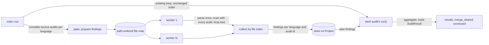

# Source Audits Parse Each File Once - Plan

## Goal Capsule

- **Objective:** Someone running `anc audit` on a large repository gets the source-audit findings back in a small
  fraction of today's time and CPU, with the same findings in one stable order and no material growth in memory.
- **Means:** parse each source file once per run and let every source audit scan that tree (KTD2, KTD3), then spread
  files across threads if measurement shows the wall-clock target needs it (KTD6).
- **Authority:** R-IDs win on behavior; KTDs win on mechanism; units override neither. The repo `CLAUDE.md` conventions
  bind unless a unit names the convention it rewrites (U6).
- **Stop conditions:** stop and report if any source audit's verdict or evidence changes in the equivalence diff (R4)
  and the cause is not the file-order fix in U1; stop if peak RSS on the large repo exceeds R3.
- **Execution profile:** sequential units, one commit each; U1 lands first so every later diff is byte-exact.
- **Finish and ship:** `ce-work` implements and verifies; changes reach `dev` through a feature branch and PR per the
  repo flow.

---

## Product Contract

### Summary

Source audits stop re-parsing a file for every pattern. A single pass reads each file's tree once, hands it to every
runnable source audit, and drops it, so memory holds one tree per worker. Each audit keeps its own verdict logic; only
how it receives files changes. Files are visited in path order, spread across worker threads when a measured gate shows
threads are needed, with a `--jobs` cap so the test suite's machine-wide self-audit throttle keeps its meaning.

### Problem Frame

Every `has_pattern`/`find_pattern_matches` call in `src/source.rs`, and every direct `Rust.ast_grep(source)` inside an
audit, parses the whole file again. A Rust file costs 15 to 25 full parses on the common path (worst case about 36), and
`p6-no-pager` alone parses most files four times. Audits run one after another, audit-outer and file-inner, on one core.

Measured on 2026-10-27 (release build, `anc audit <dir> --source --output json -q`):

| Target                                 | Rust source       | Wall   | User CPU | Peak RSS |
| -------------------------------------- | ----------------- | ------ | -------- | -------- |
| this repository                        | 216 files, 2.1 MB | 5.1 s  | 5.1 s    | 21 MB    |
| `asupersync` (a large local Rust repo) | 28.7 MB           | 49.4 s | 48.8 s   | 56 MB    |

A debug build of this repository's self-audit costs about 25 CPU-seconds, which is why `tests/common/self_audit.rs` caps
those audits at four per machine. A throwaway benchmark on this repository put one parse of every file at 188 ms and one
pattern searched across every tree at about 29 ms, about 22 ms of which is the node walk itself. So parsing once removes
the dominant cost, and the remaining cost scales with the number of tree traversals.

### Requirements

**Speed and footprint**

- R1. Source-audit user CPU at `--jobs 1` drops to at most one third of the baseline on this repository and on the large
  repository (release build).
- R2. Wall-clock time at default parallelism on the large repository drops to at most one eighth of the baseline.
- R3. Peak RSS on the large repository stays at or below 1.5 times the baseline.

**Results contract**

- R4. For any input, every source audit returns the same status, confidence, evidence lines, and row order as the U1
  build, at every thread count. Evidence spanning several files follows path order.
- R5. `--audit-profile` suppression, `applicable()`, `--principle`, `merge_shared` folding, `--include-tests`, the
  examples-directory skip, and `MAX_FILES` behave as they do today.
- R6. A suppressed or inapplicable source audit does no per-file work.

**Operators and the test suite**

- R7. Worker threads are bounded: never more than the file count, overridable with `--jobs <N>` and `AGENTNATIVE_JOBS`,
  and `self_audit` runs anc single-threaded so `SLOTS` keeps its quarter-of-the-server meaning.
- R8. The repository docs that state the source-audit cost or the per-audit helper shape describe the new present state.
- R9. The debug-build source-audit CPU of this repository's self-audit (about 25 s today, the figure the request names)
  drops to at most one third of its baseline.

### Scope Boundaries

Considered and not built:

- **One parsed tree per file cached for the whole run.** Trees cost about 30 times the source bytes (+63 MB RSS for this
  repository's 2.1 MB), so the large repository would grow from 56 MB to roughly 900 MB. Would change if a future
  consumer needed trees after the pass ends.
- **Deriving required literal tokens from each pattern to skip traversals.** The soundness argument varies by pattern
  shape and the gain is unmeasured once parsing happens once. Would change if U6's per-stage timing shows traversals
  still dominate.
- **One shared node walk dispatching every pattern at once.** Needs a pattern registry, and the walking audits
  (`code-unwrap`, `code-bare-except`, `p4-sys-exit`) still need the tree. Would change if traversals exceed half the
  source time on the large repository after U5.
- **Caching `macro_interior` re-parses.** `code-unwrap` is the only consumer.
- **Moving the text-only audits onto the pass.** `p6-timeout`, `p1-tty-detection-source`, `p2-output-module`, and
  `p6-sigterm` (both languages) never parse, so migrating them buys no time and adds diff risk; they keep iterating
  `parsed_files`. Would change if one of them starts matching patterns.

### Deferred to Follow-Up Work

- Retune `SLOTS` in `tests/common/self_audit.rs` against the new per-audit cost.

### Assumptions

- Path-ordered evidence counts as unchanged results: today's order is random per process (`RandomState` `HashMap`), so
  no consumer can depend on it.
- The wall-clock goal justifies one new user-visible flag (`--jobs`) with its environment variable, if U5's gate shows
  threads are needed.
- Memory belongs to the goal's "etc.": a speedup that multiplies peak RSS does not count as done.
- Release-build numbers gate R1–R3; the debug self-audit figure gates R9 because the request names it.

---

## Planning Contract

### Key Technical Decisions

- KTD1. **Fix the file order before changing the engine.** U1 makes `Project::parsed_files` return a path-ordered map in
  place of today's `RandomState` `HashMap`. Ten audits join per-file evidence in iteration order without sorting, so
  today's output order varies per process, and no fixture catches it because every pinned-evidence fixture is a single
  file. A fixed order lets every later unit be checked by a byte-exact diff and gives parallel collection a target
  order.
- KTD2. **One parse per file per run, file-outer.** A pass parses a file, runs every runnable source audit's per-file
  scan on it, and drops the tree before the next file. Peak memory is one tree per worker. Option A (cache every tree
  for the run) is rejected on the measured memory cost in Scope Boundaries; no bake-off is needed because the deciding
  fact is a measurement, not a design to develop.
- KTD3. **A separate per-file trait for source audits, with `run()` still the sole `AuditResult` constructor.** Each
  source audit implements a per-file `scan` returning its own typed finding, and an aggregation step its `run()` calls.
  `Audit` gains one defaulted hook that returns the scanner (default: none), so its 77 implementations elsewhere stay
  untouched. `main::run` asks the pass to prepare findings for the source audits that are applicable and not suppressed
  (R6), storing them on `Project` keyed by language and audit id, because `p6-no-color`, `p4-enumerate-valid-set`, and
  `p6-sigterm` share an id across Rust and Python. Each `run()` takes its findings, or runs a solo pass over itself when
  none were prepared (unit tests, direct callers). Both paths execute the same scan and aggregation code, so a missed
  prepare is invisible in output; a test asserts that a full audit run takes the solo path zero times.
- KTD4. **Per-file helpers take the parsed file; patterns compile once.** `audit_x` helpers take the parsed file (path,
  source, tree) instead of `&str`, and patterns become `LazyLock` statics. Unit tests build the parsed file through one
  test constructor; no `&str` shim survives beside the new signature, so each audit keeps a single core.
- KTD5. **Fewer traversals per tree.** Boolean checks over several patterns use one ast-grep `Any` matcher. First-match
  checks use `find_all(..).next()`, which applies the matcher's node-kind filter that `Node::find` skips. Cheap string
  checks run before traversals where the audit's logic is a pure conjunction. Loops that build evidence from several
  patterns keep their per-pattern order.
- KTD6. **Parallel files on `std::thread::scope`, bounded and collected by index.** Workers receive only the
  path-ordered file map and per-run flags, because `Project` is `!Sync` (`BinaryRunner`'s `RefCell` cache). Results
  return in file-index order, never completion order. Each worker holds one tree, so peak RSS grows with the worker
  count: the default is the smallest of `std::thread::available_parallelism()`, the file count, and a fixed cap U5 picks
  from measurement as the largest count that keeps R3 on the large repository. `--jobs` / `AGENTNATIVE_JOBS` (minimum
  1) override it; a flag keeps the setting visible in `--help` beside the other `AGENTNATIVE_*` settings. Workers get
     the main thread's 8 MiB stack, because `code-unwrap`, `code-bare-except`, and `p4-sys-exit` recurse once per tree
     level and the 2 MiB spawned-thread default would overflow on deeply nested files that audit fine today.
     `std::thread::scope` already appears in `src/web_audit/`, so no dependency is added.
- KTD7. **Equivalence is proven on emitted output, not source.** The U1 build is the reference binary; each later unit
  diffs the full scorecard JSON of reference and candidate on the same inputs, with `run.started_at`, `run.duration_ms`,
  and `run.invocation` (it records argv, binary path included) masked, and the candidate's thread count set through
  `AGENTNATIVE_JOBS`, since the reference has no `--jobs`
  (`docs/solutions/best-practices/diff-two-coexisting-implementations-on-one-input-to-prove-equivalence.md`). Timing
  uses interleaved reference/candidate pairs in one session, because this host drifts between runs
  (`docs/solutions/best-practices/benchmark-against-a-re-measured-interleaved-reference-on-a-drifting-host.md`).

### High-Level Technical Design

### Sources and Research

- Per-audit parse counts, iteration and early-break shapes, and which audits walk the tree:
  `src/audits/source/rust/*.rs`, `src/audits/source/python/*.rs`.
- Evidence-joining audits that need path order: unwrap, global_flags, exit_codes, process_exit, try_parse, env_flags,
  naked_println, output_clamping, bare_except, sys_exit. Early-break audits are order-free boolean ORs: no_color (both
  languages), error_types, headless_auth, sigterm, enumerate_valid_set, output_module.
- Code built as struct literals that a field change breaks: `ParsedFile { source }` in `src/project/mod.rs` and
  `src/audits/project/dry_run.rs`; `Project { .. }` in both `enumerate_valid_set.rs` files,
  `src/audits/project/dry_run.rs`, `src/audits/behavioral/mod.rs`. The `p5-dry-run` project audit also reads
  `parsed_files`.
- `macro_interior.rs` guard sweep:
  `docs/solutions/best-practices/prove-a-freshly-authored-guards-tests-are-non-vacuous-by-temporarily-degrading-the-guard.md`
  (7 guards, each mapped to its named control test).
- Oversubscription history: `docs/solutions/logic-errors/cli-linter-fork-bomb-recursive-self-invocation-20260401.md`.

---

## Implementation Units

### U1. Deterministic source file order

- **Goal:** source audits see files in path order, so multi-file evidence is stable across runs.
- **Requirements:** R4, R5 (KTD1)
- **Dependencies:** none
- **Files:** `src/project/mod.rs`, `src/audits/project/dry_run.rs`, `src/audits/source/rust/enumerate_valid_set.rs`,
  `src/audits/source/python/enumerate_valid_set.rs`, `src/audits/behavioral/mod.rs`, a new multi-file fixture under
  `tests/fixtures/`, `tests/integration.rs`
- **Approach:**
  1. Change the per-language file map behind `Project::parsed_files` to a path-ordered map; callers that only iterate or
     look up keep working.
  2. Update the struct-literal construction sites listed in Sources.
  3. Add a fixture with at least three Rust files that each trigger the same evidence-joining audit (`p4-process-exit`
     or `p7-naked-println`), and an integration test pinning the exact evidence block order.
- **Execution note:** run the new test against unfixed code several times and quote a failure; with three files a random
  order matches the pinned one about one run in six.
- **Patterns to follow:** `code_unwrap_evidence` in `tests/integration.rs` for exact-evidence assertions.
- **Test scenarios:**
  - Three files each carrying `std::process::exit(1)` outside `main.rs` produce one `p4-process-exit` row whose evidence
    lists the files in path order.
  - The same fixture audited twice in separate processes produces identical JSON once timing fields are masked.
  - `p5-dry-run` still finds its source signal through the reordered map (existing tests stay green).
- **Verification:** the new test passes on every run; the U1 release build becomes the reference binary for KTD7.

### U2. Shared parse-once pass, piloted on the two costliest audits

- **Goal:** the per-file trait, the pass, the findings store, and `main::run`'s prepare call exist, and `p6-no-pager`
  and `p7-output-clamping` run through them.
- **Requirements:** R1, R4, R5, R6 (KTD2, KTD3, KTD4, KTD5)
- **Dependencies:** U1
- **Files:** `src/audit.rs`, `src/audits/source/mod.rs` (or a new sibling module for the pass), `src/source.rs`,
  `src/project/mod.rs`, `src/main.rs`, `src/audits/source/rust/no_pager.rs`, `src/audits/source/rust/output_clamping.rs`
- **Approach:**
  1. Define the parsed-file type, the per-file trait with a typed finding, and its type-erased adapter for the pass.
  2. Add the defaulted scanner hook to `Audit`, the findings store on `Project`, and the solo-pass fallback inside
     `run()`.
  3. In `main::run`, before the audit loop, prepare findings for each language's runnable source audits, applying the
     loop's existing `applicable()` and suppression checks.
  4. Add tree-taking helpers in `src/source.rs` that accept a precompiled pattern.
  5. Migrate `no_pager` (scan once per file: pager-code flag and `--no-pager` flag) and `output_clamping` (list patterns
     keep per-pattern order; clamp patterns become one `Any` check).
- **Technical design:** directional only. A source audit implements `scan(&ParsedFile) -> Finding` plus an aggregation
  step over `[(path, Finding)]` that its `run()` calls before building `AuditResult`.
- **Patterns to follow:** the "Source Audit Convention" in `CLAUDE.md` for the `run()`-as-sole-constructor rule;
  `merge_shared` for result folding.
- **Test scenarios:**
  - Existing unit tests for both audits keep their assertions after switching to the test constructor.
  - A file using `pager::Pager` without `no-pager` yields Warn; adding a `no_pager` flag yields Pass; a project with no
    pager code yields Pass.
  - A list pattern with `.take(n)` anywhere in the file yields Pass; without clamping, Warn evidence keeps
    `LIST_PATTERNS` order and the five-location cap.
  - Preparing with `p6-no-pager` excluded, the way `main::run` excludes a suppressed or inapplicable audit, never runs
    its scan (no `--audit-profile` suppresses either pilot, so R6 is tested at the prepare step).
  - Calling `run()` on a project with nothing prepared returns the same result as the prepared path.
  - A full `anc audit` run of this repository takes the solo-pass path zero times.
- **Verification:** KTD7 diff against the U1 binary is empty on this repository and the source fixtures; the two audits'
  timings drop in a per-audit measurement.

### U3. Migrate the remaining parsing Rust audits

- **Goal:** every other Rust source audit that parses scans through the pass.
- **Requirements:** R1, R4, R5 (KTD4, KTD5)
- **Dependencies:** U2
- **Files:**
  `src/audits/source/rust/{no_color,global_flags,error_types,exit_codes,process_exit,try_parse,env_flags,naked_println,headless_auth,structured_output,enumerate_valid_set}.rs`
- **Approach:**
  1. Move each per-file helper onto the parsed file, with its patterns as statics.
  2. Turn each early `break` into an order-free aggregate over findings.
  3. Keep `env_flags`' quirk: a per-file `Skip("No agentic flags found")` does not set `has_clap_attrs`.
  4. Apply KTD5 where it fits: no_color's four `has_pattern` calls, structured_output's checks, headless_auth's seven
     patterns and its `contains`-before-traversal order.
- **Patterns to follow:** U2's two migrated audits.
- **Test scenarios:**
  - Each audit's existing unit and `run()` tests keep their assertions.
  - `p6-no-color` passes when the `NO_COLOR` signal sits in the last file in path order, not just the first.
  - `p4-error-types` passes when the error enum is in any one of several files.
  - `p1-env-flags-source` with one file holding agentic flags and another holding only `#[arg]` attributes reproduces
    today's verdict and evidence.
- **Verification:** KTD7 diff is empty; `cargo clippy` clean under `#![deny(clippy::string_slice)]`.

### U4. Migrate code-unwrap and the Python audits

- **Goal:** the tree-walking audits and every Python audit scan through the pass.
- **Requirements:** R1, R4, R5 (KTD4)
- **Dependencies:** U2
- **Files:** `src/audits/source/rust/unwrap.rs`, `src/audits/source/rust/macro_interior.rs` (entry point only),
  `src/audits/source/python/{bare_except,sys_exit,no_color,enumerate_valid_set}.rs`
- **Approach:**
  1. `code-unwrap` walks the shared tree instead of parsing its own, reading `include_tests` from the per-run flags;
     interior re-parses stay as they are, and positions stay exact through same-width normalization with no offset
     arithmetic.
  2. The Python audits move the same way U3's Rust audits did.
- **Execution note:** after migrating `code-unwrap`, rerun the 7-guard degradation sweep from Sources: disable each
  guard in turn, confirm its named control test fails, restore.
- **Test scenarios:**
  - The `cfg-test-edge-cases` and `macro-interiors` integration fixtures keep their exact evidence lines, with and
    without `--include-tests`.
  - `broken-python` keeps its rows; a mixed Rust and Python tree (`tests/fixtures/mixed-no-root`) keeps `merge_shared`
    folding for `p6-no-color`, `p4-enumerate-valid-set`, and `p6-sigterm`, and its full run takes the solo-pass path
    zero times (each language's audit takes its own findings).
  - `__main__.py` stays exempt from `p4-sys-exit`, and the `if __name__ == "__main__"` guard still suppresses findings
    under it.
- **Verification:** KTD7 diff is empty, including `--include-tests` on this repository; every guard in the sweep shows
  its predicted failure.

### U5. Parallel pass with a bounded worker count

- **Goal:** the pass spreads files across threads, with `--jobs` and `AGENTNATIVE_JOBS` as the cap.
- **Requirements:** R2, R3, R4, R7 (KTD6)
- **Dependencies:** U3, U4
- **Gate:** build this unit only if, after U4, the large repository's single-threaded wall time misses R2; otherwise
  record the measurement and skip it.
- **Files:** the pass module from U2, `src/cli.rs`, `src/main.rs`, `tests/common/self_audit.rs`, `README.md` (audit
  flags block), `tests/fixtures/help/anc__audit_--help.txt`, `completions/*`, `tests/integration.rs`
- **Approach:**
  1. Split the path-ordered files into contiguous chunks across `min(jobs, file count)` scoped workers, each spawned
     with an 8 MiB stack.
  2. Give workers only the file map and flags, and collect findings by file index.
  3. Measure peak RSS and wall time on the large repository at 2, 4, 8, and 16 workers; set the default cap to the
     largest count that meets R3, confirm R2 at it, and record the measurement beside the cap.
  4. Add `--jobs <N>` to `anc audit` with `[env: AGENTNATIVE_JOBS]`, rejecting 0 at parse time.
  5. Set `AGENTNATIVE_JOBS=1` in `self_audit`'s spawn.
  6. Regenerate the help snapshot and completions through their existing generators.
- **Patterns to follow:** `thread::scope` usage in `src/web_audit/handlers/cors_preflight.rs`; existing
  `[env: AGENTNATIVE_*]` flags in `src/cli.rs`.
- **Test scenarios:**
  - The U1 multi-file fixture produces identical JSON, with `run.invocation` and timing masked, at `AGENTNATIVE_JOBS` 1,
    2, and 8.
  - `AGENTNATIVE_JOBS=3` is honored, and `--jobs` on the command line overrides it.
  - `--jobs 0` exits with a usage error before any audit runs.
  - A one-file fixture at default jobs starts one worker (never more workers than files).
  - A generated Rust file nested deeply enough to need more than a 2 MiB stack in `code-unwrap`'s walk audits the same
    at `--jobs 2` as at `--jobs 1`.
- **Verification:** KTD7 diff is empty at the default cap; the large-repository wall time meets R2 and peak RSS meets R3
  at that cap.

### U6. Retire per-call parse helpers and record the new costs

- **Goal:** no code path parses a file per pattern call, and the docs state the measured present state.
- **Requirements:** R8
- **Dependencies:** U5 (or U4 when U5's gate skips it), U7 when its gate builds it
- **Files:** `src/source.rs`, `CLAUDE.md`, `tests/common/self_audit.rs`
- **Approach:**
  1. Delete the `&str` helpers (`has_pattern`, `find_pattern_matches`, `has_pattern_in`, `find_pattern_matches_in`,
     `has_string_literal_in`) once nothing calls them, moving their unit tests onto the tree-taking helpers.
  2. Rewrite `CLAUDE.md`'s "Source Audit Convention" around the per-file scan and aggregation, naming the text-only
     audits that still iterate `parsed_files`, and correct its ast-grep pin to `=0.42.3`.
  3. Replace the "about 25 CPU-seconds" figure in `CLAUDE.md` "Dogfooding Safety" and in `tests/common/self_audit.rs`
     with the measured debug figure.
- **Test expectation:** none beyond the moved helper tests; this unit removes dead code and updates docs.
- **Verification:** `rg` finds no `ast_grep(` call on whole-file source outside the pass and the `macro_interior`
  interiors; the docs' figures match a fresh measurement.

### U7. Optimize the parsing crates in debug builds

- **Goal:** debug builds run tree-sitter and ast-grep optimized, so the self-audit figure the request names meets R9.
- **Requirements:** R9
- **Dependencies:** U4 (and U5 when built)
- **Gate:** build this unit only if the debug self-audit source CPU after U4 (and U5) still misses R9; otherwise record
  the measurement and skip it.
- **Files:** `Cargo.toml`
- **Approach:**
  1. Add dev-profile `opt-level` overrides for `ast-grep-core`, `ast-grep-language`, `tree-sitter`, and the Rust and
     Python grammar crates; the dev profile has no package overrides today, so these run at opt-level 0.
  2. Measure the clean debug build time before and after, and record both next to the R9 figure in the PR body.
- **Test expectation:** none -- build configuration only; R9's measurement is the proof.
- **Verification:** the debug self-audit source CPU meets R9 in interleaved pairs, and the clean-build cost is recorded.

---

## Verification Contract

| Gate                      | Command or method                                                                                                                                                                                                                                                                                                                                                                                                                                                                           | Applies to             |
| ------------------------- | ------------------------------------------------------------------------------------------------------------------------------------------------------------------------------------------------------------------------------------------------------------------------------------------------------------------------------------------------------------------------------------------------------------------------------------------------------------------------------------------- | ---------------------- |
| Format, lint, tests, deny | `cargo fmt --check`, `cargo clippy --all-targets -- -Dwarnings`, `cargo test`, `cargo deny check` (the `scripts/hooks/pre-push` mirror of CI)                                                                                                                                                                                                                                                                                                                                               | every unit             |
| Coverage matrix unchanged | `anc emit coverage-matrix --check` (also run by the integration suite)                                                                                                                                                                                                                                                                                                                                                                                                                      | U2–U4                  |
| Equivalence (KTD7)        | reference = U1 release build; `anc audit <target> --source --output json` on this repository (with and without `--include-tests`), `tests/fixtures/{broken-rust,perfect-rust,source-only,cfg-test-edge-cases,macro-interiors,broken-python,hostile-utf8-evidence,mixed-no-root,workspaces}`, the U1 multi-file fixture, and the large repository; mask `run.started_at`, `run.duration_ms`, and `run.invocation`; set the candidate's threads through `AGENTNATIVE_JOBS`; the diff is empty | U2–U5                  |
| Speed and memory          | `gtime -f '%e s %U s %M KB'` on the same 16-core host as the baseline, release builds, three interleaved reference/candidate pairs per target, at `AGENTNATIVE_JOBS=1` and the default cap                                                                                                                                                                                                                                                                                                  | U4 and U5 exit (R1–R3) |
| Debug self-audit cost     | `gtime` on a debug build's `anc audit . --source`, interleaved with the U1 debug build                                                                                                                                                                                                                                                                                                                                                                                                      | U4 exit, U7 (R9)       |
| Guard sweep               | 7-guard degradation of `macro_interior.rs`                                                                                                                                                                                                                                                                                                                                                                                                                                                  | U4                     |

## Definition of Done

- R1–R3 and R9 hold in the interleaved measurement, and the numbers go in the PR body next to the baseline table, with
  each gated unit's measurement whether it was built or skipped.
- The KTD7 diff is empty on every listed input at one worker and at the default cap.
- Every unit's tests pass, and the U1 test was observed failing against the unfixed order.
- `CLAUDE.md` and `tests/common/self_audit.rs` state the measured figures and the new helper shape.
- No dead code from abandoned approaches remains in the diff, and no `&str` parse helper survives.
